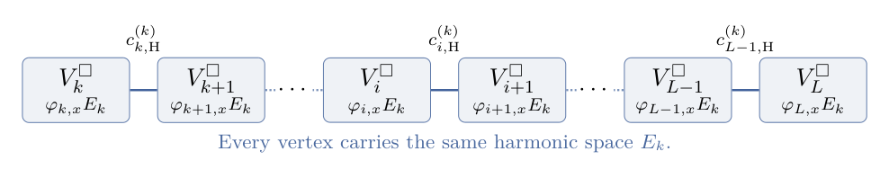
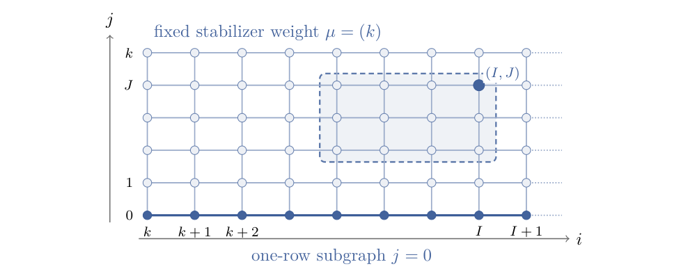

# Paper精读｜Ten Advances in Mathematics and Theoretical Computer Science

> [!abstract] 一句话结论
> OpenAI 内部模型一次性产出了**数学与理论计算机科学领域的 10 项独立重大进展**——每一项都是该领域悬置数十年、被写入综述和开放问题清单的经典难题：**非 sofic 群**的显式构造（否证 soficity 猜想）、**Connes 刚性猜想**的反例、**球堆积高维指数** 1978 年以来首次改进、**Ehrhart 体积猜想**的完整证明、**多色 Ramsey 数**超指数下界、**量子平行重复定理**（全纠缠博弈类）等。论文以 10 章独立论文形式呈现，每章包含完整证明——AI 头一回不是给人类证明打下手，而是自己把可验证的前沿数学成果做了出来。

> [!cite]- 论文信息（点开折叠）
> - **论文标题**：Ten Advances in Mathematics and Theoretical Computer Science
> - **arXiv**：无（alphaXiv slug: 2607.ten-advancements）
> - **链接**：[https://www.alphaxiv.org/abs/2607.ten-advancements](https://www.alphaxiv.org/abs/2607.ten-advancements)
> - **作者**：OpenAI（未披露具体模型名，正文仅称 "an internal OpenAI model"）
> - **机构**：OpenAI
> - **日期**：2026-08-02
> - **PDF**：249 页，10 章独立论文合集

---

## 1️⃣ 论文想解决什么问题

**领域背景**：数学与 TSC 中存在一批"经典开放问题"——被反复写进综述（Gromov、Weiss、Connes 专著、Erdős–Simonovits 猜想清单等）、被数代数学家围攻数十年、只获得部分进展或仅在某些特殊子类上被解决。它们的共同特征是：陈述简单（如"每个可数群是否都有有限置换近似？"），但证明需要高度非平凡的构造技巧与跨领域工具的深度组合。

**现有方案的不足**：人类研究者在这些问题上长期只能获得渐进性改进或特殊情形证明。例如球堆积指数停留在 1978 年的 Kabatianskii–Levenshtein 常数（0.59905576…）近半个世纪；多色 Ramsey 数下界停留在 380^(k/5)；CVP 的近似硬度依赖 PCP 定理或未证明的 Projection Games Conjecture。**瓶颈不是工具不足，而是"找到正确的构造"这一创意步骤的稀缺。**

**本文填补的空白**：论文给出的证据是，AI 模型产出这类"创意构造"可以成批——10 个结果横跨调和分析、编码理论、群论、算子代数、算术电路复杂度、量子信息、格问题、凸几何、Ramsey 理论、极值图论 10 个分支，每个都给出完整可验证的证明。"AI 能否做真正的前沿数学研究"这个问题有了硬答案：不是复述已知证明，是独立解决开放问题。

---

## 2️⃣ 核心洞察

> [!important] 核心洞察
> 1. **一个模型，十个分支，统一的方法论基因**：10 章题材迥异，方法上却带同一套"AI 风格"——善于构造**显式、代数化、带参数族**的反例/证书（如二元 Leavitt 代数的单位群、二进制进位构造的紧阿贝尔群族、分层二分图族），而不是纯存在性论证。这种"构造主义"取向恰好命中了开放问题的要害。
>
> 2. **把"改进指数"当作统一目标**：多个章节（球堆积、二元/球面码、Ramsey、CVP、Ehrhart）的核心成果都是**指数级改进**——把长期停滞的常数从 O(1) 级别推到精确值或超指数。指数是渐进意义下"信息量"的单位，改进指数 = 真正理解问题的渐近结构。
>
> 3. **多工具的组合而非新理论**：几乎每章都是"现有工具的意想不到组合"——property-(T) 扩张图 + Leavitt 代数 → 非 sofic 群；Yuen 条件化框架 + 后选择稳定采样估计 → 量子平行重复；Reed–Solomon 幂和约束 → CVP 硬度。跨领域工具调用这一步，是模型占便宜的地方。
>
> 4. **可验证性是底线的证明**：全部 10 章均为完整证明（249 页），不是猜想或实验观察——落在"数学证明"这个最高可验证性标准里，跟 AI 平时的黑盒输出不是一种东西。

*（原图未能本地化：论文第 1 页：标题、摘要与 10 项结果清单；IMA 媒体接口没有可用媒体编号）*

*论文首页：标题页含 10 项结果的摘要清单，全篇 249 页，10 章独立论文，每章含完整证明与参考文献。*

---

## 方法解读（10 个结果逐一拆解）

### 结果 1：高维球堆积——Cohn–Elkies 线性规划的指数率精确确定

- **问题**：Rd 中单位球最大堆积密度 Δd 的渐近指数。Cohn–Elkies 线性规划（LP）给出上界 LPd，但高维行为长期未知；Afkhami-Jeddi, Cohn, Hartman, de Laat, Tajdini 提出了其指数率的猜想（受模 bootstrap 启发）

- **定理 1.1**：lim_{d→∞} LPd^{1/d} = √(e/2π)。由此 Δd ≤ 2^(−(α*+o(1))d)，其中 α* = ½log₂(2π/e) = 0.6044…

- **为何重要**：这是 **1978 年以来对一般球堆积指数（KL 常数 0.59905576…）的首次改进**；且匹配的下界证明任何 Cohn–Elkies 辅助函数都无法超越此指数——LP 的渐近强度被完全确定

- **方法核心**：Fourier 符号不确定性（sign-uncertainty）问题——正、负特征值半径均为 (1/π+o(1))√d，联系 Bourgain–Clozel–Kahane 不确定原理

### 结果 2：二元码与球面码——1977/1978 年以来指数首次改进

- **问题**：固定相对距离 δ 的二元码 A₂(n,d) 与固定最大内积 s 的球面码 A(n,s) 的高维指数

- **定理**：对每个固定 0<δ<1/2，二元码界严格改进优化的 MRRW 指数；对每个固定 0<s<1，球面码界严格改进优化的 Kabatianskii–Levenshtein 指数（含球冠优化）

- **为何重要**：MRRW 指数（1977）与 KL 指数（1978）各自主宰了近 50 年——这是编码理论两大基本指数的首次实质性改进

- **方法核心**：构造**两点线性规划证书**（two-point LP certificates）；表示图（representation graph）方法；在 s→1 极限下恢复结果 1 的球堆积指数（两章形成自洽闭环）

*图 2｜固定 Boolean 调和次数下的 whole-cube 表示路径。 [来源](https://cdn.openai.com/pdf/ten-proofs-oai.pdf#page=40)*

*第二章 Figure 1（第 38 页）：whole-cube 表示路径图——二元码界证明中使用的表示图结构，展示固定 Boolean 调和下的表示路径。*

*图 3｜固定稳定子权重的球面两行表示图。 [来源](https://cdn.openai.com/pdf/ten-proofs-oai.pdf#page=62)*

*第二章 Figure 2（第 59 页）：球面两行表示图——球面码证明中经球面调和与稳定子表示的过渡图结构，用于渐近球面码界。*

### 结果 3：非 sofic 群——否证 soficity 猜想

- **问题**：Gromov 引入 sofic 群（有限乘法表可被有限置换忠实近似）；Weiss 问是否所有可数群都是 sofic 的——即 **soficity 猜想**（Pestov 开放问题 3.8）

- **定理**：二元 Leavitt 代数 LF₂(1,2) 的单位群 LF₂(1,2)× **不是 sofic 的**——显式构造出首个非 sofic 群

- **方法核心**：Kun 的 property-(T) 群扩张图分解 + Kun–Thom 中心化子障碍；一般"扩张图匹配论证"从扩张图的并集中恢复单个扩张分量；Leavitt 代数上的初等群迫使 Thompson 群 V 局部嵌入有限群（矛盾）

- **为何重要**：这是 20 余年（Gromov 1999 以来）未决的群论基础问题——soficity 猜想与 Gottschalk 猜想、Kaplansky 直接有限性猜想等拴在一起——否证一动，那几处全得跟着重新掂量

### 结果 4：Connes 刚性猜想反例——算子代数与群的解耦

- **问题**：Connes 猜想（1978/1994 专著 Problem 1）：ICC property-(T) 群的群 von Neumann 代数 L(G) 是否决定 G 的同构类？

- **定理**：构造**可数无限族**两两不同构、相互可通约（commensurable）、有限生成 ICC property-(T) 群，具有同构的群 von Neumann 代数——否证 Connes 猜想，并否定回答 Popa 的有限对一问题

- **方法核心**：利用 L∞(Â, m̂) 依赖底层概率空间而非群律——**二进制进位**产生不同的紧阿贝尔群结构，但具有相同的 Haar 测度与群作用

- **为何重要**：Connes 刚性是算子代数与群论交界处的"北极星"猜想，30 余年未解；反例的出现重新划定了"群因子决定群"的边界

### 结果 5：Permanent 的下界——电路与公式复杂度

- **问题**：n×n permanent（pern(X)=Σ_{σ∈Sn} Π x_{i,σ(i)}）的精确符号计算复杂度

- **定理**：① 无除法电路（允许中间值任意复用）需要 Ω(n² log log n) 个算术门；② 算术公式需要 Ω(n⁴/log n) 个变量标记叶（即使允许除法、分母为非零有理函数）

- **方法核心**：仿射特化使梯度在低维集合上消失 + 同时微分 + 几何度界；对短匹配的矩阵元识别大量代数独立系数，并在边不相交匹配上累加需求

- **为何重要**：permanent 是 VNP 完备函数，其下界是"P ≠ NP 的代数版"的核心证据；本文同时改进电路与公式两类模型的下界，且论证依赖 permanent 特有性质（不直接适用于 determinant）

### 结果 6：量子平行重复——全纠缠博弈的指数衰减

- **问题**：经典 Raz 平行重复定理（STOC 1995）证明博弈值的指数衰减；纠缠玩家（共享任意量子态）的情形是否同样成立？——长久开放

- **定理**：对每个有限双人单轮博弈 G，ω*(G)=1−ε<1，ω*(G⊗n) ≤ exp(−c_qs·ε¹³/(ε+log|A||B|)·n)，c_qs 为普适常数

- **方法核心**：Yuen（ICALP 2016，多项式衰减）的条件化与依赖打破框架 + 新的**后选择稳定量子可采样性估计**（postselection-stable sampleability），避免对条件事件概率的逆依赖

- **为何重要**：此前仅特殊类（锚定博弈，BVY STOC 2017）有指数衰减；本文给出**一般情形的指数平行重复**，补全量子博弈论的核心工具

### 结果 7：CVP 的 n^(1/400) 硬度——免 PCP 的直接归约

- **问题**：欧氏最近向量问题（CVP）的近似硬度

- **定理**：从 3SAT 的**确定性多项式时间多一归约**到 GapCVP₂ 的 n^(1/400) 因子——n 为显式整数平方基给出的格秩；并导出二元最近码字与综合征解码的 n^(1/200) 硬度、固定有理 ℓp 范数的 n^(1/(200p)) 硬度

- **方法核心**：特征二域上 Reed–Solomon 幂和约束编码赋值与可满足性；坐标模二归约转化为整数格；完整性用多项式插值，可靠性用低权二进制解的幂和重构（有理函数域上的可分根集 + 赋值恢复 Boolean 赋值）

- **为何重要**：**直接来自 3SAT、不调用 PCP 定理、不假设 Projection Games 猜想**——这是格密码安全基础（CVP/LWE 系）中"无条件归约"的重要一步，也展示了全新归约路线

### 结果 8：Ehrhart 体积猜想——每个维度的尖锐界

- **问题**：Ehrhart（1964）猜想：重心是唯一内格点的 n 维凸体，体积不超过 (n+1)ⁿ/n!（居中单纯形取等号）

- **定理 1.1**：K⊂Rⁿ 紧凸体，重心 0，int(K)∩Zⁿ={0} ⇒ vol(K) ≤ (n+1)ⁿ/n!；等号由单纯形 (n+1)Δn−(1,…,1) 达到

- **方法核心**：实势与格 Bergman 空间（real potential and lattice Bergman spaces）、消失阶与下斜率、Bergman 凸性与上斜率

- **为何重要**：此前仅有平面情形与单纯形情形的证明（Ehrhart 本人）、以及 4ⁿe^(−c√n) 型弱化界（HSTV 2022、Campos et al.）；**每个维度的精确尖锐界**填补了近 60 年的空白

### 结果 9：多色 Ramsey 数——Rk(3) = k^Θ(k) 的超指数下界

- **问题**：k 色 Ramsey 数 Rk(3)=R(3,…,3)（最小 N 使 K_N 的任意 k 边着色含单色三角形）的增长阶；此前下界仅 380^(k/5)−O(1)（ACPPRT 2021），上界 (e−1/6)k!+1

- **定理**：存在绝对常数 c>0，对一切 k≥2：Rk(3) ≥ (c·k^(1/3)/log k)^k —— 与阶乘上界结合得 **Rk(3)=k^Θ(k)**（增长阶确定）；推论：独立数为 2 的图的 Shannon 容量无界

- **方法核心**：饱和矩阵（saturated matrices）、坐标覆盖（coordinate covers）、调色板（palettes）与递归无三角着色

- **为何重要**：Graham–Rothschild–Spencer 专著（1990, p.146）明确记载的开放问题——"Rk(3) 是否超指数增长"？本文不仅回答"是"，且**确定了增长阶**

### 结果 10：极值图论——两个 Erdős 猜想的同时否证

- **问题**：Erdős–Simonovits 紧致性猜想（禁止一个含圈的有限图族是否能把极值数 ex(n,F) 压低超过常数因子？）与 Erdős 退化猜想（每个二分 r-退化图是否有 ex(n,H)=O(n^(2−1/r))？）

- **定理**：① 构造有限连通二分图族 F（每图含圈）：ex(n,F)=O(n^(4/3−1/48)) 但每个 F∈F 有 ex(n,F)=Ω(n^(4/3))——否证紧致性猜想；② 构造固定连通二分 2-退化图 H：ex(n,H) ≥ c·n^(3/2+ε)——**连 r=2 都否证**退化猜想

- **方法核心**：广义四边形见证（generalized-quadrangle witnesses）、二元熵不等式、分层图、采样的 Hamming 球图

- **为何重要**：Erdős 的两个经典猜想（分别来自 1967 与 1982）被显式反例同时推翻，极值图论的核心直觉需要修正

---

## 4️⃣ 实验部分怎么读

### 验证方式

- 本文没有传统 ML 实验——**"实验"就是数学证明本身**：10 章每章含完整定理-证明结构（Theorem/Proof/Lemma/Corollary），249 页全部可被人类审阅验证

- 每章包含：背景综述（前人到哪一步）、本文定理陈述、完整证明、与已知界/已知结果的对比表、参考文献

- 与前人结果的对比构成"实验基线"：球堆积 vs KL 1978；二元码 vs MRRW 1977；球面码 vs KL 1978；Ramsey vs ACPPRT 2021 的 380^(k/5)；CVP vs PCP 路线；Ehrhart vs HSTV 2022 弱化界

### 核心结果一览

| **#** | **领域** | **核心结果** | **打破的记录（年代）** |
| --- | --- | --- | --- |
| 1 | 球堆积 | LPd^{1/d}→√(e/2π)，指数 α*=0.6044… | KL 指数 0.59905576…（1978） |
| 2 | 编码理论 | MRRW 与 KL 指数全参数严格改进 | MRRW（1977）/ KL（1978） |
| 3 | 群论 | 首个非 sofic 群（Leavitt 单位群） | soficity 猜想（1999-） |
| 4 | 算子代数 | Connes 刚性猜想的无限反例族 | Connes 猜想（1978/1994） |
| 5 | 复杂度 | permanent 电路 Ω(n²loglogn)、公式 Ω(n⁴/logn) | 此前最佳下界 |
| 6 | 量子博弈 | 全纠缠博弈指数平行重复 | 仅锚定博弈有（2017） |
| 7 | 格问题 | CVP n^(1/400)-hard，免 PCP | PCP/Projection Games 依赖 |
| 8 | 凸几何 | Ehrhart 猜想每维尖锐界 (n+1)ⁿ/n! | 仅平面+单纯形（1955-1979） |
| 9 | Ramsey | Rk(3)=k^Θ(k)（超指数） | 380^(k/5)（2021） |
| 10 | 极值图论 | 否证紧致性+退化两猜想 | Erdős 1967/1982 猜想 |

### 跨章节的深层联系

- **结果 1 ↔ 结果 2**：第二章在 s→1 极限下恢复第一章的球堆积指数——两章互相印证，形成"编码界 → 堆积界"的完整闭环

- **结果 3 ↔ 结果 4**：都用 property-(T) 群与"代数结构 + 测度/近似"的对偶视角；Leavitt 代数与二进制进位都是"代数对象携带非平凡刚性/柔性"的体现

- **结果 6 ↔ 结果 7**：都依赖"条件化/幂和"的重构思想——量子后选择采样与 Reed–Solomon 幂和重构在精神上同源

- **结果 9 ↔ 结果 10**：都构造**参数族反例**（递归着色族 / 分层图族），体现模型"生成化构造"的强项

---

## 5️⃣ 学术评价

**优点：**

1. **覆盖广度惊人**：10 个分支、每个都是各自领域的长期开放问题，且每个都给出完整证明——单个数学家一辈子撞上其中一个就够写进履历了，这里一次摆出十个

2. **打破"停滞常数"**：多处改进的是 40-50 年未被触碰的指数/常数（KL 1978、MRRW 1977、380^(k/5) 2021）——不是渐进式的"挤牙膏"，而是结构性突破

3. **反例型成果居多**：3（非 sofic）、4（Connes 反例）、10（双猜想否证）都是"推翻猜想"型成果——这类成果对理论冲击最大，也最难构造（需要命中猜想的命门）

4. **自包含可验证**：249 页完整证明 + 每章独立参考文献，符合最高可验证标准；没有依赖未公开的计算（如暴力搜索验证）的声明

5. **方法论示范**：每个证明都是既有工具的新组合，而非发明新理论——"从别的领域借工具"这一步，模型做得比大多数人顺手

> [!ed-warning] 局限（风险与不确定性）
> 1. **模型信息零披露**：正文仅说 "an internal OpenAI model"，没有模型名、规模、训练方法、推理设置——无法评估这是"通用前沿模型顺带做数学"还是"专用数学模型"，也无法复现或对比
>
> 2. **无错误率/成功率数据**：未披露模型尝试了多少问题、成功率多少、证明过程是否有人类介入修正——"10 个结果"可能是筛选后的幸存者，不能代表模型的真实能力基线
>
> 3. **证明风格可读性**：AI 生成的证明以"构造复杂 + 步骤繁多"著称（如第 3 章的 Leavitt/Thompson 链、第 7 章的幂和重构），人类审阅成本高，正确性确认可能需要专门团队数月工作
>
> 4. **与传统数学社区的对接缺失**：没有注明哪些结果已通过同行评审、是否有独立验证——"可验证"与"已验证"是两回事
>
> 5. **深度 vs 广度**：10 个结果横跨 10 个方向，但每个方向只解决一个（或一类）问题，缺乏对某一分支的系统性深耕——更像是"广度冲击"而非"深度征服"

---

## 6️⃣ 局限与可扩展方向

- **模型披露与可复现性**：希望后续公开模型信息与"尝试→成功"的完整过程记录，让社区能评估真实能力与筛选偏差

- **证明的独立验证**：10 章定理值得数学社区逐章审阅——特别是第 3、4 章的反例型结果（历史上有过"反例"后来被发现错误的先例）

- **从"结果"到"理论"**：目前是 10 个独立定理；后续能否看到模型产出**统一的理论框架**（如新的约化理论、新的抽象概念）而非孤立构造？

- **与证明助手（Lean/Coq）结合**：若这些证明能形式化到 Lean 中，可一举解决"可验证性"质疑，"AI 证明 + 机器验证"的组合也就真正落地了

- **扩展到更广泛的开放问题**：10 个领域之外（数论、代数几何、P vs NP 相关）的开放问题是否同样可攻击？"AI 数学"的边界在哪？

- **对 AI 训练的反馈**：这些成果暗示"长程推理 + 构造性思维"训练的有效性——数学成果可作为 RLVR（可验证奖励）的天然训练信号，反哺下一代模型

---

## 与其他论文的对话

| **相关工作** | **关系** | **差异/关联** |
| --- | --- | --- |
| **Viazovska (2017) / CKMRV (2017)** | E8/Leech 格最优堆积证明 | 结果 1 在高维方向补全了 Cohn–Elkies 框架的渐近强度；Viazovska 是低维精确解，本文是高维指数解 |
| **Raz (1995) / BVY (2017) / Yuen (2016)** | 平行重复定理谱系 | 结果 6 把指数衰减从经典/锚定博弈推广到全纠缠博弈，站在 Yuen 条件化框架上 |
| **Gromov (1999) / Weiss (2000)** | sofic 群定义与猜想 | 结果 3 直接否证了 Weiss 的问题——sofic 群理论的核心开放问题 |
| **Connes (1978, 1994) / Popa** | 群因子刚性 | 结果 4 否证 Connes 猜想并回答 Popa 的有限对一问题 |
| **MRRW (1977) / KL (1978)** | 编码理论经典指数 | 结果 2 首次改进这两个 40+ 年未动的指数 |
| **PCP 定理 / Projection Games Conjecture** | 格问题硬度路线 | 结果 7 提供免 PCP、免 PGC 的直接 3SAT 归约——独立于经典路线的全新证明 |
| **Campos et al. (2022) / HSTV (2022)** | Ehrhart 猜想弱化界 | 结果 8 从 4ⁿ·exp(−cn/(log n)⁸) 提升到精确尖锐界 (n+1)ⁿ/n! |
| **ACPPRT (2021) / Graham–Rothschild–Spencer (1990)** | Ramsey 下界谱系 | 结果 9 从 380^(k/5) 跳到 k^Θ(k)，确定增长阶 |

---

## 7️⃣ 最后总结

这份合集做的是一件没有先例的事：一个 AI 模型在**纯数学与理论计算机科学**的多个核心分支中独立解决长期开放问题，且全部以完整可验证证明的形式呈现。技术上，10 个结果相互呼应（编码↔堆积、群论↔算子代数、量子↔格、Ramsey↔极值图论），跨领域迁移在这里是事实，不是口号；方法上，它以"显式构造 + 参数族反例 + 指数改进"为主线，命中了许多人类长期卡壳问题的要害。但它也是"黑盒声明"：模型细节为零披露、验证未完成、成功率未知。**它的真正意义不在于这 10 个定理本身，而在于它为"AI 数学研究"确立了一个新的质量标准——这个标准要立得住，还得看两件事补不补得上：独立验证，以及模型透明度。** 对读者而言，第 1、2、9 章（指数改进型）最容易快速验证价值，第 3、4 章（反例型）最值得深入审阅，第 7 章（免 PCP 归约）在密码学上影响最大。

---

## 8️⃣ 三句速记

> [!summary]- 点开展开
> 1. **十个世纪难题，一份 249 页证明**：OpenAI 内部模型同时解决球堆积指数、非 sofic 群、Connes 刚性猜想、Ehrhart 猜想、多色 Ramsey 增长阶等 10 个经典开放问题，每章完整证明。
>
> 2. **打破 40-50 年停滞的指数**：MRRW/KL 编码指数（1977/1978）、球堆积指数（1978）、Ramsey 下界（2021）全部被结构性改进——不是挤牙膏，是突破。
>
> 3. **可验证但未验证**：证明完整可审阅，但模型零披露、无独立验证、成功率未知——里程碑的成色，要等数学社区逐章验完才算数。
