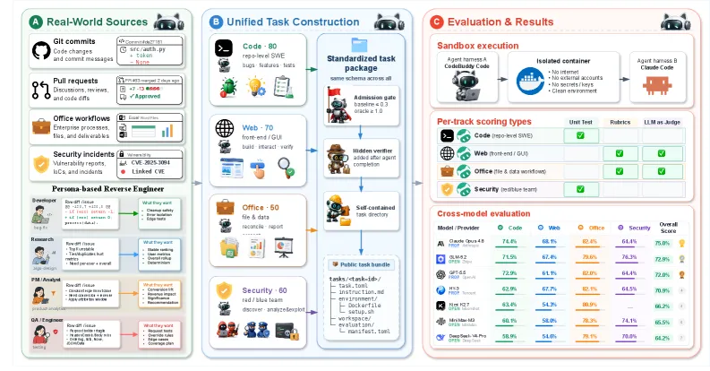
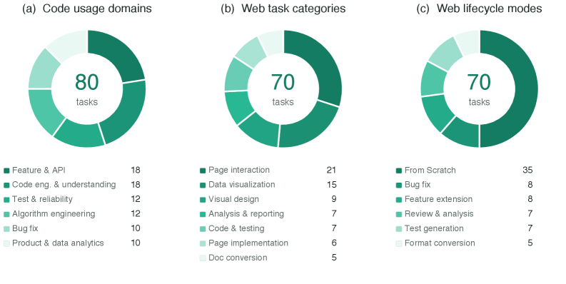
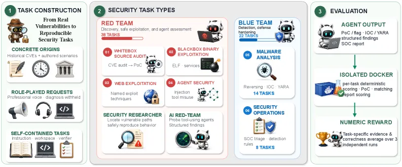

# Paper精读｜Tencent WorkBuddy Bench: A Multi-Domain Coding-Agent Benchmark with Contamination-Resistant Task Construction

> [!abstract] 一句话结论
> 腾讯这套**多领域编码智能体评测套件**，最值得记的是**抗污染的任务构建方式**：四个工作域（**Code / Web / Office / Security**）的每个任务都从**真实 commit / PR / 业务场景反向工程**而来，再改写成**口语化、角色扮演、欠定义的自然语言请求**——拿着任务 prompt 去搜底层的 issue/PR/commit 线程，什么都搜不到。全套开源（任务目录、环境镜像、评测 harness、测试、参考答案），**抗污染靠"构建方式 + 数据集版本管理"而非保密**。统一任务目录格式 + 统一可复现协议，跑在两个 harness（CodeBuddy Code 和 Claude Code）上。四子集评分工具不同（隐藏测试 / 规则+LLM/VLM/agent 裁判 / 确定性评分程序），**分数跨子集不可比，不报套件级平均**（刻意设计）。跨模型排行榜显示：无单一模型通吃，**GLM-5.2 开源模型在 Security 双榜夺冠**。

> [!cite]- 论文信息（点开折叠）
> - **论文标题**：Tencent WorkBuddy Bench — A Multi-Domain Coding-Agent Benchmark with Contamination-Resistant Task Construction
> - **arXiv**：2607.20911
> - **链接**：[https://arxiv.org/abs/2607.20911](https://arxiv.org/abs/2607.20911)
> - **作者**：Tencent WorkBuddy Bench Team（Youtu Lab / Keen Security Lab / Workbuddy / Yunding Security Lab，30+ 人）
> - **机构**：腾讯
> - **日期**：2026-07-23

---

## 1️⃣ 论文想解决什么问题

现有编码智能体基准有两类，各有缺陷：

1. **静态公开套件（SWE-bench / SWE-bench Verified）**：

  - 任务集在发布时固定，问题陈述和答案**在网络上公开流通**——分数上升可能是**记住了特定 issue 线程/PR**，而非真正的仓库级推理

  - 范围窄——绝大多数是**单一 issue 的 bug 修复**

  - 前端生成/web agent 基准同样可被爬取（公开仓库、截图、网站）

2. **厂商生产基准（CursorBench）**：

  - 任务来自真实生产会话，任务分布贴近真实使用——但**基准本身封闭**：外部无法检查任务分布、排除"偏向自家 agent 的选择偏差"、确认任务组合能泛化到该厂商用户群之外

**核心需求**：评估"要在真实组织内部运作的 agent"需要一个套件——① 任务分布由真实工作驱动；② 抗"最关键的污染路径（web 可搜索的 prompt）"——**靠构建方式而非发布时的新颖性**；③ 足够开放，外部方可重跑每个任务并直接审计内容。

---

## 2️⃣ 核心洞察

> [!important] 核心洞察
> 1. **"反向工程 + 改写"是抗污染的构建哲学**：不从公开 issue 文本改编任务，而是从真实 commit/PR/业务场景**反推**出任务，再改写成口语化、角色扮演的请求——**prompt 与源头之间没有可搜索的文本痕迹**。这是对 SWE-bench 类"任务文本 = 公开 issue"的根本性规避。
>
> 2. **开放 + 版本管理取代保密**：数据集完全开放（任务目录/环境镜像/评测 harness/测试/参考答案）——抗污染靠"构建方式让 prompt 不可 web 搜索"+"数据集版本化"（后续任务随版本更新），而非藏起来。**可审计性成为设计目标**：第三方可重跑每个任务。
>
> 3. **任务分布由"使用分类法"驱动，而非任务本身**：各子集的任务类别/模式/角色/难度配比**匹配真实请求的分布**——但**绝不使用真实用户 prompt/会话/数据**（只参考聚合分布）。隐私与分布真实性兼得。
>
> 4. **故意的欠定义（deliberate underspecification）**：请求像同事/客户的口头委托——**扣住根因、参考 diff、任何会送答案的框架**，agent 必须自己定位工作区中相关的部分。与"提供详细已诊断 issue 报告"的基准形成对比。
>
> 5. **评分工具因域而异 = 刻意设计**：Code 隐藏测试、Web 规则+LLM/VLM/agent 裁判、Office 确定性规则+证据 LLM 裁判、Security 纯确定性 scoring.py（**无任何 LLM 裁判**）——**跨子集分数不可比、不报平均**是诚实的设计决策，不是缺陷。

*Figure 1（套件总览）：左：真实 commit、PR、办公工作流与安全案例被反向工程为口语化、角色扮演的请求，任务分布匹配真实使用；中：Code/Web/Office/Security 四轨道共享一个开放任务目录格式；右：每个任务在隔离沙箱中、两个 agent harness 下评分。*

---

## 3️⃣ 方法解读

### 组件1：统一任务构建协议（§2）

- **任务来源**两类：① 真实上游工件——开源仓库的历史 commit/PR（Code）、真实历史 CVE（Security 白盒审计任务）；② 具体业务场景（Web、Office、Code/Security 的合成任务族）

- **哪些场景值得构建、以什么比例**：由**内部使用分类法**决定——各子集的任务类别/模式/角色/难度配比匹配真实请求分布，**从不匹配请求本身**；无原始用户 prompt/会话/数据进入任何任务

- **改写协议**：Code 的每个任务通过**五种请求者人设**发声（developer、algorithm engineer、product manager、QA、operations）；Security 给每个任务域分配专业角色；指令**扣住根因、参考 diff、任何送答案的框架**

- **打包**：每个任务自包含目录——instruction.md、task.toml 元数据、environment/ Docker 快照、tests/ 隐藏测试 + 诊断用 gold.patch

### 组件2：Code 子集（§3.1，80 任务）

- **三个来源族**：

  - **Family A（34）**：真实 OSS 快照 + 真实人类修复（Django、Flask、pytest、Black、Pydantic、httpx、Celery 等 ~18 仓库）

  - **Family B（24）**：目标库公开 API 的 clean-room 重实现（含 4 个跨语言移植：JS/TS/Rust → Python）

  - **Family C（22）**：全合成工作区（algo 工作区 12 + pm 数据工作区 10）

- **Oracle 门控准入**：每个候选任务须通过 oracle 验证

- **18 个细粒度类别合并为 6 个使用域**；bug 修复只占 80 任务中的 10 个——**远超"单一 issue bug 修复"**（SWE-bench 的窄范围对比）

### 组件3：Web 子集（§3.2，70 任务）

- **artifact-not-chat 契约**：agent 必须在声明的输出路径产出**可运行工件**（如 HTML 入口点）——写得再好但没有工件的答案**直接失败**

- **7 类任务**：页面交互（21）、数据可视化（15）占 36/70；其余覆盖视觉设计、前端项目分析、代码测试、页面实现、文档转换——传统前端生成基准很少覆盖的工作

- **6 种生命周期模式**：From Scratch 等（Figure 2c）

### 组件4：Office 子集（§3.3，50 任务）

- 混合格式文件的本地工作区（电子表格、文档、PDF、JSON 导出、Markdown 笔记、文件树）；输出包括更新后的工作簿、报告、结构化记录、状态文件、交接材料

- 必须保持跨文件信息一致、更新关联状态、保留审查证据、遵守任务特定执行约束

- **评估检查最终工作区**——能抓住文本答案分数漏掉的失败（写了合理摘要却没更新它描述的工作簿；创建文件但依赖状态不一致）

- 两条构建路线：任务规格+目标能力重建 / 抽象办公流程扩展

### 组件5：Security 子集（§3.4）

- 覆盖安全团队光谱：**红队**（发现+安全利用）、**恶意软件分析**、**安全运营**（告警流分流）、**agent 安全评估**（探测工具使用 agent）

- 任务**不预先给出缺陷位置或预期行为**，agent 必须逐步挣得；每任务在沙箱化评估环境运行

- **全套件唯一不带任何 LLM 裁判的子集**：每任务配确定性 scoring.py，直接把 agent 输出转为分数

- 任务构建自真实历史漏洞（CVE，白盒审计）+ 作者场景

*Figure 2（Code/Web 构成）：(a) 18 个细粒度类别合并为 6 个 Code 使用域——bug 修复只占 80 任务中的 10 个，远非 SWE-bench 式"单一 issue 修复"；(b) Web 任务 7 类——页面交互（21）与数据可视化（15）主导；(c) 6 种 Web 生命周期模式，From Scratch 占比最高。*

### 组件6：评测协议（§4）与跨模型排行榜（§5，Table 6）

- 每个分数 = think 模式下**三次独立运行的平均**；四子集都在 CodeBuddy Code（cbc）与 Claude Code（cc）双 harness 下评分

- 无单一模型通吃八个榜单：

| **模型** | **Code cbc/cc** | **Web cbc/cc** | **Office cbc/cc** | **Security cbc/cc** |
| --- | --- | --- | --- | --- |
| **Claude Opus 4.8** | 74.43 / 77.90‡ | 68.14 / 69.86 | 82.37 / 83.23 | 64.37 / 65.87 |
| GPT-5.5 | 72.90 / 76.63 | 61.14 / 64.86 | 81.96 / **86.05** | 64.39 / 77.91 |
| **GLM-5.2** | 71.54 / 77.06 | 67.43 / 60.71 | 79.60 / 79.57 | **76.32 / 80.86** |
| HY-3 | 62.90 / 66.26 | 67.71 / 66.43 | 82.08 / 80.08 | 64.50 / 65.59 |
| MiniMax-M3 | 60.14 / 66.42 | 58.00 / 52.57 | 78.28 / 76.30 | 74.14 / 59.30 |
| DeepSeek-V4-Pro | 58.92 / 64.59 | 54.57 / 51.57 | 79.11 / 78.71 | 70.04 / 58.73 |
| DeepSeek-V4-Flash | 55.73 / 61.89 | 47.29 / 50.29 | 77.47 / 77.54 | 67.11 / 53.90 |

- **排行榜领跑分布**：Claude Opus 4.8 领 5 榜（Code 双榜、Web 双榜、Office-cbc）；GLM-5.2 领 2 榜（Security 双榜）；GPT-5.5 领 1 榜（Office-cc）

- **关键发现 1（开源 ≠ 全面落后）**：开源模型 GLM-5.2 在 **Security 双榜直接夺冠**——"开源与闭源前沿模型的差距是**榜单依赖的**而非均匀的"

- **关键发现 2（harness 不是中性仪器）**：Code 上模型排名随 harness 改变（GPT-5.5 在 cbc 领先 GLM-5.2，cc 下反转）；Web 在 cc 下 4/7 模型分数下降——**harness 选择本身影响结论**

- **关键发现 3（Office 难度校准）**：Figure 9——各难度层模型差距不同，harness 差异在低难度层更明显

*Figure 8（Security 子集）：任务构建自真实历史漏洞（CVE）与作者场景，形成可复现、自包含的案例；覆盖 6 种红/蓝队任务类型（白盒审计、渗透、恶意软件分析、告警分流、agent 探测等）；每任务配确定性 scoring.py——全套件唯一无 LLM 裁判的子集。*

---

## 5️⃣ 学术评价

**优点：**

1. **抗污染构建方式是真正的贡献**：不是"发布时新颖、发布后被记忆"，而是**结构性规避**——prompt 从真实工件反向工程 + 口语化改写，web 搜索找不到源头。配合开放发布 + 版本管理，这是对 SWE-bench 数据泄漏问题最系统的回应之一

2. **"分布驱动 + 零用户数据"两头都占住了**：任务分布匹配真实使用，构建过程却一条用户 prompt/数据都不碰——隐私合规和分布真实性谁都没牺牲，设计范式可以直接抄走

3. **多域扩展了"编码 agent"的定义**：Code（仓库工程）、Web（前端工件）、Office（办公工作流）、Security（红/蓝队）——四个真实工作域，且**每个域都有专属验证风格**（隐藏测试/多裁判/规则+LLM/纯确定性）

4. **"分数不可比、不报平均"的诚实**：不同评分工具下报套件级平均是伪科学——论文明确拒绝，这是评测方法论的正确态度

5. **harness 敏感性的透明报告**：双 harness 评分暴露"换 harness 结论会变"——对只报单 harness 的基准是降维打击

6. **Security 子集无 LLM 裁判**：纯确定性评分规避了"用 LLM 评 LLM"的信任问题，是安全域评测的正确选择

> [!ed-warning] 局限（风险与不确定性）
> 1. **规模偏小**：Code 80 / Web 70 / Office 50 / Security 数量更少——相比 SWE-bench（2,294）任务量级小一个数量级，统计显著性受限
>
> 2. **Office/Web 的裁判仍有主观成分**：LLM/VLM 裁判的 rubric 质量决定分数可信度；agent-judge 的使用引入额外的复杂度与成本
>
> 3. **“欠定义请求”的双刃剑**：口语化欠定义接近真实，但也引入**评分方差**——不同 agent 对同一请求的理解可能合法地不同，隐藏测试/裁判是否能公平对待“合法但不同的解法”？
>
> 4. **排行榜的厂商色彩**：CodeBuddy Code 是腾讯自家 harness——cbc 分数与 cc 的差异虽被透明呈现，但“自家 harness 上的自家基准”仍需第三方独立复现背书
>
> 5. **跨域不可比是双刃剑**：拒绝套件平均是诚实的，但也意味着**无法回答“哪个模型综合最强”**——用户只能看八块板

---

## 6️⃣ 局限与可扩展方向

- **规模扩展**：任务数提升到与 SWE-bench 同级，提升统计功效

- **任务版本化滚动**：随真实 commit/PR 持续增加新任务，防"旧任务被记忆"

- **第三方独立复现**：外部机构在非腾讯 harness 上复跑并报告——验证基准中立性

- **Security 域扩展**：更多 CVE 类型、漏洞利用链、SOC 场景

- **与真实部署对比**：基准分数与 WorkBuddy 产品内真实任务表现的关联度验证

---

## 与其他论文的对话

| **相关工作** | **关系** | **差异** |
| --- | --- | --- |
| **SWE-bench / SWE-bench Verified** | 直接对比对象 | 任务文本 = 公开 issue（可记忆）；WorkBuddy 反向工程+改写（结构性抗污染）；且 WorkBuddy 远超"单 issue bug 修复" |
| **CursorBench** | 另一极 | 真实生产任务但封闭；WorkBuddy 全开放可审计——"开放 vs 厂商封闭"的对照 |
| **Terminal-Bench / OSWorld** | 已有 agent 基准 | 单域；WorkBuddy 四域 + 每域专属验证风格 |
| **LongHorizon-Harness（2608.01964）** | 同为腾讯系 agent 工作 | LHH 是任务状态管理方法；WorkBuddy Bench 是评测——"方法 + 评测"配套 |
| **LLMRouter（2608.06867）** | 评测基础设施主题 | LLMRouter 统一路由评测；WorkBuddy 统一 agent 任务评测——"评测方法论"浪潮的两面 |
| **Leanstral（2608.leanstral）** | 开源模型能力 | Leanstral 开源模型证明自己；WorkBuddy 的 GLM-5.2 夺冠同样证明"开源 ≠ 落后"——榜单依赖而非均匀 |

---

## 7️⃣ 最后总结

Tencent WorkBuddy Bench 的核心贡献不在"又大又强"，而在**评测方法论**：① 用"反向工程 + 口语化改写 + 开放发布 + 版本管理"系统性解决基准污染问题（SWE-bench 时代的达摩克利斯之剑）；② 把编码 agent 评测从单一仓库 bug 修复扩展到**四个真实工作域**（仓库工程/前端工件/办公流程/红蓝队安全），每域配专属验证；③ 诚实面对"跨域不可比"与"harness 非中性"——不报平均、双 harness 透明呈现。实证发现同样有信息量：**GLM-5.2 开源模型在 Security 双榜夺冠**、"开源 vs 闭源差距是榜单依赖的"、harness 选择会翻转模型排名。对做 agent 评测或部署选型的人，这篇提供了抗污染基准设计的范本；它揭示的"基准结论随评测装置漂移"问题，也是整个 agent 评测领域要正视的。

---

## 8️⃣ 三句速记

> [!summary]- 点开展开
> 1. **抗污染靠构建方式**：任务从真实 commit/PR/业务场景反向工程 + 口语化改写——prompt 无法 web 搜索找回；开放发布 + 版本管理，可审计性内建。
>
> 2. **四域四验证**：Code 隐藏测试（80 任务，bug 修复仅 10）、Web artifact-not-chat 契约（70）、Office 检查最终工作区（50）、Security 纯确定性评分无 LLM 裁判——跨域分数不可比，不报平均。
>
> 3. **开源 ≠ 全面落后**：GLM-5.2 在 Security 双榜夺冠（76.32/80.86）；harness 不是中性仪器——换 harness 模型排名会反转。
