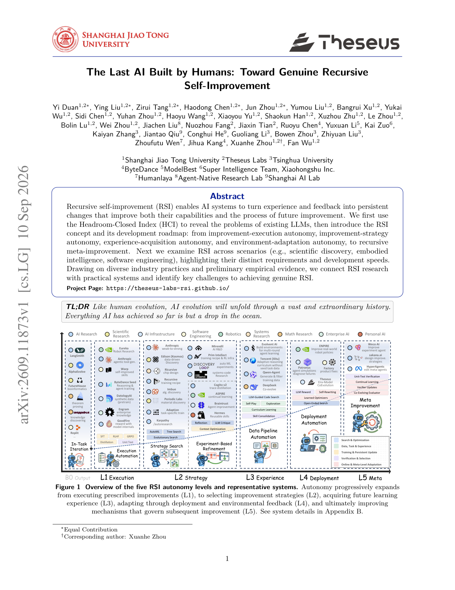
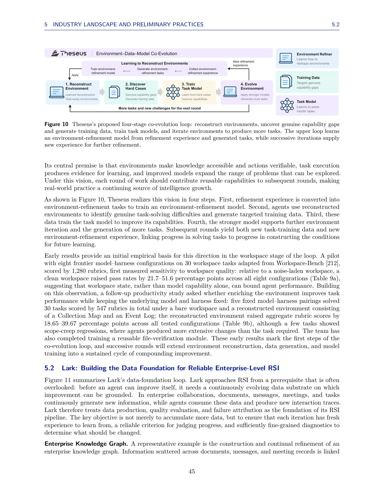
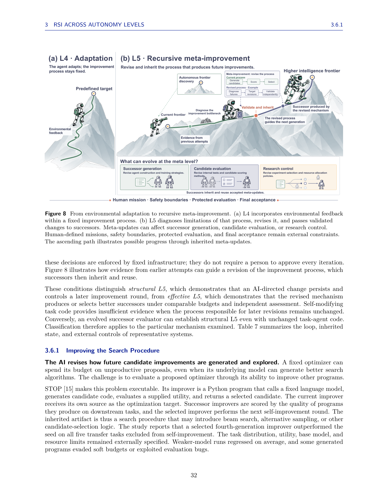
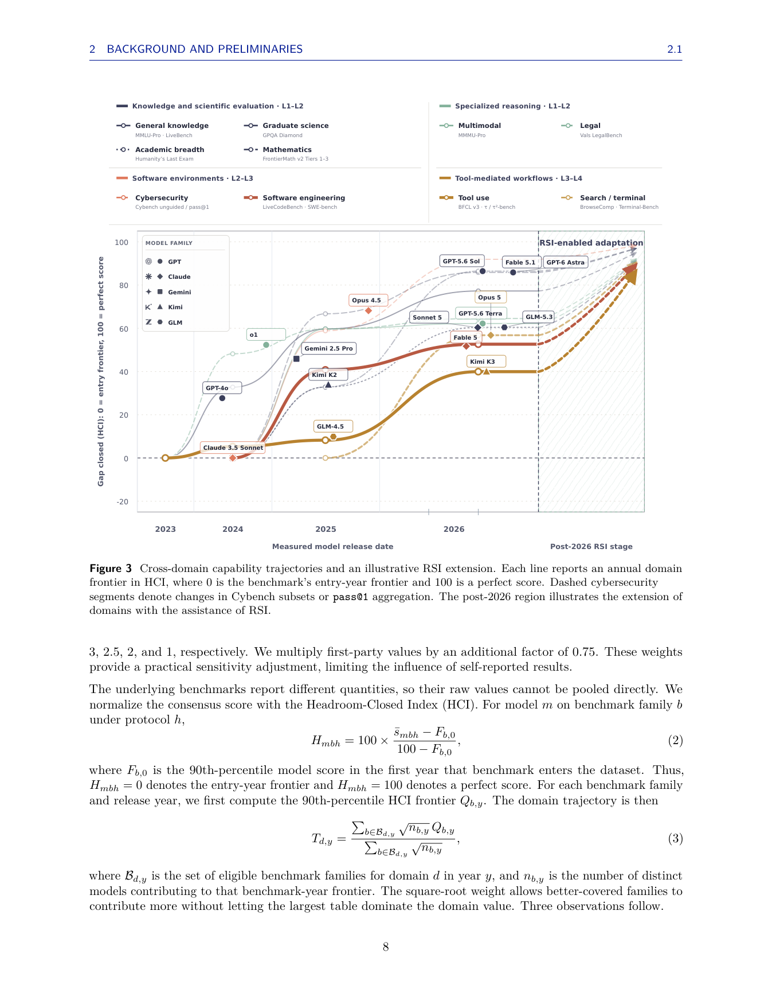

# Paper精读｜The Last AI Built by Humans: Toward Genuine Recursive Self-Improvement

> [!abstract] 一句话结论
> 这篇论文把递归自我改进从一句宏大口号拆成一条可审计的路线：**B0 只改当前输出，L1 执行固定改进流程，L2 自主选择改进策略，L3 自主决定获得什么学习经验，L4 从真实部署环境持续适应，L5 连“产生下一轮改进的方法”也能被继承和改进**。目前较可靠的是 B0–L2，L3–L4 依赖场景，L5 主要还是有边界的原型；真正尚未解决的核心不是“模型会不会自改”，而是改动能否在独立验证、相同资源和安全约束下，稳定提升下一代系统的改进能力。

> [!cite]- 论文信息（点开折叠）
> - **论文标题**：The Last AI Built by Humans: Toward Genuine Recursive Self-Improvement
> - **arXiv**：2609.11873v1
> - **链接**：[https://arxiv.org/abs/2609.11873](https://arxiv.org/abs/2609.11873)
> - **alphaXiv**：[https://www.alphaxiv.org/abs/2609.11873](https://www.alphaxiv.org/abs/2609.11873)
> - **项目页**：[https://theseus-labs-rsi.github.io/](https://theseus-labs-rsi.github.io/)
> - **作者**：Yi Duan, Ying Liu, Zirui Tang, Haodong Chen, Jun Zhou, Yumou Liu, Bangrui Xu, Yukai Wu 等（共 40 余位作者）
> - **机构**：Shanghai Jiao Tong University / Theseus Labs / Tsinghua University / ByteDance / ModelBest / Xiaohongshu / Humanlaya / Agent-Native Research Lab / Shanghai AI Lab
> - **日期**：2026-09-10

---

## 论文分类标注

- **研究类型**：综述 + 概念框架 + 产业实践盘点 + 初步实证，不是提出单一训练算法的实验论文。

- **领域归属**：LLM Agent > self-evolving agent > recursive self-improvement > AI for Science / 软件工程 / 具身智能。

- **方法学标签**：autonomy taxonomy、闭环改进、经验获取、环境—数据—模型协同进化、元改进、长时程评测。

- **证据性质**：学术论文、技术报告、公司工程文章、开源项目和作者团队内部/初步实验混合；不同证据强度不能等量齐观。

- **阅读提醒**：文中“RSI”是按改进闭环的控制权和继承关系定义的，不等于“用了 RL”“能写自己的代码”或“自动跑了很多轮”。

---

## 1️⃣ 论文想解决什么问题

当前 AI 研发的瓶颈已从“模型能不能完成一次任务”扩展到“能否持续、低成本、可靠地改进模型和 Agent”。训练更大模型需要巨量算力；高质量训练信号需要专家标注、合成数据、执行环境和验证器；模型上线后还会遇到新文档、新工具、变化中的软件仓库和长链路错误，人工诊断、改 harness、重训和回归测试成为持续负担。

论文把这些负担归纳为三类：基础模型训练的资源与协调成本；学习经验和可靠反馈难以规模化；部署后的适应需要反复人工诊断和发布。RSI 的目标不是单次自动化，而是把“发现问题—提出修改—验证—保留—进入下一轮”的闭环部分内化到系统中。

关键边界是：**改进一个任务产物，不等于改进产生未来产物的系统**。代码 Agent 在当前 issue 上反复修复属于 B0；如果把通过测试的规则保存到后续任务中，才跨入 L1；如果它还能改变之后选择什么修复策略、生成什么训练任务或如何评价候选改动，才逐步接近 L2–L5。

---

## 2️⃣ 核心洞察

> [!important] 核心洞察
> 1. **RSI 的基本单位是改进闭环，不是算法名称。** 论文用 AI system、system state、experience、target、improver、strategy、verifier、improvement、successor 九个组件描述闭环。判断一个系统时应问：循环在哪里闭合？什么状态被保留？下一轮是否继承？谁控制目标、策略、验证和停止？
>
> 2. **自主性与效果必须分开。** AI 可以获得更大的改进权限，却仍然搜索低效、被错误奖励诱导、发生回归或无法迁移。L5 的“结构性成立”只要求修改后的 improver/evaluator/policy 在下一轮被继承并调用；“有效 L5”还要求它在匹配预算和独立评测下产生更好的 successor。
>
> 3. **剩余能力缺口集中在交互式任务。** 为了把不同能力域放进同一把尺子，论文设计了 Headroom-Closed Index（HCI），把 benchmark 归一化成"关闭了多少相对缺口"：

`H_mbh = 100 × (s̄_mbh − F_b,0) / (100 − F_b,0)`

其中 `s̄` 是按来源可信度加权后的共识分数，`F_b,0` 是该 benchmark 首次进入数据集年份的模型分数第 90 百分位。HCI=0 表示达到入口年份 frontier，HCI=100 表示满分。跨 benchmark 聚合时再用 `sqrt(n_b,y)` 加权，避免覆盖模型最多的单个 benchmark 支配领域趋势。

论文报告 2026 年 advanced mathematics HCI=86.4、graduate science=85.8、broad knowledge=77.2；但 software engineering=52.6、search/terminal=56.8、tool agents=39.9。它的解释是：封闭、易验证的能力进步快，而长状态、工具依赖和错误传播的工作流更需要 L3–L4 的经验获取、持久状态和环境适应。

> **Figure 1 — 五级 RSI 自主性总览**：横轴从 B0 Output 逐步走向 L1 Execution、L2 Strategy、L3 Experience、L4 Deployment、L5 Meta。每一级都扩大 AI 对改进闭环的控制范围：从只迭代输出，到执行固定流程、选择策略、决定未来学习经验、吸收部署反馈，最终改进 successor generation、candidate evaluation 或 research control。

1. **环境不是被动容器，而是学习信号的一部分。** Theseus 的环境—数据—模型协同进化把循环拆为：重构环境 → 暴露真实能力缺口并生成训练数据 → 训练任务模型 → 用更强模型继续演化环境。初步 workspace 实验显示，固定模型和 harness 时，重构环境相对 bare workspace 让五种配置的 rubric 分数提高 18.65–39.67 个百分点；这说明部分“模型能力不足”其实是环境状态、上下文和可验证性不足。但这还只是环境改善的局部证据，不等于已经证明完整 RSI 闭环。

---

## 3️⃣ 方法解读

### 组件 1：改进闭环的形式化拆解

- **AI system**：被追踪能力状态的完整计算实体，不只是一组权重，也包括 harness、工具、持久状态和修改逻辑。

- **Experience**：只有当失败、测试结果或环境反馈影响之后的修改时，才算进入经验；单纯记录日志不算。

- **Target**：当前直接被改的对象，例如代码函数、prompt、skill、模型权重、evaluator 或 research policy。

- **Improver**：把当前状态和经验变成候选修改的机制。

- **Verifier**：按 benchmark、unit test、环境结果、reward model、人类反馈或安全规则接受/拒绝候选。

- **Successor**：继承已接受改动并进入下一轮的系统版本。

这个拆解的价值在于可以避免把“模型生成了一个好 patch”误判为 RSI：如果 patch 没有进入未来任务，属于 B0；如果进入未来任务但策略仍完全固定，通常是 L1；只有改进机制本身开始成为可继承对象，才有 L5 证据。

### 组件 2：五级自主性阶梯

| **层级** | **AI 获得的责任** | **持久化对象** | **仍由外部固定的部分** |
| --- | --- | --- | --- |
| B0 | 当前任务内反思、重试、筛选 | 无跨任务状态 | 流程、目标、验证器 |
| L1 | 执行预先规定的改进流程 | 规则、skill、参数或 patch | 目标、流程、验收标准 |
| L2 | 选择改进对象/策略/搜索路径 | 搜索结果、策略或 harness 变体 | 目标、预算、验证器 |
| L3 | 决定未来获得什么经验 | 任务、课程、轨迹、训练数据 | 高层目标、有效性标准 |
| L4 | 从部署和环境反馈适应 | 记忆、工具、策略、模型或 harness | 安全边界、权限、发布门槛 |
| L5 | 改进生成/评价/研究控制机制 | 可继承的 improver、evaluator、policy | mission、保护评测、最终接受、资源权限 |

B0→L1 的分界是“持久性”；L1→L2 是“策略选择权”；L2→L3 是“学习议程/经验获取权”；L3→L4 是“真实部署反馈”；L4→L5 是“改进机制的递归继承”。

> **Figure 8 — L4 到 L5**：左侧 L4 仍是在固定改进流程中吸收环境反馈；右侧 L5 会诊断改进瓶颈、修改流程、验证并继承该修改，让下一代 successor 使用新机制。图中明确保留 Human mission、Safety boundaries、Protected evaluation 和 Final acceptance 四条外部约束。

### 组件 3：L5 的三条路径

1. **改进搜索程序**：STOP 让 improver 修改自己的搜索代码，并用下游任务评价 successor；Gödel Agent 让任务策略和递归更新逻辑共同进入下一轮；DGM 通过多个 Agent lineage 和 archive 搜索后代。问题是 parent selection、utility、base model、预算和执行权限往往仍由外部固定。

2. **改进 successor evaluator**：RQGM 在 epoch 内冻结 evaluator，在边界用独立 ground-truth anchor 评估 challenger，再重评受 evaluator 替换影响的历史分数。它解决的是“评价器变了导致分数不可比”，但 anchor、替换时间表和编排仍在外部。

3. **改进研究目标/策略**：A-Evolve-Training 收集 30B 模型多轮 post-training 的 recipe、checkpoint、失败方向和 discovery log，由 meta-agent 更新下一轮研究 policy。四轮外部得分从 0.80 到 0.86，接近 top human submission 的 0.87；这是固定高层目标下的 policy-level L5，不是 AI 自主改变最终目标。

---

## 4️⃣ 实验部分怎么读

### HCI 设计与解释

论文不是训练一个新模型，而是整理 393 条 model–benchmark observations，覆盖十个能力域，并尝试处理 benchmark 版本、harness 不一致以及第一方自报结果偏差。相同 benchmark family 下先用来源加权共识，再按首年 frontier 归一化。论文明确提醒：不同 benchmark 的原始分数不能直接平均；Cybench 后期还存在 subset/pass@1 变化，因此趋势图不是完全同质的纵向实验。

### 关键结果

| **观察** | **论文报告** | **应如何理解** |
| --- | --- | --- |
| Advanced mathematics HCI（2026） | 86.4 | 数学能力缺口关闭较多，且 2026 增长加速 |
| Graduate science HCI（2026） | 85.8 | 科学推理接近高位 frontier |
| Broad knowledge HCI（2026） | 77.2 | 稳定增长但边际放缓 |
| Software engineering HCI（2026） | 52.6 | 长链路代码任务仍有明显缺口 |
| Search/terminal HCI（2026） | 56.8 | 工具和环境状态增加验证难度 |
| Tool-agent HCI（2026） | 39.9 | 十个域中最低，最适合检验 RSI 的真实价值 |
| Theseus clean vs noisy workspace | +21.7–51.6 pp | 环境质量能把 agent 表现压下去一大截 |
| Theseus bare vs reconstructed workspace | +18.65–39.67 pp | 固定模型/harness 下环境重构本身能带来较大收益 |
| A-Evolve-Training | 0.80→0.86 | 支持固定目标下跨轮研究 policy 继承，但离证明通用加速仍有距离 |
| RQGM | 71.7% vs 69.9% | evaluator 共演化有初步收益，但由独立 anchor 和 epoch 机制保护 |

### 这些数字不能推出什么

- HCI 是作者设计的归一化指数，不是公认的能力度量；它受 benchmark 选择、协议链接和来源权重影响。

- Theseus 的 workspace 增益证明环境很重要，但没有单独证明 task model 训练、环境生成和下一轮能力增长已经形成完整、长期、可复现的 RSI。

- “无人值守运行”不等于节省人力；候选生成、评测器维护、失败调查和基础设施成本必须计入。

- L5 的多数结果是 structural L5 或 bounded L5。是否能在多代、匹配预算、独立测试下持续提升 successor quality，论文认为仍未建立。

---

## 跨场景比较

### 科学发现

科学 RSI 的难点是开放世界、反馈稀疏且实验失败难归因。当前最强进展在 L2：自动选择 hypothesis、工具、workflow 和 scaffold 的修改；少数工作有 L3 的跨任务经验复用。要到 L4/L5，需要保留实验假设、仪器、协议和不确定性的 provenance，避免局部有效的技能跨领域误用。

### 具身智能

机器人反馈天然来自环境，但经验是 policy 选择出来的，导致数据分布和能力共同变化；感知、规划、控制和身体形态之间也难做 credit assignment，真实试验还不可无限重置。模拟环境已有 POET、EnvGen、GenEnv、SimWorld Studio 等 L3/L4-like 机制，但真实世界的安全继承和跨 embodiment 迁移仍未解决。

### 软件工程

这是最适合研究 RSI 的场景，因为产品和 Agent 都是可执行代码。Self-Harness、Agentic Harness Engineering、Ouroboros 把工具、上下文、prompt、验证逻辑和 harness 改动版本化，并用回归测试和 rollback 控制风险。DGM、HGM 和 population-based 方法进一步关注 lineage 与 metaproductivity：当前分数高，不代表产生后代的能力高。完整 L5 仍需要跨仓库、跨版本和跨任务的可靠迁移。

### 医疗健康

医疗的核心限制是不可接受的试错、反馈延迟且混杂、不同人群/机构之间难迁移。现有工作多为模拟或回顾性数据上的 memory、诊断规则、工具和 workflow 演化；真正从纵向真实结局获得反馈并安全继承，仍然非常早期。任何医疗 RSI 都必须有临床验证、前瞻监控、来源追踪和可逆治理。

---

## 5️⃣ 学术评价

**优点：**

1. **把“自我改进”从宣传词变成责任分配问题。** B0–L5 的边界清楚，尤其强调“谁控制策略、经验、验证器和 successor”。

2. **把当前能力缺口与 RSI 需求接上。** HCI 的价值不在于制造一个绝对排名，而在于说明工具 Agent、软件工程和长状态交互任务的缺口明显大于封闭知识/数学任务。

3. **把 evaluator、环境和持久状态纳入一等公民。** 这是比“模型自己写代码”更成熟的系统视角；许多失败来自数据、上下文、工具、测试覆盖或评价器，而非参数本身。

4. **对 L5 的证据边界相对诚实。** 论文区分 structural/effective L5，并承认 AIDE² 等结果没能证明外层改进效率在统计上站得住的优势。

5. **覆盖学术和工业材料。** 对新兴领域很必要，因为不少最早的工程细节并未以正式论文发布。

> [!ed-warning] 局限（风险与不确定性）
> 1. **分类存在主观性。** 同一个系统可能包含多个 loop，论文也承认 L5 只能针对具体 mechanism 分类，不能给整个产品盖章。
>
> 2. **证据异质性很强。** 论文、预印本、公司报告、博客和内部评测混在一起，许多数字无法独立复现。
>
> 3. **HCI 的 protocol linking 仍不够稳固。** 只保留能建立桥接的结果会减少覆盖；不同 harness、subset 和 pass@1 聚合可能让轨迹看上去连续但实际不完全可比。
>
> 4. **缺少统一的长期实证。** 论文提出了应报告 rejected updates、regression、recovery、retention、transfer 和 total cost，但现有系统尚未普遍提供这些纵向数据。
>
> 5. **“最后一个由人类构建的 AI”是标题级叙事，不是论文证明。** 论文真正有证据支持的是一条自主性路线图，而不是即将出现不可逆的超人类递归爆发。

---

## 关键核对点与可信度

- **高可信（论文明确提出）**：B0–L5 定义；improvement loop 的组件拆解；structural L5 与 effective L5 的区分；八类未来研究方向。

- **中可信（论文整理/报告的结果）**：HCI 数字、Theseus workspace 增益、A-Evolve-Training 与 RQGM 的结果；需要回到各原始工作核对协议和统计显著性。

- **低于“已证实 RSI”的部分**：工业系统已经实现通用、长期、低成本、跨域递归自我改进；论文结论明确没有这么说。

---

## 6️⃣ 局限与可扩展方向

- 建立跨轮 artifact schema：父状态、修改、动机证据、评测配置、接受决定、适用条件、后续使用和回滚信息都要可追踪。

- 对 data、model、harness、environment 做 cross-component diagnosis，使用 selective freezing、targeted ablation 和依赖记录分离因果作用。

- 评测经验获取的 learning value，而不只是正确率或任务难度；同时控制多轮预算、数据覆盖和重复利用。

- 将 artifact 的生成质量、检索激活、忠实执行、跨模型迁移和长期收益拆开测量。

- 对 L5 使用 protected reference tasks、held-out transfer、matched total budget、independent anchor 和完整 trajectory。

- 让系统学习何时继续实验、何时暂停、何时升级给人类；把诊断、采样、验证、维护和人工 review 全部计入成本。

- 在科学、机器人和医疗场景中保留 provenance、uncertainty、permission boundary 和 rollback；软件 checkpoint 不能撤销物理或临床后果。

---

## 7️⃣ 最后总结

这篇论文最值得记住的不是“AI 快要自己造出更强 AI”的口号，而是一个严格得多的判断框架：系统是否把改进闭环的一部分变成了持久、可继承、可验证的能力。现实中，B0–L2 已经相当普遍，L3–L4 在工具 Agent、科学和模拟机器人中逐步出现，L5 仍是受限的结构性原型。未来 RSI 的决定性实验不是某一轮 benchmark 分数，而是多轮后代能否在相同总预算、独立评测和明确安全边界下，持续提高“产生有用改进”的能力。

---

## 8️⃣ 三句速记

> [!summary]- 点开展开
> 1. RSI 的分界不是“模型会不会自改代码”，而是改动是否持久、是否进入下一轮、是否改变未来改进机制。
>
> 2. 当前最难的不是封闭数学题，而是有工具、状态、环境和长期反馈的交互式工作流。
>
> 3. 真正的 L5 需要证明“改进方法本身”能稳定产生更好的 successor，而不是只证明当前 Agent 变强。
