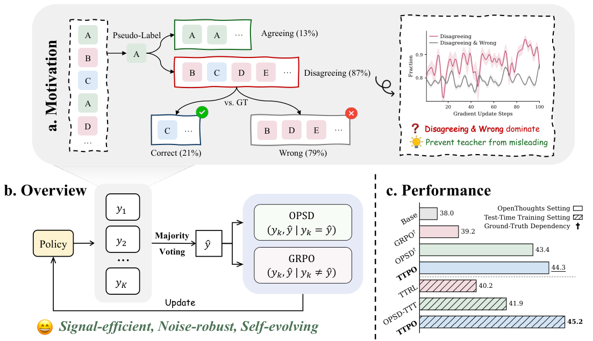
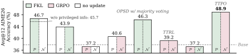

# Paper精读｜TTPO: Test-Time Policy Optimization

> [!abstract] 一句话结论
> TTPO 用**非对称目标**把"多数投票伪标签"里的安全信息分离出来——**一致样本走 OPSD 蒸馏**、**分歧样本走 GRPO 惩罚**，再配上 token 级选择，零标签条件下就在五个竞赛级数学基准上追平甚至压过带标签的 OPSD，而且这套能力是自己长出来的：在一个基准上训，另外两个也跟着涨。

> [!cite]- 论文信息（点开折叠）
> - **论文标题**：TTPO: Test-Time Policy Optimization
> - **arXiv**：[2608.27448](https://arxiv.org/abs/2608.27448)
> - **链接**：[https://arxiv.org/abs/2608.27448](https://arxiv.org/abs/2608.27448)
> - **作者**：Aozhe Wang, Zhengxi Lu, Jianze Wang, Shangke Lv, Ying Liu, Weiming Lu, Jun Xiao, Yueting Zhuang, Hua Yang, Qianglong Chen, Yongliang Shen
> - **机构**：浙江大学 / 阿里巴巴集团
> - **日期**：2026-08-27
> - **代码**：[https://github.com/ZJU-REAL/TTPO](https://github.com/ZJU-REAL/TTPO)

---

## 1️⃣ 论文想解决什么问题

当前大模型数学推理的主流后训练路线是 RLVR（可验证奖励强化学习）和 OPSD（在线策略自蒸馏）。前者靠端到端二值奖励传播，梯度稀疏；后者用"带参考答案的 teacher"对 rollout 做逐 token 前向 KL，提供密集监督，两者都依赖 ground-truth 答案。

在**测试时训练（Test-Time Training, TTT）**场景下，问题没有标注：模型只能在推理时从自身生成的 rollout 中抽取监督信号。最朴素的做法是用多数投票（majority vote）构造伪标签，但问题是：

1. 竞赛级题目的多数投票准确率大约只有 ~15%，大部分伪标签是错的。

2. 直接把错误伪标签作为 teacher 条件输入 OPSD，会让所有 rollout 都被误导——**一个错误标签会污染每一个 token 的梯度**。

3. 纯 RL（如 TTRL）只给出序列级二值 reward，无法精细区分好位置与坏位置。

所以 TTT 下需要的监督信号得满足两条：**容忍伪标签的噪声，同时让正面/反面两种 rollout 都派上用场**。

---

## 2️⃣ 核心洞察

> [!important] 三条核心洞察
> 1. **噪声的不对称性**：当多数票错时，~79% 与票"不一致"的 rollout 本身也是错的——**不依赖票内容、只依赖"是否一致"即可正确惩罚它们**；而"一致"组即使票错了，因为 teacher 和被蒸馏的 student 看到相同的错误答案，update 退化为"thinking→non-thinking 内部风格蒸馏"，不会引入额外错误。
>
> 2. **正负样本各取所需**：正样本用 FKL 蒸馏（dense token-level 监督），负样本用 GRPO 惩罚（粗粒度但鲁棒），二者互补；把二者混用或互换（如对负样本做 FKL）都会让伪标签误差放大。
>
> 3. **投票比 GT 更"好用"**：在难题上 GT 正样本极少（接近 0），导致两个分支同时被饿死；多数票总能维持一定的正负比例，让两条梯度流都保持活跃。

---

## 3️⃣ 方法解读

### 整体流程

对每个测试题 x：

1. 采样 K 条 rollout {y₁...y_K}，提取最终答案 {a₁...a_K}

2. 多数投票得到伪标签 â，计算共识 c = |{k: a_k ≡ â}|

3. 划分正集 P = {k: a_k ≡ â} 和负集 N = {k: a_k ≠ â}

4. 构造 **answer-conditioned teacher**：q_t = π_θ(· | [x; â], y_<t)，固定权重无梯度

5. student 正常前向：p_t = π_θ(· | x, y_<t)，有梯度

6. 对 P 执行 OPSD 前向 KL + token 加权；对 N 执行 GRPO + token 掩码

7. 联合更新：θ ← θ - η ∇(L_OPSD + λ L_GRPO)

*图注：Figure 1 同时展示伪标签错误时的样本分布、TTPO 的总体思路，以及 Qwen3-1.7B 在三个数学基准上的性能对比。*

*图注：Figure 3 比较正负样本分别使用 FKL、GRPO 或不更新时的组合；完整的“正样本 FKL + 负样本 GRPO”明显最好。*

*（原图未能本地化：Figure 5/6 — 监督方式与自演化过程；IMA 媒体接口没有可用媒体编号）*

*图注：Figure 5 对比多数票与 ground truth 监督，Figure 6 展示训练过程中 Avg@12 与多数票质量 Maj@12 同步上升。*

### 组件 1：正样本 OPSD 分支

$\mathcal{L}_{OPSD}^{(k)} = \frac{1}{T_k}\sum_{t=1}^{T_k} w(t)\cdot KL(q_t^{(\hat{a})} \| p_t)$

- token 级 forward KL，teacher 被伪标签 â 条件化

- **token 加权**：w(t) = Ĥ(t) + Δ̂(t) - Ĥ(t)·Δ̂(t)，其中 Ĥ 是学生熵的 min-max 归一化，Δ̂ 是 teacher-student  divergence 的归一化。用 Soft-OR 组合：只要"学生不确定"或"师生分歧大"就赋予高权重；两者都小时（学生已收敛）权重趋 0。

### 组件 2：负样本 GRPO 分支

$\mathcal{L}_{GRPO}^{(k)} = -\frac{A_k}{T_k}\sum_{t=1}^{T_k} m(t)\cdot \log\pi_\theta(y_k^{(t)}|x,y_{<t}^k)$

- 基于多数投票的二值 reward（一致=1，否则=0），计算 group-relative advantage A_k，对负样本 A_k < 0，产生惩罚

- **token 掩码**：m(t) = 1[s(t) ≥ median]，其中 s(t) = -log p_t(y_k^{(t)})·(1 - Ĥ(t))。用**未归一化的负对数概率**作为主排序因子（确保"本地正确的 token"天然被排除），再用 (1-Ĥ) 放大"低熵高置信"的异常 token，选取 top-50% 掩码掉

- 动机：避免 GRPO 对局部正确但总体失败 trajectory 上"无辜 token"的误罚（即 False Penalties on Negative Samples 问题）

### 组件 3：联合目标与采样策略

$\mathcal{L}_{TTPO} = \frac{1}{|B|}\sum_{k\in P}\mathcal{L}_{OPSD}^{(k)} + \lambda\sum_{k\in N}\mathcal{L}_{GRPO}^{(k)}$

- λ = 0.1 平衡两条分支的梯度量级（FKL 原始值约为 GRPO 的 1/10）

- 从 K=64 条 rollout 中按固定 50/50 比例抽取 K_train=8 条做梯度（shortest selection 效果最佳）

- thinking-mode-on teacher + thinking-mode-off student，教师只用短答案作为特权信息（完整的 trajectory 反而会让 teacher 退化为首尾续写）

---

## 4️⃣ 实验部分怎么读

### 实验设置

- **模型**：Qwen3-1.7B / 4B / 8B，LoRA (r=64, α=128)

- **训练数据**：OpenThoughts（有标注，但 TTPO 不用标签）

- **评测基准**：AIME 2025/2026, HMMT 2025/2026, BRUMO 2025

- **评估方式**：thinking mode on, temperature=1.0, Avg@12

### 核心结果

**表 1（OpenThoughts 训练数据，TTPO 只用多数票）：**

| **模型** | **Base** | **+GRPO†** | **+OPSD†** | **+TTPO** |
| --- | --- | --- | --- | --- |
| 1.7B avg | 34.6 | 35.7 | 39.7 | **40.1** |
| 4B avg | 56.0 | 57.5 | 58.4 | **58.6** |
| 8B avg | 58.6 | 61.2 | 61.7 | **62.6** |

→ TTPO 在零标签情况下**超过**带标签的 OPSD 约 0.4~0.9 点。

**表 2（纯 TTT，完全无标签）：**

| **模型** | **Base** | **+TTRL** | **+OPSD-TTT** | **+TTPO** |
| --- | --- | --- | --- | --- |
| 1.7B avg | 38.0 | 40.2 | 41.9 | **45.2** |
| 4B avg | 57.4 | 58.8 | 59.4 | **61.1** |
| 8B avg | 60.7 | 63.0 | 63.7 | **65.3** |

→ TTPO 相对 base 提升 7.2 / 3.7 / 4.6 点，把其他 label-free 方法甩开一截。

**无 thinking 模式（直接输出答案）下 TTPO 的增益更惊人：**

| **模型** | **OPSD† 提升** | **TTPO 提升** |
| --- | --- | --- |
| 1.7B | +7.1 | **+25.2** |
| 4B | +5.8 | **+30.6** |
| 8B | +3.5 | **+36.4** |

说明 TTPO 比纯蒸馏更能把 thinking-mode 推理能力转移到 non-thinking 推断中。

### 关键发现

1. **TTPO 匹配并超过 OPSD**（表 1）：多数票 + 非对称目标可以把伪标签的信息损失降到低于"直接用 GT 但样本太少"的损失

2. **TTPO 在 TTT 上大幅领先 TTRL 和 OPSD-TTT**（表 2）：dense 监督 + 鲁棒负样本惩罚的双重优势

3. **跨基准泛化**（Figure 4）：在任意一个基准训练，另外两个也会涨，说明学到的是通用推理能力而非过拟合

4. **self-evolving 正向循环**（Figure 6）：Maj@12 随训练稳步上升，pseudo-label 质量随之改善

5. **TTPO with GT 反不如 TTPO**（Figure 5）：GT 导致正样本太少，两条分支同时饿死；多数票反而维持了"足够多的正负样本"

### 消融与参数

- **正向 token 加权去掉** → 均值下降约 3%（AIME26 46.5→43.3）

- **负向 token 掩码去掉** → 均值下降约 3%（BRUMO 54.7→50.0）

- **正负样本比例固定 50/50** 优于随机采样或动态比例（动态会在多数正确时饿死负样本分支）

- **最短 completion 优先**效果最好（前 1024 token 覆盖最关键推理步骤）

- **λ = 0.1** 为最优，过大过小都会破坏双分支平衡

---

## 5️⃣ 学术评价

**优点：**

1. **"非对称"这个动作切中要害**：TTT 是大模型走向"自修正"的关键一步，而两条现有路线各有死穴——TTRL 只有序列级二值 reward，OPSD-TTT 拿错误伪标签照单全收；TTPO 不去修多数票，而是承认它必错，按"一致与否"把两类样本拆开各用各的。

2. **Appendix E 把"为什么非对称更稳"证出来了**：两条分支的 FKL 信号在正/负样本下性质不同——正样本退化为"thinking vs non-thinking"，负样本引入冲突项——非对称设计不是经验拍脑袋，背后有推导撑着。

3. **意外发现有价值**：TTPO with 多数票 > TTPO with GT 这一结果反直觉但解释得通——难题上"样本数量"比"样本准确度"更要紧，这条经验法则 TTT 圈子该记住。

4. **复现门槛低**：prompt 模板、超参、训练曲线、cross-benchmark 验证全数给出，代码开源，照着跑就行。

> [!ed-warning] 局限（风险与不确定性）
> 1. **多数票依赖前提**：K 过小或题目过难（没有任何 rollout 能答对）时，伪标签完全失效，双分支都失去意义；论文未讨论极端情况的 fallback 策略。
>
> 2. **数学推理单一域**：目前仅在可验证答案的数学题上验证，扩展到代码（需执行验证）、开放推理（需 learned reward model）尚属空白。
>
> 3. **非自适应**：固定 λ 和正负比例，没有随训练动态调整——随着 Maj@12 上升，最优的 distillation/RL 权重配比显然应该变化。
>
> 4. **teacher 始终固定 base 权重**：未尝试 teacher 也逐步更新（self-distillation 通常 teacher 也会移动）。

---

## 6️⃣ 局限与可扩展方向

- **动态 curriculum**：随训练推进，多数票准确率上升，可以逐步提高 λ（加强 RL 分支）或反过来

- **自适应 K**：对简单题少采样、难题多采样，优化计算效率

- **跨域扩展**：代码生成（用执行器判对错）、开放推理（用 reward model）、多轮对话（用一致性）

- **Teacher 在线更新**：让 teacher 也参与梯度，形成真正的协同演化

- **Low-consensus fallback**：当共识不足时回退到纯 RL 或跳过该题

---

## 与其他论文的对话

| **相关论文** | **关系** |
| --- | --- |
| OPSD (Zhao et al., 2026) | TTPO 的正样本分支直接沿用，但把 ground-truth 替换为多数票 |
| TTRL (Zuo et al., 2026) | 同为 label-free TTT 的 RL 方法，TTPO 用 dense 监督 + 非对称设计明显超越 |
| Hi-TTRL / SCRL | 后续工作尝试通过 hint / selective pseudo-labeling 改善 TTRL，但仍是纯 RL 范式 |
| NLNL (Kim et al., 2019) | "否定学习"的思路源头——"告诉模型这不是什么"在噪声标签下比"告诉模型这是什么"更可靠 |
| TIP / STAPO | token 级选择的先驱，TTPO 分别把它用到两个分支 |
| WikiSkill (2608.27454, 已在 IMA) | 同一批阿里/浙大团队的工作，关注 agent 经验如何沉淀为持久知识；TTPO 则是把"测试时自我进化"思想应用到数学推理 |

---

## 7️⃣ 最后总结

TTPO 的核心贡献是**把一个"伪标签不可靠"的问题重新建模为"正负样本需要区别对待"**。它没有试图让多数票变得更准，而是承认它的错误不可避免，然后设计了一个让错误"伤害范围最小化"的不对称目标：正样本的 FKL 天然容忍错误（退化为风格蒸馏），负样本的 GRPO 根本不依赖票内容（只依赖是否一致）。再加上 token 级的选择和掩码，TTPO 在零标签条件下达到了带标签 OPSD 的水平，并且实现了自我演化式的跨任务泛化。这篇论文最值得借鉴的思想是：**在噪声监督下，区分"可以信任的信号"和"只能否定信号"往往比追求全信更重要。**

---

## 8️⃣ 三句速记

> [!summary]- 点开展开
> 1. **TTPO 用非对称目标把多数票伪标签的"正样本蒸馏 + 负样本惩罚"拆开**，容忍 ~85% 的伪标签错误率。
>
> 2. **多数投票反而比 GT 更好用**——GT 在难题上正样本太少让双分支同时饿死，投票则维持了足够的样本量和梯度活性。
>
> 3. **TTPO 在零标签 TTT 下让 Qwen3-1.7B 从 38% 跳到 45.2%**，无 thinking 模式时提升 +25~+36 点，远超其他 label-free 方法。
