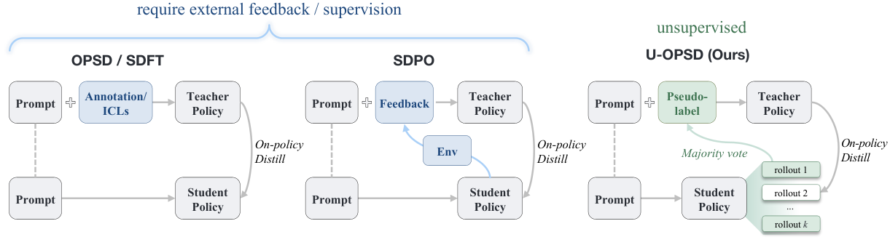
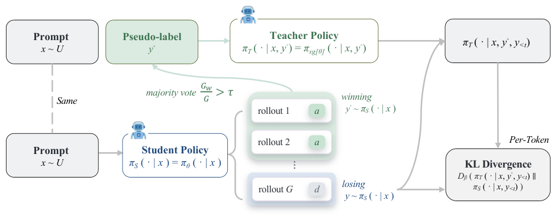

# Paper精读｜U-OPSD: On-Policy Self-Distillation without Any Supervision

> [!abstract] 一句话结论
> 提出 **u-OPSD（Unsupervised On-Policy Self-Distillation）**：证明 on-policy 自蒸馏可以**<span class="mark-strong">完全不需要任何外部监督</span>**（无 ground-truth 答案、无环境反馈、无更强教师）——只用模型自身的多次采样 + **内部一致性（多数投票）** 构造伪解。方法：采样 G 个 rollout → 多数投票得伪答案（置信度阈值过滤）→ 用**最短的同意 rollout** 作为教师参考 → 把教师分布蒸馏到学生**最长的错误补全**前缀上，让模型在"自己确信错误的地方"精确自我纠正。<span class="mark-strong">无监督却打平甚至反超有监督方法</span>：AIME24/AIME25/HMMT25/MATH500/AMC23 上，non-thinking 模式超基座 **8.5%/10.7%**（4B/8B），超 OPSD **3.2%/2.3%**；thinking 模式与 OPSD 持平、超 GRPO 0.7%/1.1%。

> [!cite]- 论文信息（点开折叠）
> - **论文标题**：On-Policy Self-Distillation without Any Supervision
> - **arXiv**：2608.06296
> - **链接**：[https://arxiv.org/abs/2608.06296](https://arxiv.org/abs/2608.06296)
> - **作者**：Yijiang Li, Bingyang Wang, Yijun Liang, Yunjie Tian, Di Fu, Nuno Vasconcelos
> - **机构**：UC San Diego / Georgia Tech / University of Maryland / ByteDance
> - **日期**：2026-08-06

---

## 1️⃣ 论文想解决什么问题

OPD/OPSD（on-policy self-distillation）是 LLM 后训练的强方法——在模型自己的生成上训练，减少 train-inference mismatch 和灾难性遗忘，同时保留稠密 token 级监督。**但现有的"自"蒸馏其实并不自**：

- **OPSD**（Zhao 2026）：教师和学生是同一模型，但教师条件化在 **ground-truth 解** 上——特权信息来自外部

- **SDFT**：教师条件化在 ICL 示例上（外部提供）

- **SDPO**：需要环境丰富反馈

- 后续工作（DistiLLM、OPSD 变体、RLSD 等）要么需要更强教师、要么需要 GT、要么需要环境反馈

**核心问题**：模型只是"教师和学生共享参数"意义上的自蒸馏；让教师更强大的信息**仍来自模型外部**。这卡住了两件事：

1. 无标签问题的可扩展性（不能用于无标注语料）

2. 监督昂贵/不可靠/不可得的领域的适用性

**论文的问题**：OPSD 的教师真的需要 ground-truth 解吗？模型能否自己构造特权上下文、做真正的自蒸馏？

---

## 2️⃣ 核心洞察

> [!important] 核心洞察
> 1. **多数投票 = 内生置信信号**：单个 rollout 不可靠，但**多个独立采样的共识**提供无监督置信度——"agreeing rollouts 多于 disagreeing"本身就是"模型知道答案"的证据。这是从 self-consistency（Wang et al. 2023）到训练信号的桥接。
>
> 2. **投票划分出"能力前沿"（competence frontier）**：过滤掉两类样本——① 投票不充分一致（c(x) < τ，伪解不可靠）；② 所有 rollout 已一致（Y⁻ 空，无分歧可纠正）。**训练只聚焦"模型能稳定识别合理解、但仍给冲突轨迹分配可观概率"的提示**——这个课程天然从投票统计涌现，无需外部难度标签。
>
> 3. **"<span class="mark-strong">最短正确补全 → 最长错误补全</span>"的精确纠正**：教师参考选**最短的同意 rollout**（简洁=高质量信号），蒸馏目标作用于**最长的不同意（错误）rollout 前缀**——在模型"确信错误"的地方给最大修正信号。这是对"错误最长=错得最远=最需要纠正"这个直觉的形式化。
>
> 4. **蒸馏的是"解条件化的 next-token 分布"，不是简单模仿**：与多数投票自训练（直接 teacher-forced 模仿选中响应）不同，u-OPSD 沿学生自己的（错误）轨迹转移解条件化的条件分布——**稠密 token 级监督 + on-policy 轨迹**，OPD 的优点一个不落。
>
> 5. **<span class="mark-strong">共识作为特权上下文的增益 > 标量奖励</span>**：label-free RL 基线（TTRL/RENT/Intuitor）在同样 rollout 预算下最多提升 1.5 点，而 u-OPSD 提升 8.5-10.7 点——**共识解作为 token 级蒸馏的教师上下文，远比把它压缩成标量奖励更有效**。



*Figure 1（动机图）：现有方法的外部监督来源（GT 解/ICL/环境反馈）与 u-OPSD 的"零监督"对比——u-OPSD 的特权上下文完全来自模型自身的 rollout 共识。*

---

## 3️⃣ 方法解读

### 组件1：三步管线（Sample → Vote → Distill）

**(1) Sample**：对每个提示 x，以训练温度采样 G 个 rollout y⁽¹⁾…y⁽ᵍ⁾ ~ π̄(·|x)（π̄ = stop-gradient 策略），解析最终答案 a⁽ᵍ⁾ = Ans(y⁽ᵍ⁾)（从 \boxed{...} 提取 + 规范化/标准化；∅ 标记无法解析的 rollout = 截断产生的无效样本）。

**(2) Vote**：有效答案间多数投票得伪答案 ã(x)（平局随机打破）。划分：

- Y⁺_x = {同意 ã 的 rollout}，Y⁻_x = {不同意 ã 的 rollout}，无效 rollout 两边都不算

- **自一致性分数** c(x) = (1/G)·Σ 𝟙[a⁽ᵍ⁾ = ã(x)]——注意**按总 rollout 数 G 归一化**而不是按有效数：截断本身就是扣分项，c(x) < τ=1/2 的提示视为无标签、不产生梯度

**(3) Distill**：挑一个同意 rollout y⁺ ∈ Y⁺_x 当教师参考（顶替 OPSD 里的 GT 解 y⋆），蒸馏发生在学生的不同意 rollout Y⁻_x 上：

```
L_u-OPSD(θ) = Σ_{i∈W_k} Σ_{t=1}^{|y⁽ⁱ⁾|} D_β( π̄(·|x, y⁺, y⁽ⁱ⁾_{<t}) ‖ π_θ(·|x, y⁽ⁱ⁾_{<t}) )
```

- 教师 = 条件化在 (x, y⁺, 学生轨迹前缀) 的 stop-gradient 模型——**"沿着学生自己的错误轨迹"**把解条件化的 next-token 分布传下去

- W_k = 只包含不同意 rollout 的窗口（错误补全）

### 组件2：与 OPSD 的形式对比

- OPSD：教师条件化在 (x, y⋆)（GT 解）；u-OPSD：教师条件化在 (x, y⁺)（投票伪解）——形式上只换了这一个上下文，监督依赖就整个拆掉了

- OPSD 需要标注对 (x, y⋆)；u-OPSD 只需要无标签 x

- 两者都共享参数、都在 on-policy 轨迹上给稠密 token 监督

### 组件3：与 OPD 家族的关系定位

- **OPD**：外部更强教师，c = x（学生只看到问题）

- **OPSD**：同模型教师 + GT 特权上下文

- **u-OPSD**：同模型教师 + **模型自造的**特权上下文——"真正的自蒸馏"

### 优势估计

- **零监督成本**：无标注需求，可扩展到任意无标签语料

- **训练-推理一致**：与 OPSD 相同——学生只条件化在 x 上，推理时无特权信息

- **天然课程**：投票统计自动聚焦"能力前沿"，无需外部难度信号

- **与 RLVR 的互补**：GRPO 在"可验证奖励"可用时很强；u-OPSD 在奖励不可得时提供稠密监督替代——两者可组合（u-OPSD 构造伪标签 + GRPO 验证）

---

## 4️⃣ 实验部分怎么读

### 实验设置

- **模型**：Qwen3-4B / Qwen3-8B（base），另测 Qwen3-30B-A3B-Instruct-2507 等指令微调模型

- **模式**：thinking 与 non-thinking 两种推理模式分别评测

- **基准**：AIME24、AIME25、HMMT25、MATH500、AMC23（五个数学竞赛/推理基准）

- **基线**：有监督（SFT、GRPO、OPSD）+ 无监督 RL（TTRL、RENT、Intuitor）——同 rollout 预算

### 核心结果

**Non-thinking 模式（Table 1）——无监督反超有监督**

| **方法** | **Qwen3-4B Avg** | **Qwen3-8B Avg** |
| --- | --- | --- |
| Base | 41.0（推算） | 43.6（推算） |
| + SFT (GT) | ~42 | ~45 |
| + GRPO (GT) | ~46 | ~52 |
| + OPSD (GT) | ~46 | ~52 |
| + TTRL / RENT / Intuitor (无监督 RL) | ≤ +1.5 | ≤ +1.5 |
| **+ u-OPSD (无监督)** | **49.49**（+8.5） | **54.31**（+10.7） |

- **关键解读**：u-OPSD 用**零监督**超过了所有用 GT 的监督基线（SFT/GRPO/OPSD）——超 OPSD 3.2/2.3 点；无监督 RL 基线最多提升 1.5 点。**"共识构造的教师上下文 + 稠密 token 蒸馏" > "标量奖励压缩共识"**，差距不是零点几个点，是一整个量级。

- 5 个基准中 u-OPSD 在两个模型上各拿 4 个最优——增益一致，不是某一两个基准上的运气。

**Thinking 模式（Table 2）——与有监督打平**

| **方法** | **Qwen3-4B Avg** | **Qwen3-8B Avg** |
| --- | --- | --- |
| Base | 74.85 | 76.09 |
| + GRPO | 76.35 | 76.92 |
| + OPSD | 76.20 | 77.97 |
| **+ u-OPSD** | **77.05**（+0.9 vs OPSD） | **77.99**（持平 OPSD，+1.1 vs GRPO） |

- **关键解读**：thinking 模式基座更强（74.85 vs 41.0），提升空间小——u-OPSD 仍打平/略超有监督。论文的解释说得通：**共识蒸馏在"基座足够可靠能产生有信息量的共识、但仍有提升空间"时最有效**——thinking 模式余量已经不大。

**指令微调模型（Table 3）**：Qwen3-30B-A3B-Instruct-2507 上同样提升——方法不限于 base 模型。

### 训练曲线（Figure 3）

- 前 4 个 checkpoint 的 AIME24/AIME25/MATH500 曲线：u-OPSD 在 non-thinking 模式快速拉开差距，thinking 模式稳定略优——与表 1/2 一致。



*Figure 2（方法总览）：采样 G 个 rollout → 解析答案 → 多数投票得伪答案（置信度阈值过滤）→ 选最短同意 rollout 作教师参考 → 在最长错误补全上蒸馏解条件化分布。*

---

## 5️⃣ 学术评价

**优点：**

1. **"自"字第一次名副其实**：特权上下文完全内生（投票共识），OPSD 对 GT 解的依赖被打断。OPSD 论文留下的那个问题——"教师需要 GT 吗？"——答案是不需要。

2. **赢的档次不对**：无监督超过有监督基线（+3.2/+2.3 vs OPSD）——不是"无监督勉强追上有监督"，是反超。"监督信息是蒸馏的必要输入"这个隐含假设被正面挑战了。

3. **课程是自己长出来的**：投票统计天然圈出"能力前沿"（能认出解、但仍有分歧），外部难度标签和调度都不用——这一手我很买账。

4. **"最短正确→最长错误"有信息论直觉撑腰**：简洁参考 = 高质量信号；最长错误 = 修正需求最大——修正信号被投放到最需要它的地方。

5. **与 RLVR/GRPO 正交**：无监督伪标签 + 可验证奖励可以叠着用，"奖励不可得"的领域有了稠密监督的替代品。

> [!ed-warning] 局限（风险与不确定性）
> 1. **答案可解析假设**：Ans(·) 提取依赖 \boxed{...} 这类可解析格式——只适用于**答案有明确格式的数学/推理任务**；开放式任务（写作、代码、对话）无法投票
>
> 2. **投票有效性依赖基座能力**：基座太弱时共识本身不可靠（c(x) < τ 过滤大量样本 → 训练数据稀缺）；基座太强时无分歧可纠正（提升空间小）——**u-OPSD 只在"中间能力带"最有效**，论文也承认 thinking 模式增益小
>
> 3. **共识 ≠ 正确**：多数投票的伪答案可能是**系统性错误**（模型集体犯同类错误）——与 RLVR 的可验证奖励不同，无外部纠错；论文未讨论"共识错误"的污染风险
>
> 4. **采样成本**：G 个 rollout/提示 + 双上下文前向（教师+学生）——训练成本高于 GRPO，与 OPSD 同级但都明显贵于 SFT
>
> 5. **基准面窄**：全部是数学推理基准；代码、agentic、多模态领域的验证缺失

---

## 6️⃣ 局限与可扩展方向

- **共识正确性的保障**：与 RLVR 结合（共识伪标签 + 可验证奖励二次确认），或交叉验证（分两组投票互验）

- **开放式任务的投票信号**：无 \boxed 格式的任务如何定义"答案一致"（嵌入相似度、语义等价）？

- **多粒度蒸馏窗口**：目前选最长错误补全；能否按"错误程度"分层（部分正确轨迹给部分监督）？

- **与 AgentOPSD 的融合**：u-OPSD 的投票共识 vs AgentOPSD 的技能条件化——两者都在构造"特权上下文"，可否统一为"自监督信用分配"框架？

- **规模化验证**：更大模型（30B+）与更多领域（代码/数学/agent）

---

## 与其他论文的对话

| **相关工作** | **关系** | **差异** |
| --- | --- | --- |
| **OPSD (Zhao 2026)** | 直接前身 | OPSD 教师条件化在 GT 解上；u-OPSD 用投票伪解替换 GT——无监督反超 3.2/2.3 点 |
| **SDFT / SDPO** | OPD 家族 | 分别需要 ICL 示例/环境反馈；u-OPSD 两者都不要 |
| **GRPO (DeepSeek 2025)** | RLVR 代表 | GRPO 需要可验证奖励（GT 答案）；u-OPSD 在无奖励时提供稠密监督替代 |
| **TTRL / RENT / Intuitor** | 无监督 RL 基线 | 把共识压缩成标量奖励，最多 +1.5 点；u-OPSD 用它做教师上下文，+8.5~10.7 点 |
| **Self-Consistency (Wang 2023)** | 投票方法论来源 | SC 是推理时解码策略；u-OPSD 把共识从"解码时"升级为"训练时特权信号" |
| **AgentOPSD（2608.05987）** | 同日 OPD 家族 | AgentOPSD 用技能条件化构造特权上下文（agentic）；u-OPSD 用投票共识（数学）——两种"无监督特权上下文"路线 |
| **W2S-OPD（2607.26246）** | OPD 家族源头之一 | W2S-OPD 用弱/强模型对比构造 proxy teacher；u-OPSD 用投票共识——"教师从哪来"的三种答案 |

---

## 7️⃣ 最后总结

u-OPSD 的贡献是一个干净的概念跃迁：**自蒸馏的"自"第一次名副其实**——<span class="mark-strong">教师参考、学生轨迹、置信度信号全部来自模型自身的采样一致性</span>，没有任何外部输入。更难得的是它在实证上赢了：无监督反超所有有监督基线（non-thinking +8.5/+10.7 vs 基座、+3.2/+2.3 vs OPSD），证明"共识构造的特权上下文 + 稠密 token 蒸馏"这条路径比"标量奖励压缩共识"（无监督 RL）和"外部 GT 特权"（OPSD）都强。局限也摆得清楚：依赖可解析答案格式、在基座能力的"中间带"最有效、共识可能系统性错误。对做后训练/蒸馏的人，这篇的价值在于**给出了"监督在蒸馏中可能不是必需品"的证据**，并铺了一条零标注的实操路径——和 AgentOPSD、W2S-OPD 放在一起看，OPD 家族正在整体走向"无监督化"。

---

## 8️⃣ 三句速记

> [!summary]- 点开展开
> 1. **真正的自蒸馏**：教师参考、学生轨迹、置信度全部来自模型自身采样 + 多数投票——零外部监督，无监督反超 OPSD 3.2/2.3 点。
>
> 2. **投票划分能力前沿**：只训练"能稳定识别合理解、但仍有分歧"的提示——课程从投票统计自动涌现，无需外部难度标签。
>
> 3. **最短正确 → 最长错误**：选最短同意 rollout 作教师，在最长错误补全前缀上蒸馏——在模型"确信错误"处精确投放修正信号。
