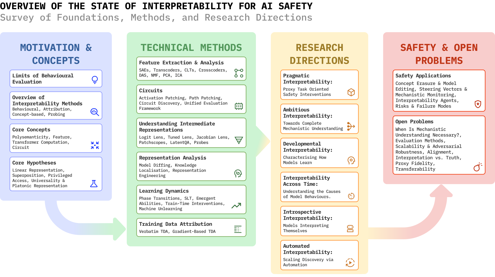
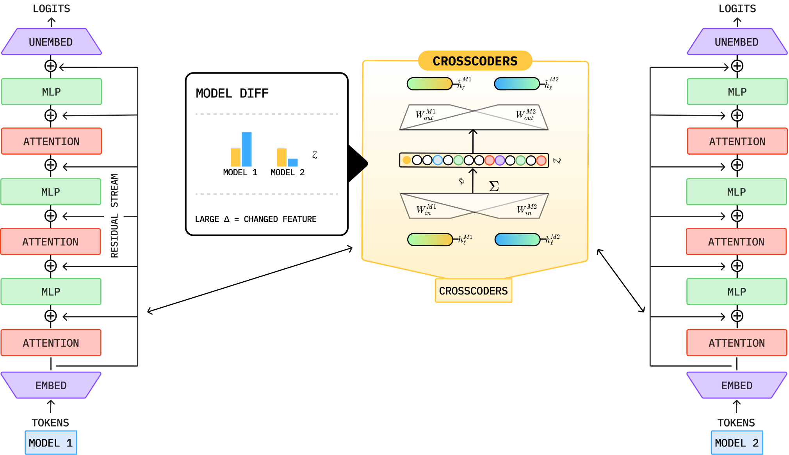
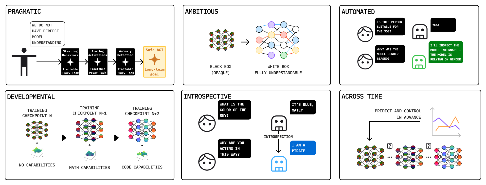

# Paper精读｜Understanding AI from the Inside: The State of Mechanistic Interpretability for AI Safety

> [!abstract] 一句话结论
> 这篇综述的核心结论不是“看懂模型就能保证安全”，而是：**机制可解释性为行为评测补上内部表征、计算路径和因果干预证据，但现有解释既不完整、也不够稳健或可扩展，理解本身更不等于控制；它应与行为评测、训练治理和部署防护组成纵深防御。**

> [!cite]- 论文信息（点开折叠）
> - **论文标题**：Understanding AI from the Inside: The State of Mechanistic Interpretability for AI Safety
> - **arXiv**：2611.08438v1（cs.CL），2026-11-05
> - **链接**：[https://arxiv.org/abs/2611.08438](https://arxiv.org/abs/2611.08438)
> - **HTML 全文**：[https://arxiv.org/html/2611.08438](https://arxiv.org/html/2611.08438)
> - **作者**：Fazl Barez、Tung-Yu Wu、Hunar Batra、Gabriele Dominici、Florent Draye、Yanai Elazar、Damiano Fornasiere、Antía García、Abir Harrasse、Riley Harris、Sara Hooker、Michael Lan、Belinda Z. Li、Aaron Maiwald、Narmeen Fatimah Oozeer、Naomi Saphra、Or David Shafran、Adi Simhi、Robert Trager、Shriyash Kaustubh Upadhyay、Ziyu Yao、Yu Zhao、Shay B. Cohen、Mor Geva、Yoshua Bengio、Stella Biderman、Hassan Sajjad
> - **机构**：University of Oxford、Martian、Università della Svizzera italiana、Max Planck Institute for Intelligent Systems、Bar-Ilan University、LawZero、Adaption Labs、MIT、Anthropic、Boston University、Tel Aviv University、Technion、George Mason University、University of Edinburgh、Mila / Université de Montréal、EleutherAI、NYU Abu Dhabi / Dalhousie University
> - **通讯作者**：Fazl Barez（论文署名页）
> - **论文类型**：机制可解释性与 AI 安全综述（survey）；不是提出单一新算法或报告统一新实验的实证论文
> - **阅读范围**：正文 §§1–15、附录 A–C。附录 A 是符号表，B 解释图示及引文证据颜色，C 补充因果推断、局部学习系数和信息论基础。参考文献未逐篇重新核验；论文中的既有研究结果按“作者转述”理解。

---

## 论文分类标注与阅读导航

- 研究类型：领域综述 + 评估框架提案 + 安全应用与风险分析。

- 领域归属：AI 安全 / 可信 AI → 机制可解释性（Mechanistic Interpretability, MI）→ 特征、回路、训练动态、数据归因与安全干预。

- 核心问题：“知道模型内部怎么算”到底能否带来比“只测它输出什么”更可靠的安全保证？在哪些场景值得付出机制分析成本？

- 文章的三层贡献：① 系统整理方法谱系与基础假设；② 提出五维评估框架、划分六种研究取向；③ 将安全收益与认识论、部署、对抗及资源分配风险放在同一框架中讨论。

- 证据等级提醒：论文以橙色标注正式发表成果、绿色标注预印本/技术报告/工作坊/博客等尚未经过正式同行评审的研究输出。综述里的例子和数字，不等于作者在本文中重新跑过实验——读的时候随时记着这一条。

---

## 1️⃣ 论文想解决什么问题

行为评测观察的是有限输入集上的输入—输出关系。它擅长发现模型“在这里做错了什么”，却无法单凭分数判断模型是靠稳健机制、数据记忆、捷径，还是对评测环境的识别来得到答案。训练集污染、基准饱和、评测意识、分布外失效与缺乏精细控制，都会让高分不足以推出部署安全（§2）。一个模型在测试集上拒绝有害请求，这个结果证明不了它在陌生触发条件下也没有有害能力。

机制可解释性试图把证据往内部推进：找到可重复的特征，追踪组件间信息流，再用消融、patching、steering 等干预检验这些内部结构是否真的影响行为。论文的关键限定——也是我建议每个读者都背下来的一句——**知道信息可读出，不等于模型使用了它；干预能改变行为，不等于完整机制已被解释；机制解释成立，也不等于已证明模型安全。**

---

## 核心框架：从观察到可审计的因果主张

*Figure 2：文章把基础概念、技术方法、研究方向与安全应用/开放问题连接起来；它是全文结构图，不是新实验结果。*

### 行为评估与内部解释的证据阶梯

| **证据层次** | **典型问题** | **可支持的结论** | **单独不能支持的结论** |
| --- | --- | --- | --- |
| 行为评测 | 模型在测试输入上表现如何？ | 特定分布上的输出、错误和回归 | 错误由哪个机制导致；未测输入上安全吗 |
| 输入归因 / saliency | 哪些输入部分与输出相关？ | 输入 token、像素或特征的影响线索 | 模型内部如何加工这些信息 |
| Probe / lens / verbaliser | 激活里能读出什么？ | 某信息在表示中可解码或可描述 | 模型实际使用了它，或解释忠实 |
| 定位与干预 | 修改某层/方向/特征会怎样？ | 在给定条件下的因果影响 | 找到的是唯一、完整且可迁移的机制 |
| 回路与因果抽象 | 哪些组件共同实现行为？ | 有范围限定的内部机制解释 | 对未覆盖情形、替代路径或未来模型的安全保证 |

这张阶梯表是全文的底盘。机制解释的强弱取决于覆盖范围、替代解释、干预特异性和跨条件稳健性；“图画得清楚”不是验证标准。

### 论文提出的五维评估框架（§7.5）

| **维度** | **要回答的问题** | **代表性测量** | **常见误读** |
| --- | --- | --- | --- |
| 归因忠实度 | 解释的重要性分数是否对应真实干预效应？ | 分数—干预效应相关、效应大小误差、反事实效应恢复 | 相关不等于完整解释；分母接近零时比例指标不稳定 |
| 完整性 | 解释覆盖了多少目标行为或激活？ | loss recovery、行为覆盖率、未解释方差 | 低重构误差不等于重建了原模型的计算 |
| 稳定性 | 换随机种子、超参、提示改写后结论是否一致？ | 跨种子特征对齐、超参敏感度、改写一致性 | 单次跑出的漂亮 feature 可能只是偶然解 |
| 因果有效性 | 目标部件是否必要、充分且特异？ | 消融、只保留目标回路、目标/非目标副作用 | 必要性或充分性单项结果都可能受冗余路径影响 |
| 人类可解释性 | 人是否因此更会预测、调试或一致地理解模型？ | 预测增益、错误修复率、标注者一致性 | 自然语言解释流畅不等于人真的理解了机制 |

这是作者提出的评估框架，不是已经被社区采纳的标准化 benchmark。指标阈值、任务选择、人类评估成本、不同目标间的可比性，都还没解决（§7.5.4、§14.2）——拿它当检查表用可以，拿它当排名榜用不行。

---

## 基础概念与四项核心假设

### Transformer、特征与回路

MI 的全套工具都挂在残差流这个概念上：把它当作各层共享的信息通道，每层只管往里写自己的贡献。省掉归一化细节，经典 Transformer 就剩两行：

$$h'_{\ell}=h_{\ell-1}+\mathrm{Attn}_{\ell}(h_{\ell-1}),\qquad h_{\ell}=h'_{\ell}+\mathrm{MLP}_{\ell}(h'_{\ell}).$$

展开后，每层 attention 与 MLP 都向残差流写入加性贡献。注意力主要做跨 token 的信息路由与聚合，MLP 做逐位置的非线性变换。提醒一句：这是便于分析的简化视角，不是所有现代 Transformer、MoE、GQA 或 MLA 的完整实现（§4.4）。

论文把“特征”定义为激活空间中的几何结构：它既要能预测某概念的出现，也要对相关行为有因果关联——两条腿缺一不可，probe 解码成功只满足可读出那条腿。Circuit 是由头、MLP 或特征节点及其信息流组成的计算子图；task-level circuit 解释一类行为，query-level circuit 追踪单一输入的计算，两者不能混为一谈（§4.3–4.5）。

### 四项假设不是定理（§5）

1. 线性表征假设：部分概念能由激活空间中的方向表示，投影大小近似反映特征强度。它让线性 probe、SAE 与 steering 可行；但非线性组合、分布式子空间和算法性表征构成边界。弱版本比“所有概念都线性”可信得多。

2. 超叠假设：概念特征数可能远多于神经元维度，多个方向共享表示空间，用来解释神经元多义性。多义性与 SAE 可提取许多特征是支持线索，却不能单独证明超叠是成因；没有超叠，特征学习和神经元多义也可能出现。

3. 特权访问假设：模型可能在特定训练/提示下读取自身内部信息。自我报告有时有效，但 probe、activation-reading 工具和模型自我预测也存在失败；语言流畅的“内省”不能当内部访问证据用。

4. 普遍性 / 柏拉图表征假设：相似任务可能令不同模型收敛到相似表征或算法。相似电路给弱普遍性提供线索；强普遍性证据更弱，受架构、数据、优化轨迹与相似度度量影响。

作者自己把话说得很清楚：这些是**指导研究的方法论假设，尚未被严格证明**。论文没有建立一套统一、已验证的“真实特征本体”。

---

## 方法解读：从激活分解到训练数据归因

### 1. SAE：稀疏分解是候选特征，不是“真实神经元”

SAE 押的是这件事：激活其实能由少量字典方向拼出来。为此学一对编码器解码器，用重构误差和稀疏惩罚一起训练：

$$z=E(h),\qquad \mathcal L_{SAE}=\mathbb E[\|h-D(z)\|_2^2+\lambda\|z\|_1].$$

重构项逼着稀疏字典保住原激活，$L_1$ 项让每个输入只点亮少数潜变量；过完备字典允许特征数大于残差维度。解码器列必须规范化，不然可以缩小 $z$、放大 $D$ 来“投机”降低稀疏惩罚，实际一点没变稀疏（§6.1–6.2）。

- Gated SAE 将是否启用与激活幅度分开，缓解 $L_1$ shrinkage，但需要额外门控与辅助损失。

- JumpReLU 学阈值决定特征是否为零，使用 straight-through estimator，仍需调参。

- Top-k / BatchTop-k 直接限制每样本或每批的活跃特征数；前者要选 $k$，后者让不同样本按难度分配稀疏预算。

论文转述的失效模式，读的时候最好都记一笔：死特征在不佳设置下可达 10–50%（示例激活率阈值 <0.01%）；特征重复、父特征被子特征吸收/拆分，以及不同随机种子得到不同字典（部分研究报告跨种子一致特征常不足 50%）。这些是综述引用的经验报告，不是固定普遍常数。更根本的一条是不可辨识性：多个稀疏分解可能都能重构同一激活，却给出不同“特征”。所以必要性、充分性、特异性、跨种子稳定和下游任务效用得另外测（§6.5）。

### 2. Transcoder、CLT、Crosscoder：分析“表示”还是“变换”

- Transcoder 学 MLP 输入特征如何生成输出：$z=E(h^{in})$，$\hat h^{out}=W_{out}z+b$。相较在某层静态激活上训练 SAE，它更直接覆盖组件的非线性输入—输出映射。

- Cross-layer transcoder（CLT） 让较早层特征向本层及后续层 MLP 输出写入，可形成跨层 attribution graph。好处是跨层计算好追踪了；代价是模型规模、训练成本和替代模型保真度风险。论文特别提醒，局部精确匹配依赖冻结原模型 attention pattern、缓存 normalization 统计和逐层误差校正；这不代表 CLT 全量替代原模型时普遍等价。综述举的两个数很能说明问题：18 层小 Transformer 的 CLT top-1 一致率约 50%；Gemma-2-9B CLT 训练约 3,844 H100 GPU-hours（50% FLOPs efficiency）。方法能做细粒度分析，但当前成本与代理保真度都不能忽略。

- Crosscoder 将多层（或多模型）输入投影到共享潜空间，适合研究跨层特征与 model diffing；acausal 版本可以比较层，但不等同真实前向因果路径。

选工具前先问自己：问题是“这一层有哪些可解码特征”，还是“这个组件如何改变表示”，或“信息如何跨层传播”？SAE、transcoder、CLT、crosscoder 不产生可互换的解释对象。

### 3. Circuit discovery：重要边图必须经过因果核验

Activation/path patching 将干净输入激活与损坏输入激活互换，测目标行为指标变化；ACDC 逐边判断是否剪枝，直观但计算昂贵且受阈值/顺序影响。EAP 以梯度与干净—损坏激活差的内积作一阶 Taylor 近似，能高效并行给边打分，却可能漏掉强非线性交互。

回路**必要性**：消融后目标行为受损；回路**充分性**：只保留候选回路并把其余部分换成损坏激活，行为仍可复现。真实回路常受冗余路径、上下文与边界例影响，论文引用的概括中常只能解释约 60–80% 行为方差——这个范围不能当固定目标使。Causal scrubbing 和 interchange intervention 用来检验高层机制假设能否对应底层干预。发现一个归因图不等于完成证明：图可能只解释输入特定的路径，或依赖 CLT 对原模型计算的近似（§7）。

### 4. Lens、Patchscopes 与 Probe：读得出不等于模型用得上

- Logit Lens 把每层残差状态直接投影到最终词表；简单，但假设了中间层已适合最终解码。

- Tuned Lens 为各层学习映射，使预测接近最终输出；它可能把中间过程过度翻译成终点，低 KL 不等于忠实展示内部算法。

- Jacobian Lens 用隐藏状态对最终状态的局部雅可比，尝试解释当前表示会推动什么输出；属于局部线性影响，词级限制与层位依赖仍在。论文给的 Claude Sonnet 4.5 例子中，信息层段约占深度 38–92%——单模型数字，不可推广到别处。

- Patchscopes / LatentQA 把激活注入检查提示，或微调 verbaliser 把激活说成文字。流畅解释仍可能来自分布外注入、提示偏差、记忆或从原输入猜答案，需用反事实激活和不同提示独立核验。

*（原图未能本地化：Figure 11：Patchscopes 从源提示提取中间表示，再移植至检查提示以观察可解码内容；该资源曾被明确限制访问，未再次获取）*

*Figure 11：图中用“United Kingdom”表示示例展示激活移植；它说明方法流程，不单独证明语言解释忠实。*

- Probe 准确率只说明信息可解码，不证明下游模型实际用它。控制任务、selectivity、简单 probe、跨种子测试、amnesic probing 与 activation patching 能增强证据；冗余信息和副作用仍须检查。论文转述 sleeper-agent 探针 AUROC >99% 的结果，是特定构造实验的检测证据，不是一般欺骗检测保证（§8）——这两个字的差别，在安全语境里是全部的差别。

### 5. Model diffing、定位与 steering

Model diffing 试图找微调前后、不同规模/架构间出现或变化的表征。难点在特征方向可能旋转，SAE/crosscoder 的分解也会制造“新特征”假象；发现一个模型独有 latent，只能算一条待核验假设。Knowledge localisation 找到对目标事实或行为影响较大的层、MLP、子空间，但信息可能冗余分布在多个组件；“干预这里影响最大”推不出“知识只存这里”（§9.1–9.2）。

*Figure 14：特征激活差异可提示模型变化，但方向旋转、字典分解伪差异仍需因果验证。*

steering 的标准做法便宜得直接：偏好样本和非偏好样本的残差均值一减，就拿来当方向用：

$$v_{steer}=\mathbb E[h_\ell\mid preferred]-\mathbb E[h_\ell\mid unpreferred],\qquad \tilde h_\ell=h_\ell+\alpha v_{steer}.$$

它可以在不更新权重的情况下改拒答、语气或迎合行为，也顺带充当候选特征的因果探针。但一个方向里可能混着好几个因素，还常受提示分布漂移影响，所以要同步看目标收益、非目标能力损害、反向/随机方向基线和分布外输入。**行为被 steering 改了，不代表这个方向就是某个单一概念的完整实现。**

### 6. 学习动态与训练数据归因

固定终态只能看到模型最后是什么；checkpoint 纵向分析才能观察表示何时形成、稳定或漂移。能力专属连续指标、逐样本 loss、refined Local Learning Coefficient（LLC）及分叉续训可定位候选跃迁与机制形成时间。作者特别提醒的一点很容易被忽略：许多“早期预警”是训练结束后回溯找到的信号；只有预先登记并在未观察的未来训练上验证，才算前瞻预测。行为跃迁可能来自多个组件平滑变化的叠加，不能仅凭曲线拐点断言单一机制突变（§10）。

训练数据归因有两类不同证据：**OLMoTrace** 找生成文本与语料的最长逐字匹配，支持“这段文字在语料中出现过”，不证明模型唯一依赖该来源；**influence function / PBRF / GGN、K-FAC、TRAK、TracIn** 估计训练样本对参数或测试行为的敏感度。后者最经典的路子是影响函数——问的是「把这个样本的权重抬高一点，测试行为会怎么动」：

$$\mathcal I_M(z_m,z_{test})=-\nabla_\theta M^T H^{-1}\nabla_\theta\mathcal L(z_m,\theta^*).$$

它来自对样本权重 $\epsilon$ 的一阶扰动，依赖局部最优、可微、Hessian 可逆和小扰动这些条件；而神经网络的 Hessian 常常是病态的。PBRF 用输出空间 Bregman 距离加 $\lambda I$ 正则，得到 $G+\lambda I$（GGN），构造上保证可逆，但终究是代理目标下的局部估计。TracIn 拿训练轨迹上的梯度内积近似影响，绕开了 Hessian 求逆，精度受 checkpoint 采样和一阶近似影响（§11）。

---

## 六种研究取向：目标不同，不应争一个“最佳方法”（§12）

| **取向** | **主要目标** | **优势** | **关键风险/边界** |
| --- | --- | --- | --- |
| Pragmatic Interpretability | 用 proxy task 找当下可用安全干预 | 可较快产生实际安全收益；不要求先完整理解 | 干预有用不等于解释机制 |
| Ambitious Interpretability | 完整、可预测的内部算法理解 | 科学目标明确，强调 faithfulness 与 simulatability | 当前成本高，frontier 模型覆盖不足 |
| Developmental Interpretability | 解释表示、能力如何在训练中形成 | 观察阶段、相变与有效复杂度 | 以科学解释为主，不自动预测/控制未来行为 |
| Interpretability Across Time | 预测并干预训练中的安全相关轨迹 | 争取在不良行为显现前预警/干预 | checkpoint 与训练数据难获取；回溯式证据多 |
| Introspective Interpretability | 让模型报告自己的内部状态 | 访问门槛低，适合假设生成与快速分诊 | confabulation、校准差、提示敏感、策略性误报 |
| Automated Interpretability | 自动发现、解释、审计大量特征/回路 | 覆盖面与规模潜力大 | 错误可批量传播、automation bias、反馈回路 |

*Figure 17：六种取向各自优化目标与时间尺度不同，不存在对所有任务都占优的单一路线。*

这张表最大的用处是止争：内省方法应经独立机制与行为证据核验；自动化要保留抽样人工审核、跨解释器一致性、因果检查、对抗测试、校准与监管版本记录。最合理的分工是自动化提供 breadth，人类负责深度、目标设定与异常审查；六种路线可以混合，取决于问题、成本、访问权限和容忍的不确定性。

---

## 从理解到安全干预：能做什么，不能承诺什么（§13）

1. 概念擦除（PISCES）：用 SAE 找目标概念特征，在 MLP 输出向量中识别对应部分，再将目标特征系数反向后重构，试图比“只压住输出”更精确地移除概念。作者展示的是流程与引用结果，不等于本文对所有概念重新实验；是否完全消除、能否被提示重新学回，仍要做行为与副作用测试。

2. 知识编辑（ROME / MEMIT）：通过 causal tracing 定位事实关联影响最大的 MLP，再对局部权重做 rank-one 等编辑。可快速纠错，也可被滥用植入错误信息；早期方法有一般能力副作用，后续方法仍需审计。

3. Steering 与 mechanistic monitoring：前者在推理时加方向改变行为，后者监控特征/回路是否出现危险机制。监控可捕捉尚未外显的内部信号，但“应监控哪些百万级特征”、误报、漏报和被模型规避，都还没有答案。

4. 与 black-box 的关系：prompt、输入/输出过滤、用户风险分级、数据过滤和安全微调各有实用性。黑盒不提供内部机制证据；白盒也不因此普遍更优。互补部署比二选一更合理。

### MI 自身的四类安全风险

| **风险** | **机制** | **例子 / 防护方向** |
| --- | --- | --- |
| 认识论 | 对部分或错误解释产生过度信心 | 报告覆盖边界；“未在 top-10% 归因边中找到”不等于“机制不存在” |
| 部署运行 | 分布漂移时工具静默失效 | 持续监控、对抗测试、与行为防护异构组合、失效时保守降级 |
| 对抗双用 | 解释揭示拒答回路或可编辑权重 | 负责任披露、访问控制、红队测试，不把公开分析视作无风险 |
| 机会成本 | 过度投入昂贵 MI，挤占即时有效措施 | 比较边际安全收益；同时投资行为评估、训练、harness、治理与 MI |

---

## Open Problems 与作者结论（§14–15）

- 何时机制理解是必要条件？若目标是解释内部算法，它显然必要；若只需满足一项可验证安全属性，是否必须先完整理解模型，社区尚无定论。

- 评测标准如何统一？不同方法优化重构、稀疏度、覆盖、因果保真或成本，需建立有 ground-truth circuit 的合成任务与多行为基准。

- 不完整、不可扩展、不可泛化和对抗适应：人类可读的高层因果模型可能丢失神经计算信息；规模、迁移与反解释策略都可能形成长期瓶颈。

- **理解与对齐不是同一个问题：**MI 可帮验证、定位、控制，却不能单独告诉我们“模型应该追求什么”或替代价值/目标规范。

- 解释的本体问题：同一行为可能有多个有效抽象层级；一个符合干预数据的解释未必是唯一真实算法。

- Proxy fidelity：SAE、CLT 等可解释代理可能学出和原模型输出相似、但内部算法不同的计算。因此代理里“没发现 deception circuit”不能推成目标模型没有。

- 超越 Transformer：CNN、Mamba/RWKV、扩散语言模型与 MoE 的计算结构不同；现有工具大多围绕 Transformer 残差流发展，跨架构原理尚未清楚。

作者最后把路线概括为三种互补范式：**post-hoc explanation、studying learning dynamics、interpretability by design**。领域需要可证伪、可复现的科学主张；机制可解释性是防御纵深中的一种方法，不是独立安全认证。

---

## 5️⃣ 学术评价

**优点：**

1. 把"解释"拆成证据强度。全文反复区分可读出、因果影响、必要/充分和完整性，抑制了“特征有名字所以解释了行为”的跳跃——这一条就值得全文通读一遍。

2. 把评测、方法和部署风险接在一起。不仅盘点 SAE / circuits，也讨论自我报告、自动化治理、知识编辑双用和资源机会成本，视野没有停在方法层。

3. **对代理模型问题抓得准。**重构成功不能推出计算忠实；这直接关系到“未发现危险机制”能否作为安全证据——我认为是全文最有杀伤力的一条限定。

4. 框架有可操作性。五维评估与六种取向可以直接当检查表用：设计实验、读论文、判断某个应用成熟度，都能对号入座。

> [!ed-warning] 局限（风险与不确定性）
> 1. 这是一篇范围很广的叙述性综述；正文未给出可复核的系统检索/纳排流程或证据综合统计，因此不能据此断言文献覆盖完整、引用选择无偏。
>
> 2. 五维框架提供的是维度，不是统一量尺。阈值、数据分布、干预基线、效应方向和“人类理解”测量仍依赖任务，跨论文直接排名做不了。
>
> 3. 部分安全应用以概念性案例说明流程；它们展示“如何做”，不应误读成本文已验证规模化部署有效。
>
> 4. 论文覆盖的是截至 2026 年的快速演进领域；对引用成果的结论需回到原研究核对审稿状态、实验设置与后来修订，尤其留意论文自己的橙/绿引文标记。

---

## 附录 A–C 的作用

- A 符号表：统一残差维度 $d$、层数 $L$、序列长度 $T$、SAE 扩展系数与激活、attention 权重等。

- B 图示与证据颜色：蓝色定义、绿色例子、金色洞见、红色警告、青色实践；橙色引文为正式发表成果，绿色引文为预印本/报告/工作坊/博客等。

- C 数学基础：必要性是移除组件后行为消失；充分性是只保留组件时行为出现；因果抽象要求高层干预映射到底层干预后因果效果一致。LLC 以局部低损失参数区域体积随容忍度 $\epsilon$ 缩小的速率刻画局部有效复杂度；熵、互信息和 KL 可度量信息，但本身不建立因果机制。

---

## 8️⃣ 三句速记

> [!summary]- 点开展开
> 1. Probe 能读出 ≠ 模型使用；SAE 重构好 ≠ 原计算被忠实还原。
>
> 2. 因果干预增强机制证据，但必要、充分、特异、稳定、完整是不同验收项。
>
> 3. MI 的安全价值来自与行为评测、训练治理和部署防护互补；它不是单独的安全保证。
