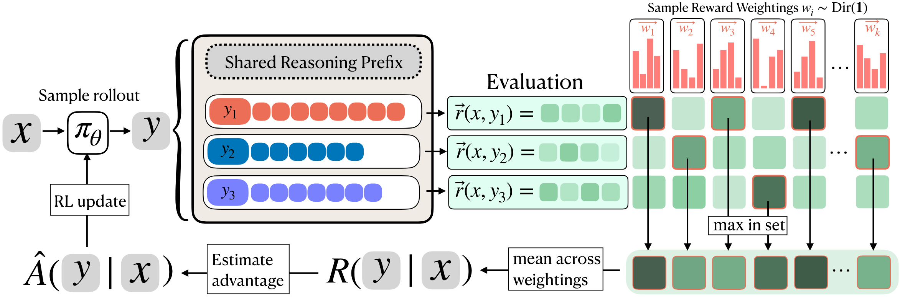
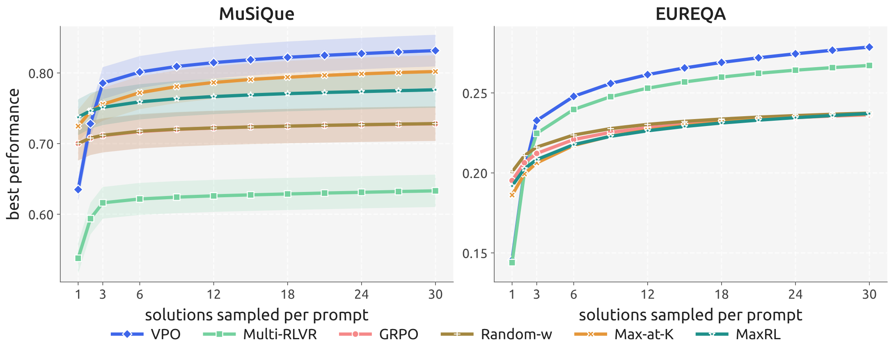

# Paper精读｜Vector Policy Optimization: Training for Diversity Improves Test-Time Search

> [!abstract] 一句话结论
> VPO 把 GRPO 的固定标量奖励换成**随机奖励加权 + 多答案联合生成**，训出一个能铺满 Pareto 前沿的多样化候选集——test-time search（pass@k / best@k / AlphaEvolve）吃的就是这个多样性，性能跟着上去了。

> [!cite]- 论文信息（点开折叠）
> - **论文标题**：Vector Policy Optimization: Training for Diversity Improves Test-Time Search
> - **arXiv**：2605.22817
> - **链接**：[https://arxiv.org/abs/2605.22817](https://arxiv.org/abs/2605.22817)
> - **作者**：Ryan Bahlous-Boldi, Isha Puri, Idan Shenfeld, Akarsh Kumar, Mehul Damani, Sebastian Risi, Omar Khattab, Zhang-Wei Hong, Pulkit Agrawal
> - **机构**：MIT / Improbable AI Lab / MIT-IBM Computing Research Lab / Sakana AI
> - **日期**：2026-05-21

---

## 1️⃣ 论文想解决什么问题

GRPO 这类 LLM post-training 优化的是一个**预定标量奖励**，训到后期策略收敛到少数几个高概率响应，熵掉得飞快。可模型一旦部署进推理时搜索管线（Best-of-N、AlphaEvolve 这类），搜索要吃的是**多样化的优质候选池**——GRPO 训出来的模型再多采几条，几乎全是重复品。论文的核心问题：**怎么让 RL post-training 为推理时搜索「预留多样性」。**

---

## 2️⃣ 核心洞察

> [!important] 三条核心洞察
> 1. **探索与利用应该分离**：利用交给推理时搜索去做，训练阶段专心供货——产出一批多样化、且个个都有本事的候选解。
>
> 2. **奖励天然可分解成向量**：代码生成有 per-test-case 正确性，多跳推理有 per-hop 正确性，RLHF 有 per-criterion 评分。这些维度之间存在真实的 trade-off，正好给多样性提供了天然的坐标轴。
>
> 3. **标量奖励把所有解推向同一点**：GRPO 固定权重 w*，梯度把所有 rollout 往同一个标量最优解上压。VPO 改从 Dirichlet 分布随机采样权重 w，让不同候选在不同 rollout 里「专精」不同的奖励 trade-off，把 Pareto 前沿铺满。

---

## 3️⃣ 方法解读

VPO 拆开看就两个关键组件：

### 组件1：多答案联合生成（Multi-answer generation）

*图 2｜VPO 的多答案训练与随机标量化流程。 [来源](https://arxiv.org/html/2605.22817v1/#S3.F2)*

- 借鉴 Puri et al. 2026：模型在**单次自回归 rollout** 里连着生成 m=3 个候选解，用分隔符隔开。

- 后生成的候选看得到前面已生成的候选——有能力「察觉哪些解空间区域已经被占了，转个方向」。

- 但注意，这只给了多样性**能力**（capacity），没给**激励**（incentive）——实验证明 Multi-RLVR（多答案 + 固定标量奖励）的奖励空间多样性在训练中照样崩塌。

### 组件2：随机奖励标量化（Stochastic scalarization）

- 每个 rollout 从 Dir(1,...,1)（单纯形上的均匀分布）采样权重 w。

- 对候选集 S={y1,...,ym}，奖励定义为 max_i w^T r(xi, yi)——取集合里最好的那个。

- 这一手直接奖励对奖励空间的覆盖：w 一换，最优候选就换一个，模型有激励把候选撒到 Pareto 前沿上。

### 优势估计

- VPO 的 advantage 是对 K 个随机权重采样的平均：A_i = (1/K) * sum_k [max_j (w_k^T r_j) - baseline]

- 它是 GRPO advantage 估计器的**直接替换**（drop-in replacement），训练框架其他部分一个字不用改。

---

## 理论贡献 / 机制解释

论文的关键理论概念是**奖励多样性（reward diversity）**：

- 一个候选池算「奖励多样」，当且仅当里面的解在不同奖励加权 w 下各自最优。

- 形式化定义衡量的是集合覆盖 Pareto 前沿的程度。

论文还配了个**奖励共线性诊断（Reward Collinearity Diagnostic）**：

- 算 on-policy 奖励向量的 off-diagonal Pearson 相关系数。

- 预测：相关系数低（奖励维度真的在互相竞争）时 VPO 赢 GRPO；接近 1（奖励退化成标量）时 VPO 不该赢。

- 实验验证：UltraFeedback 的相关系数 = 0.95，VPO 果然只跟 GRPO 打了个平手——理论预测对上了。

---

## 4️⃣ 实验部分怎么读

### 四个实验域（覆盖不同奖励结构）

| **域** | **模型** | **奖励维度** | **特点** |
| --- | --- | --- | --- |
| Maze（9x9 迷宫导航） | Qwen3-4B | r in R^4（完成+金+钻石+避岩浆） | 人工构造的强制 trade-off |
| MuSiQue（多跳 QA） | Qwen3-1.7B | r in R^5（4跳引用+F1） | 松耦合的多跳推理 |
| EUREQA（5跳链式推理） | Qwen3-8B | r in {0,1}^5 | 因果有序的链式推理 |
| ToolRL（函数调用） | Qwen3-1.7B | r in R^4（结构+F1x3） | Agent 工具调用 |

### 核心结果

*图 3｜MuSiQue 与 EUREQA 的测试时扩展。 [来源](https://arxiv.org/html/2605.22817v1/#S5.F3)*

- **best@k**：VPO 在四个域上全赢 GRPO，而且 k 越大差距越大——GRPO 很快饱和，VPO 还在持续改善。

- **pass@k**：同一个模式，VPO 随 k 增长持续受益。

- **AlphaEvolve（进化搜索）**：VPO 模型能解开 GRPO 模型完全解不动的问题。

- **Multi-RLVR 对比**：光有多答案不够，必须配上随机标量化才养得住多样性。

- **3x 计算公平对比**：给 GRPO 3 倍 rollout（n=24 vs n=8），VPO 照样赢。

- **GDPO 对比**：per-dimension 归一化关不上差距——VPO 赢的不是梯度条件化，是集合级的多样性。

### 训练细节

- 基于 veRL + GRPO 框架，4xH100 GPU，~12h/次，总计 ~2000 GPU-hours。

- VPO 拿 pass@1 换 pass@k——设计使然，用在推理时搜索是系统一环的场景。

---

## 5️⃣ 学术评价

**优点：**

1. 问题定义我买账：「训练负责探索，搜索负责利用」的分工，把「训完的模型不适合搜索」讲成了一个结构性错配，不是调参失误。

2. 方法便宜得少见：随机标量化 + max-in-set 奖励，就是 GRPO 的 drop-in 替换，工程成本几乎为零。

3. 理论不是挂件：reward diversity 的形式化定义 + 共线性诊断，连「VPO 什么时候不该赢」都给了可证伪的预测。

4. 实验设计扎实：四个域覆盖不同奖励结构，3x 计算的公平对比和 Multi-RLVR / GDPO 消融都做了。

> [!ed-warning] 局限（风险与不确定性）
> 先说处境：VPO 的前提是奖励真有多个维度，下面这几条局限多半就是从这个前提里长出来的：
> 1. 吃向量奖励——奖励只有单一标量时，退化成标准 RL。
>
> 2. pass@1 会掉——推理时搜索不在系统里的场景，别用。
>
> 3. 计算等量化不干净——m 个候选共享前缀但长度不同，严格等计算的比较做不精确。

---

## 6️⃣ 局限与可扩展方向

- **标量奖励场景**：能不能用 reward model ensemble 或 synthetic decomposition 造出伪向量奖励？

- **自适应 m**：现在固定 m=3，能不能按任务难度动态调整候选数？

- **与推理扩展的结合**：VPO 训出的策略怎么跟更复杂的搜索算法（MCTS、beam search）配合？

- **在线学习**：能不能推理时按搜索反馈继续调策略的多样性？

---

## 7️⃣ 最后总结

VPO 敢把默认目标改掉，靠的是这个判断：推理时搜索越来越标配，**post-training 的默认目标就不该再是「优化单一标量」，而该换成「优化多样性」**。改动便宜得惊人——GRPO 的固定权重换成随机采样、奖励函数换成 max-in-set，模型就学会把候选铺满 Pareto 前沿。四个域的一致结果，加上连「什么时候 VPO 不该赢」都预测对了的共线性诊断，一起把这个立场撑住了。

---

## 8️⃣ 三句速记

> [!summary]- 点开展开
> 1. GRPO 把所有解推向同一点 → test-time search 的候选池退化。
>
> 2. VPO 用随机奖励加权 + 多答案联合生成 → 训练模型覆盖 Pareto 前沿。
>
> 3. 结果：pass@k / best@k / AlphaEvolve 全面优于 GRPO，k 越大优势越大。
