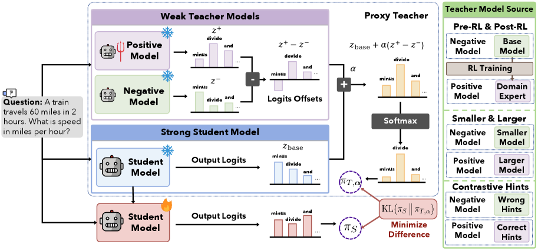
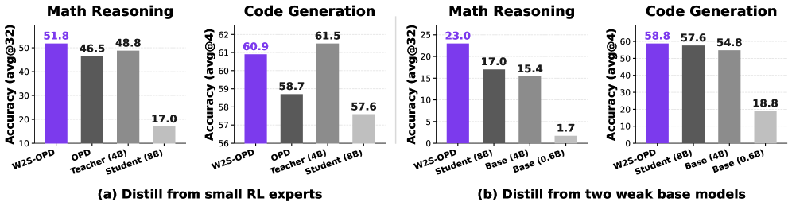
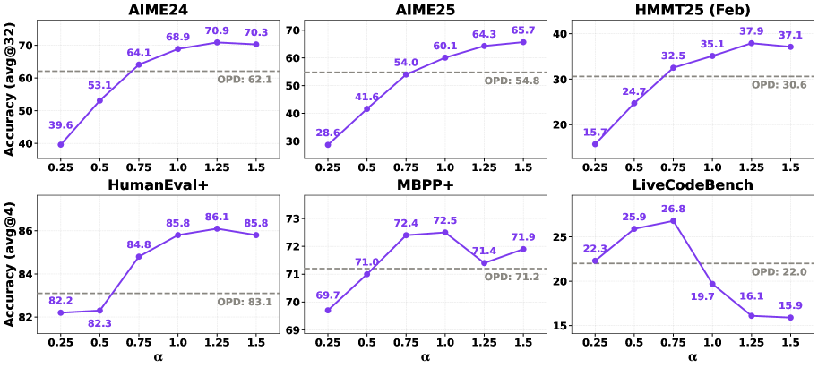
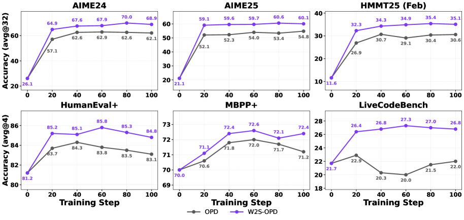

# Paper精读｜Weak-to-Strong On-Policy Distillation

> [!abstract] 一句话结论
> **W2S-OPD（Weak-to-Strong On-Policy Distillation）** 把"教师必须不弱于学生"这条默认前提直接掀掉：拿<span class="mark-strong">**两个比学生更弱的模型**</span>（正/负对比对）的 logit 差值提出"能力方向"（capability direction），叠回学生自己的基模型，拼出一个**代理教师**，学生对着它在自己的 rollout 上做反向 KL 蒸馏。**所有监督源都比学生弱**，强学生照样继续变强，数学推理上甚至<span class="mark-strong">**反超它所学习的领域教师**</span>。

> [!cite]- 论文信息（点开折叠）
> - **论文标题**：Weak-to-Strong On-Policy Distillation
> - **arXiv**：2607.26246
> - **链接**：[https://arxiv.org/abs/2607.26246](https://arxiv.org/abs/2607.26246)
> - **作者**：Fangxu Yu, Zinan Lin, Xiaodong Liu, Weijia Xu, Michael Xu, Tianyi Zhou, Jianfeng Gao
> - **机构**：University of Maryland, College Park / Microsoft Research / MBZUAI
> - **日期**：2026-07-28
> - **项目页**：[https://w2s-opd.github.io](https://w2s-opd.github.io) | 代码：[GitHub](https://github.com/Yu-Fangxu/W2S-OPD)

---

## 1️⃣ 论文想解决什么问题

在线蒸馏（OPD）已经成为 LLM 能力迁移的主流范式：它在学生自己采样的轨迹上，用教师逐 token 的分布做监督，兼具 RL 的密集信用分配和 KD 的细粒度监督，同时避免 off-policy 的暴露偏差（exposure bias）。但 OPD 有一个隐蔽的**前提假设：<span class="mark-strong">教师必须至少和学生一样强</span>**。

这个假设在两条现有路径上都会破裂：

1. **强→弱蒸馏**（如 Qwen3 用 235B 蒸馏 8B/14B）：当模型逼近 frontier 时，不存在更大的教师可蒸馏，性能被"天花板"锁死；

2. **同源合并**（MOPD、DeepSeek-V4 的 specialize-then-consolidate）：需要在学生规模上训练多个领域专家，计算成本随学生规模膨胀。

论文赌的就是这一件事：**不训练更大的教师、也不在学生规模上训练专家，仅用已经存在或廉价的弱模型组合，让强学生继续变强？** 直接拿弱模型做 OPD 有两个障碍——弱模型分布与学生不匹配（蒸馏信号失效），且弱教师会把学生拉向更低能力水平（能力天花板）。W2S-OPD 用"方向性视角"把两个障碍一起化解：不模仿弱监督者本身，只**隔离并转移"能力方向"**。

---

## 2️⃣ 核心洞察

> [!important] 核心洞察
> 1. <span class="mark-strong">**能力方向藏在差值里**</span>：两个弱模型共有的部分反映它们共同的能力上限；它们的 logit 差值则恰好保留了"正模型比负模型强在哪"的方向。这个方向**与模型规模基本解耦**，因此可以跨规模转移——把方向重新锚定到学生基模型上，代理教师就同时拥有了领域能力和与学生的分布邻近性。
>
> 2. **代理教师 = 指数倾斜（exponential tilting）**：`π_{T,α}(a|s) ∝ π_base(a|s) · (π_+(a|s)/π_-(a|s))^α`（Eq. 11）——这是一个 **product of experts**：学生基模型是锚定专家，正模型作为"合谋专家"进入，负模型作为"否定专家"被除出去，α 控制倾斜强度。弱模型只以比值形式进入，所以一对无能力差距的模型不会扰动锚点。
>
> 3. **三种对比对覆盖三种能力来源**：RL 前后对比隔离"RL 习得的技能"；大小基座对比隔离"规模带来的能力"（零训练成本）；正确/错误 hint 对比隔离"实例级解题方向"（单模型即可，利用同一模型在不同上下文下的响应差异）。
>
> 4. **对比的方向性让"天花板"消失**：直接 OPD 的最优解是 π₊ 本身，学生被弱教师封顶；W2S-OPD 只转移方向，学生能力由自身基模型决定，因此<span class="mark-strong">**可以超越教师**</span>——数学推理上 8B 学生（51.8%）反超 4B-RL 教师（48.8%）。



*Figure 2（方法总览）：正模型（+）与负模型（−）的 logit 差值被提取为能力方向，以放大系数 α 叠加到学生基模型 logits 上，得到代理教师；学生在自己生成的 rollout 上最小化到代理教师的逐 token 反向 KL。三种对比对实例化：pre-RL/post-RL、smaller/larger、correct/wrong hints。*

---

## 3️⃣ 方法解读

### 组件1：代理教师合成（Proxy Teacher Synthesis）

- 输入：三个**冻结**模型（学生基模型锚点 + 正模型 m⁺ + 负模型 m⁻），只需它们的输出 logits，无需任何训练

- 核心构造（Eq. 2）：`π_{T,α}(·|s_t) = softmax(z_base(s_t) + α·[z⁺(s_t) − z⁻(s_t)])`

  - `z_base`：学生基模型（锚点，保证分布邻近性）

  - `z⁺ − z⁻`：能力方向（logit 空间减法 = 除法掉两弱模型共识）

  - `α ≥ 0`：放大系数，权衡信号强度 vs 分布邻近性——α 太小注入不了方向，α 太大把教师推离学生分布

- 蒸馏目标（Eq. 3）：学生在自己 rollout 上最小化 `KL(π_S(·|s_t) ∥ π_{T,α}(·|s_t))`——与标准 OPD 的唯一区别是教师从"更强模型"换成了"合成代理教师"

### 组件2：理论视角——从 logit 算术到 KL 约束目标（附录 B）

- 定义**能力奖励** `r(s,a) = log π⁺(a|s) − log π⁻(a|s)`：一个逐 token 的相对量，测量正模型比负模型更偏好 a 多少，**两个源的绝对能力从不出现**

- Eq. 8 显示代理教师是对学生基模型的**指数倾斜**：`π_{T,α}(a|s) = π_base(a|s)·e^{αr(s,a)} / Z_α(s)`，其中 `Z_α(s) = E_{a~π_base}[e^{αr(s,a)}]` 是配分函数

- 代入 KL 后得到关键等价（Eq. 9-10）：**代理教师是以下 KL 约束奖励最大化问题的唯一闭式解**

```
π_{T,α} = argmax_q { E_{a~q}[r(s,a)] ─ (1/α)·KL(q ∥ π_base) }
            └── 注入能力 ──┘   └── 与学生保持邻近 ──┘
```

`1/α` 正是**以学生为中心（而非以任何弱模型为中心）的信任区域强度**——这是对"为什么学生不会被弱模型拉低"的形式化回答

- **组合视角（Eq. 12）**：K 个对比对 → 能力方向相乘 = 专家乘积 `π_base · Π_k (π_k⁺/π_k⁻)^{α_k}`。**合并能力方向是乘法而非加法**，因此结果**与引入顺序无关**——不像顺序微调/蒸馏那样依赖 schedule 且会覆盖先前技能

### 组件3：三种对比对实例化（§3.2）

| **设置** | **正模型 m⁺** | **负模型 m⁻** | **锚点** | **隔离的能力** | **成本** |
| --- | --- | --- | --- | --- | --- |
| Pre-RL / Post-RL | Qwen3-4B-RL（GRPO 领域专家） | Qwen3-4B（RL 前初始化） | Qwen3-8B | RL 习得的技能 | 仅在 4B 规模跑 RL |
| Smaller / Larger | Qwen3-4B base | Qwen3-0.6B base | Qwen3-8B | 规模涌现的能力 | **零训练** |
| Correct / Wrong Hints | Qwen3-4B + 正确 hint | Qwen3-4B + 错误 hint | Qwen3-8B | 实例级解题方向 | 单模型 + 参考答案 |

### 优势估计

- **无需更强的教师**：能力方向从弱模型差值提取，可跨规模转移，frontier 模型也能自我提升

- **理论保证**：代理教师是 KL 约束奖励最大化的闭式解，信任区域以学生为中心，数学上解释了"不塌缩到弱教师"和"超越教师"两个现象

- **多技能一次合并**：多教师蒸馏只需一次训练（Eq. 4 把所有方向求和注入同一代理教师），避免了顺序蒸馏的遗忘问题

- **训练开销可控**：教师侧只有前向传播（评分），单步时间仅比 OPD 高 20%（868s → 1043s，Table 10）

---

## 4️⃣ 实验部分怎么读

### 实验设置

- **学生**：Qwen3-8B（non-thinking 模式），冻结同 checkpoint 作锚点；W2S-OPD 与 OPD 完全同配置训练 100 步

- **数学基准**（4 个，avg@32）：AIME24、AIME25、HMMT25(Feb)、HMMT25(Nov)——均为竞赛级推理

- **代码基准**（3 个，avg@4）：HumanEval+、MBPP+、LiveCodeBench-V6

- **OOD 泛化**：GPQA-Diamond（科学推理）、IFBench（指令遵循）

- **对比对来源**：math 专家 = GRPO 在 DeepMath-103K L6 上 500 步；code 专家 = Eurus-RL-Code 上 300 步

### 核心结果

**① Pre-RL / Post-RL 设置（Table 2）——超越所学的教师**

| **方法（单教师）** | **数学 Avg** | **代码 Avg** | **相对提升（vs OPD）** |
| --- | --- | --- | --- |
| 负模型 4B（教师） | 14.9 | 54.8 | — |
| 正模型 4B-RL（教师） | 48.8 | 61.5 | — |
| 学生基座 8B | 17.0 | 57.6 | — |
| SFT | 45.7 | 59.7 | — |
| OPD | 46.5 | 58.7 | — |
| **W2S-OPD** | **51.8** | **60.9** | 数学 +11.4% / 代码 +3.7% |

- **关键解读**：W2S-OPD 数学 51.8 不仅远超 OPD 46.5，还**反超了领域教师 48.8**——"弱中取强"不只是修辞，而是定量事实。OPD 学生始终低于教师，因为它被教师的绝对水平封顶；W2S-OPD 转移的是方向而非水平，天花板被移除。代码上差距较小（+2.2），因为 8B 学生的代码基础本身已接近 4B 教师。

- **多教师设置**：数学+代码双专家合并，W2S-OPD 52.1 vs OPD 46.5，相对提升 +12.0%——一次蒸馏同时吸收两个领域方向。

**② Smaller / Larger 设置（Table 4）——纯弱模型也有效**

- 两个源模型（4B 与 0.6B）**都明显弱于** 8B 学生，零训练成本

- W2S-OPD 数学 Avg 从 17.0 → **23.0（+6.0 绝对）**，代码 57.6 → 58.8（+1.2）

- 尤其 HMMT25(Nov) 上 +11.1 绝对提升——规模差距本身就编码了可迁移的能力方向，这信号"免费"存在于已发布模型中

**③ Correct/Wrong Hints 设置（Table 3）——单模型也能提供方向**

- 仅用一个 4B 模型 + 两条 hint（正确/错误），数学 +1.4、代码 +1.1

- 说明有意义的监督信号**不一定来自两个模型**，也可来自同一模型在不同上下文下的响应差异——hint 条件共享抵消了风格偏移，纯化了"朝正确解的方向"



*Figure 1（总览结果）：(a) 用 post-RL 的 Qwen3-4B 专家，W2S-OPD（51.8）超过 OPD（46.5）和教师本身（48.8）；(b) 用两个开箱即用、无需训练的弱基座（4B 与 0.6B），W2S-OPD（23.0）仍把学生抬到自身基座（17.0）和两个源之上。*

### 训练分析

**α 的影响（Figure 4）**：α 从 0.25 到 1.5 扫掠——α 小（0.25）时代理教师贴近基座、方向注入不足，学生落后于 OPD；α 增大到 1.0-1.25 时达到峰值（AIME24 从 39.6 爬到 70.9）；继续增大则因教师偏离学生分布而回落。**中等 α 最优**是"信号强度 vs 分布邻近"权衡的实证证据。训练中使用 α=1.0（math）/ 0.75（code）。



*Figure 4（α 消融）：横轴 α ∈ {0.25, 0.5, 0.75, 1.0, 1.25, 1.5}。OPD 基线为灰色水平线。多数基准在 α≈1.0-1.25 达到峰值后回落（如 AIME24 峰值 70.9@α=1.25，LCB 在 α=0.75 后急剧下降）——印证了"中等 α 最优"的设计选择。*

**收敛速度（Figure 3）**：训练全程 W2S-OPD 曲线始终在 OPD 上方，且提升更快——方向性监督比直接模仿弱教师提供了更高效的梯度信号。



*Figure 3（训练曲线）：横轴训练步数（0-100）。W2S-OPD（实线）在 AIME24/25、HMMT、HumanEval+、MBPP+、LCB 六个基准上从早期步数起即领先 OPD（虚线）并保持到训练结束，说明方向性蒸馏信号更稳定、更高效。*

**OOD 泛化（Table 5）**：只在 math 上训练后，W2S-OPD 把 GPQA-Diamond 从 38.9 → **56.5**（OPD 仅到 54.4，+2.1）；IFBench 上 OPD 反而退化到 25.9（低于基座 26.3），而 W2S-OPD 提升到 27.0。**关键 insight**：直接模仿弱专家会把专家自身的局限（如过度拟合数学格式）吸收进学生；而方向性转移在传递领域技能的同时保住了学生的通用能力。

### 逐 token 分析（§4.4）——不同对比强化不同推理环节

- 定义 `Δ_t = log π⁺(x_t|s_t) − log π⁻(x_t|s_t)`（Eq. 5），收集 200 条数学轨迹 top-1% 高 Δ token，用 ThinkARM 标注为 8 种 Schoenfeld 解题环节

- **Table 6 揭示三种对比的互补性**：

| **环节（占比%）** | **全部token** | **Pre-RL/Post-RL** | **Smaller/Larger** | **Hints** |
| --- | --- | --- | --- | --- |
| Analyze | 33.2 | 40.5 | 44.4 | 29.8 |
| Implement | 40.7 | 24.0 | 27.7 | 19.6 |
| **Plan** | 8.6 | **15.7** | 12.6 | **20.2** |
| **Monitor** | 0.5 | **1.8** | 0.9 | **2.3** |
| **Answer** | 3.8 | 2.9 | 2.9 | **16.4** |

- **解读**：post-RL 与 hint 对比把更多权重放在**推理框架**（Plan、Monitor——结构化与跟踪解题过程），而 scale 对比更偏向**核心求解步骤**（Analyze、Implement）；hint 对比额外聚焦 Answer token（正确/错误答案条件化的直接后果）。**三种方向互补**——这解释了为什么多教师 W2S-OPD 效果最好：学生在一次蒸馏中同时吸收"怎么规划"和"怎么算"。

---

## 5️⃣ 学术评价

**优点：**

1. **把口号做成了能跑的算法**：weak-to-strong 在 Burns 那里还只是 generalization 现象，这里已经是一条可训练的蒸馏流程——不需要更强的教师、不需要学生规模训练，现成弱模型组合就能持续改进 frontier 模型，"模型逼近前沿后从哪找监督"这个开放问题有了一个具体答案。

2. **理论闭环**：附录 B 的指数倾斜 + KL 信任区域视角不是装饰——它形式化了"为什么学生不被弱教师拉低"（信任区域以学生为中心）和"为什么能超越教师"（转移方向而非水平），且 product-of-experts 的组合性（顺序无关）直接支撑多教师扩展。

3. **极低的工程门槛**：三个模型全部冻结、只需 logits、教师侧纯前向；单步开销仅 +20%；三种对比对里"大小基座"和"hint"两种几乎零成本，真要落地，阻碍不在方法本身。

4. **机制级可解释性**：逐 token 的 Δ 分析 + Schoenfeld 环节标注，让"不同对比提供不同学习信号"从口号变成可量化的分布数据，也为未来设计对比对提供了诊断工具。

> [!ed-warning] 局限（风险与不确定性）
> 1. **α 依赖手工调参**：最优 α 随基准变化明显（LCB 的 α 敏感度远高于数学基准），论文仅给出启发式（1.0/0.75），没有自适应或自动选择机制。
>
> 2. **对比对选择无指导**：论文只给了三种自然实例，"如何系统性地为任意领域找最优正/负对"仍是开放问题——hint 设置还需要参考答案，限制了纯无监督场景。
>
> 3. **规模外推未经检验**：所有实验都在 Qwen3 家族 0.6B-8B 区间；frontier 规模（100B+）下 logit 差值的可转移性、以及更大学生的蒸馏稳定性都没有证据。
>
> 4. **能力方向的语义**：logit 差值的"方向"缺乏解释性保证——Table 6 只是相关性证据，方向到底对应什么样的内部表示变化（representation-level）未被分析。

---

## 6️⃣ 局限与可扩展方向

- **自适应 α**：把 α 变成可学习的（如随训练进度衰减、按 token 置信度调节），替代手工调参

- **自动化对比对发现**：能否用搜索/元学习自动发现"能力差距最大、方向最可迁移"的模型对，或从模型动物园中自动挑选？

- **表征层面的分析**：能力方向在隐藏状态/表示空间里对应什么？能否从 logit 差值推广到中间层特征差值（更丰富的方向信息）？

- **与 RL 结合**：W2S-OPD 蒸馏出的学生能否直接作为 PPO/GRPO 初始策略，形成"蒸馏 + 直接强化"的接力？

- **弱到强的饱和点**：讨论中自问"弱监督能推多远"——值得系统研究监督强度 vs 学生规模的 scaling law

- **扩展到连续控制/多模态**：token 级 KL 框架能否推广到连续动作空间或其他模态？

---

## 与其他论文的对话

| **相关工作** | **关系** | **差异** |
| --- | --- | --- |
| **GKD (Agarwal et al. 2024)** | W2S-OPD 的直接基础 | GKD 假定强教师；W2S-OPD 把教师换成弱模型合成的代理教师 |
| **MOPD / DeepSeek-V4** | 同源多专家合并 | 它们在学生规模训练专家；W2S-OPD 在弱模型上提取方向，成本低一个量级 |
| **Direct-OPD (Feng et al. 2026)** | 并发工作，同样用 pre/post-RL log-ratio 做稠密奖励 | 其对比局限于 RL 教师且只测数学；W2S-OPD 覆盖三种对比源 + 代码 + 多教师 |
| **Weak-to-Strong Generalization (Burns et al. 2023)** | 弱到强范式的理论源头 | Burns 关注弱监督下 elicitation；W2S-OPD 关注用弱模型**训练**强学生 |
| **Decoding-time experts / 对比解码 (Liu et al. 2021)** | 代理教师构造的技术来源 | 对比解码用于推理期控制；W2S-OPD 把它变成训练期监督信号 |
| **DPO / 对比偏好学习** | 同用正负对比信号 | DPO 用二元偏好 + Bradley-Terry；W2S-OPD 用连续 logit 差值 + 指数倾斜 |

---

## 7️⃣ 最后总结

W2S-OPD 的核心贡献是把弱到强学习从"利用弱模型输出"推进到"隔离并转移弱模型之间的能力方向"：logit 差值构造代理教师，学生基模型当锚做 KL 约束蒸馏，理论上不塌缩，实证上反超教师。我最看重的是它<span class="mark-strong">**重新定义了 OPD 的监督来源**</span>——模型逼近前沿、不再有更强教师时，监督可以从"更弱但更便宜、更丰富"的模型群体里来。它的说服力来自极不对称的投入产出：核心公式只有一行，换来数学 +11.4%、反超教师、OOD 也在涨。往下走有三件事绕不开：α 的自适应化、对比对的自动发现、能力方向的表征级理解——这三件没补上之前，规模外推和调参自动化就是它落地的两道坎。

---

## 8️⃣ 三句速记

> [!summary]- 点开展开
> 1. **弱中取强**：两个弱模型的 logit 差值 = 可跨规模转移的能力方向，叠加到学生基模型上就得到代理教师——不需要更强的教师。
>
> 2. **方向而非水平**：代理教师是 KL 信任区域约束下的奖励最大化闭式解，信任区域以学生为中心，所以学生能超越教师且不被弱源拉低。
>
> 3. **全程更弱，全程受益**：RL 前后、大小基座、正确/错误 hint 三种对比全部有效，且不同对比互补强化"推理框架"与"求解步骤"；多教师一次蒸馏合并所有方向。
