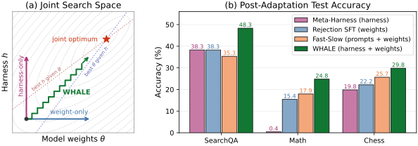
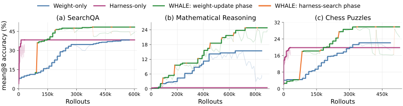
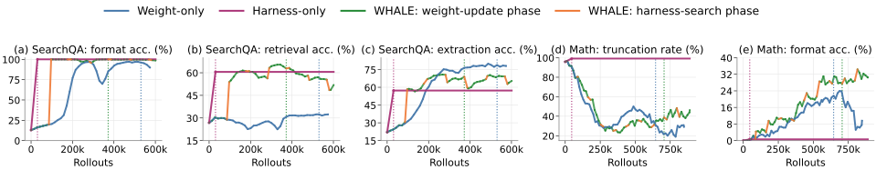

# Paper精读｜WHALE: A Simple Recipe for Joint Harness–Weight Optimization

> [!abstract] 一句话结论
> **WHALE** 认定一个 Agent 是"模型权重 + 可执行 harness"的联合系统，优化就不该只动一边。它交替执行"固定 harness 更新权重"和"固定权重搜索 harness"，在 SearchQA、数学推理、国际象棋三个领域全部超过单组件优化；全文最值钱的一条经验是**<span class="mark-strong">小步交替</span>**胜过把一边训到底再换另一边。

> [!cite]- 论文信息（点开折叠）
> - **论文标题**：WHALE: A Simple Recipe for Joint Harness–Weight Optimization
> - **arXiv**：2609.00196v1
> - **链接**：[https://arxiv.org/abs/2609.00196](https://arxiv.org/abs/2609.00196)
> - **代码**：[https://github.com/krafton-ai/WHALE](https://github.com/krafton-ai/WHALE)
> - **作者**：Haechan Kim, Yoonho Lee, Gisang Lee, Chelsea Finn, Kangwook Lee
> - **机构**：KRAFTON / KAIST / Stanford University
> - **日期**：2026-08-31

---

## 论文分类标注

- <span class="mark-strong">研究类型</span>：Agent 系统优化方法论文 + 交替优化实验研究

- <span class="mark-strong">领域归属</span>：LLM Agent > Harness Engineering > 模型权重与可执行工作流联合优化

- <span class="mark-strong">方法学标签</span>：在线拒绝采样微调、LLM 驱动代码搜索、黑盒交替优化、预算/停止策略研究

- <span class="mark-strong">研究对象</span>：模型参数 θ 与可执行 harness h 的联合适配

- <span class="mark-strong">与已有工作关系</span>：将 Meta-Harness 的可执行 harness 搜索与 RSFT 权重更新结合；对比 weight-only、harness-only 和只优化 prompt 的 Fast–Slow Training

---

## 1️⃣ 论文想解决什么问题

工具型 Agent 的能力从来不只是模型参数的事。harness 决定模型每次调用看到的世界长什么样：哪些观察进上下文、工具怎么暴露、结果怎么回填、错误怎么处理、一轮交互何时结束、最终答案怎么解析。模型再强，harness 没检索到证据、截断了关键结果、没给够轮数，任务照样黄；反过来，harness 再讲究，模型不会查询、不会用代码工具、不会按格式交答案，也白搭。

以往的联合适配大多只碰"模型权重 + 文本 prompt"，工具接口、上下文管理、中间反馈、解析逻辑和终止策略全冻着。WHALE 要问的是：这些<span class="mark-strong">可执行的系统代码</span>能不能也纳入适配，跟模型权重一起演化？

难处在于两边的更新节奏对不上：权重更新要不停采样 rollout、筛正确轨迹、做梯度更新；harness 搜索要提案、运行、评估、留候选。两边同时动，一次成功到底该记谁的账说不清。WHALE 的解法是交替——每个阶段把另一半冻住，让当前更新面对一个稳定的对象。

---

## 2️⃣ 核心洞察

> [!important] 核心洞察
> 1. <span class="mark-strong">Harness 是可训练系统的一部分。</span> 它不是模型外面永远固定的胶水代码，而是直接塑造轨迹分布的"控制策略"：检索参数、工具反馈、上下文格式、停止条件，动任何一样，模型实际面对的问题就变了。
>
> 2. **<span class="mark-strong">优化瓶颈是领域相关的</span>。** SearchQA 卡在 harness，数学推理卡在模型；没有一个先验答案规定该先训模型还是先改工作流。
>
> 3. **<span class="mark-strong">一个组件的更新可能解锁另一个组件</span>。** 数学任务上，初始模型不会主动用代码工具，直接搜 harness 收获很小；先做一小段权重更新，模型行为变了，同一套 harness 搜索才开始起作用。
>
> 4. **<span class="mark-strong">长阶段优化会过拟合被冻结的另一半</span>。** 权重可能过度适配旧 harness，harness 也可能过度适配一个马上要被替换的模型。小步交替让两边在联合目标上一起挪。



*图注：左边画得很直白——weight-only 和 harness-only 只能沿一根坐标轴挪，WHALE 两个坐标都动；右边概括三类任务上的对比结果。*

---

## 3️⃣ 方法解读

### 1. 把 Agent 写成 J(θ,h)

论文先把话说清楚：定义模型参数 θ、可执行 harness h，以及二者共同诱导的轨迹分布——

```text
τ ~ πθ,h(· | x)
```

τ 里装的是模型消息、工具调用、工具返回和环境状态转移。给定任务分布 P 和二值/连续 verifier R，系统目标就是：

```text
J(θ,h) = E[x~P] E[τ~πθ,h(·|x)] [R(x,τ)]
```

这个公式好就好在不玩数学花样，只钉死一件事：**<span class="mark-strong">θ 和 h 通过轨迹分布耦合</span>**。改权重，模型的查询方式、回答长度、工具习惯全变；改 harness，上下文、反馈和终止条件变了，模型能不能成事也跟着变。

weight-only 把 h 冻死只沿 θ 优化，harness-only 反过来；WHALE 在两个方向之间来回挪。

### 2. 权重更新：Online RSFT

权重这边不搞花活，用的是 Online Rejection-Sampling Fine-Tuning（RSFT）：

1. 固定当前 harness hₖ；

2. 用冻结的旧模型 θ_old 采样多条轨迹；

3. 只留 verifier 判定为正确的轨迹；

4. 拿模型自己的成功轨迹做监督微调；

5. 把更新后的模型同步给 rollout worker。

目标概括成一行：

```text
Ĵweight = 平均的 token-level log pθ(成功轨迹中的模型 token | x,h,历史)
```

只训模型生成的 token，用户输入和工具返回不进监督目标。选它的理由是比直接 policy gradient 简单稳定；代价也明摆着——全靠成功轨迹，初始模型几乎不出成功样本时，学习信号弱得可怜。

### 3. Harness 更新：Meta-Harness

θ 冻住后，Meta-Harness 对可执行 harness 做提案—评估—选择：

1. 从当前 harness 起一份候选档案；

2. 让 proposer 看已有代码、运行结果、逐题成败和 trajectory log；

3. 一次提若干候选 harness；

4. 每个候选在 harness-search 数据集上跑 rollout；

5. 按 verifier 分数选出档案里最好的版本；

6. 下一轮要么继续改新版本，要么回退旧版本。

要紧的是，搜索对象远比 system prompt 大：

- system/user prompt；

- 工具输入输出格式；

- 检索 query 的后处理和 top-k/ranking；

- 工具结果和错误信息如何注入上下文；

- Python 代码的提取与执行；

- 棋盘/状态如何展示；

- 输出解析、retry 逻辑和终止条件；

- 每轮允许的 turn 数和上下文压缩方式。

论文的 FST 对照组只许改 system/user prompt，所以 WHALE 跟 FST 的差距直接回答一个问题：<span class="mark-strong">搜完整可执行 harness，到底比只改 prompt 多赚多少。</span>

### 4. WHALE 交替算法

第 k 个周期就两行：

```text
θₖ₊₁ = ModelUpdate(θₖ ; hₖ, Dweight)
hₖ₊₁ = HarnessSearch(hₖ ; θₖ₊₁, Dharness)
```

默认设置里，每个周期先跑 `E=0.6` 个权重训练 epoch，再做 `I=6` 次 harness 搜索迭代，然后把更新后的 `(θₖ₊₁,hₖ₊₁)` 当作下一周期的起点。

它是个模块化 recipe，不是绑死 RSFT 和 Meta-Harness 的单一算法：只要有一个"固定 h 更新 θ"的方法和一个"固定 θ 更新 h"的方法，都能换进来。

### 5. Adaptive WHALE

固定 `(E,I)` 是个手工活。Adaptive WHALE 用两条 patience 规则决定切换时机：

- 权重阶段：滑动窗口内的 verifier reward 在超过最小阶段长度后，连续一段时间没刷新最佳值，就切到 harness 搜索；

- harness 阶段：档案里的最佳训练分数在至少若干轮后不再涨，就切回权重更新。

实验里的最小条件：权重阶段至少 0.2 epoch，harness 阶段至少 6 次迭代；patience 定为 0.2 epoch / 2 次迭代。全程只看训练信号，不看测试集——这不是拿测试集早停。



*图注：曲线按累计 rollout 展示 best-so-far test mean@8 accuracy。WHALE 的权重更新阶段和 harness 搜索阶段交替出现，整体超过单组件基线。*

---

## 4️⃣ 实验部分怎么读

### 实验设置

| **领域** | **基础模型** | **训练/测试设置** | **主要瓶颈** |
| --- | --- | --- | --- |
| SearchQA | Qwen3.5-2B | HotpotQA/NQ 训练，7 个 QA 测试集 | 检索、格式、答案提取和工具流程 |
| 数学推理 | Qwen3.5-2B | DAPO-Math-17K，AIME 2024/2025 | 是否使用代码工具、是否被截断、最终答案格式 |
| Chess Puzzles | Qwen3.5-4B | Lichess puzzles | 棋盘表示、合法走法解析、重试和多轮交互 |

主要设置：

- 权重训练数据：SearchQA 18,946 条，数学 17,917 条，棋题 16,384 条；

- harness 搜索数据：每个领域 256 条；

- 测试集：SearchQA 700 条、数学 60 条、棋题 256 条；

- 权重更新每题采样 8 条轨迹；harness 候选每题使用 1 条 rollout；

- 测试报告为每题 8 条采样的 `mean@8`；

- harness proposer 使用 Claude Opus 4.7；

- 搜索空间包括完整 harness，FST 则只允许改初始 harness 的 system/user prompt。

### 核心结果：固定交替方案

默认 `(E,I)=(0.6,6)` 下，WHALE 在三个领域全部压过单组件基线：

| **领域** | **Harness-only** | **Weight-only** | **FST（prompt+weight）** | **WHALE** |
| --- | --- | --- | --- | --- |
| SearchQA | 38.29 | 38.27 | 35.34 | **48.34** |
| 数学推理 | 0.42 | 15.42 | 17.92 | **24.79** |
| Chess Puzzles | 19.82 | 22.17 | 25.68 | **29.83** |

相对更强的单组件基线提升约 **<span class="mark-number">7.67–10.05 个百分点</span>**，相对 FST 提升 **<span class="mark-number">4.15–13.00 个百分点</span>**。附录的逐数据集结果也核过一遍：SearchQA 的 7 个子集、数学的 2 个 AIME 子集、棋题测试集，WHALE 全拿最高分——不是靠某个特殊子集撑场面。

### 为什么 SearchQA 是 harness-dominant？

SearchQA 里模型本身有点检索底子，卡脖子的是 harness——"怎么检索""什么时候收工"都归它管：

- harness-only 把检索命中参考答案的轨迹比例从 **<span class="mark-number">26.88% 提升到 60.61%</span>**；

- WHALE 进一步达到 **65.41%**；

- harness-only 在格式遵循上达到 **99.98%**，weight-only 为 **97.07%**；

- 但答案提取能力反而更依赖权重，weight-only 峰值 **79.93%**，harness-only 只有 **57.28%**。

这组数字把两件常被混为一谈的事拆开了："能把正确文档找回来"和"能从文档里把答案抠出来交上去"是两个子能力。WHALE 的路径是 harness 先修检索和格式，权重再补信息综合和答案提取。

成本证据更直接：harness-only 只花 weight-only **<span class="mark-number">5.79%</span>** 的 rollout 就摸到了后者的峰值准确率附近。SearchQA 这类任务多训模型解决不了，工作流自己就是主要瓶颈。

### 为什么数学推理是 model-dominant？

数学任务上，初始模型爱写长篇解释、不叫 Python，最后 token 上限一到就被截断，verifier 连 `\\boxed{}` 都找不到：

- weight-only 把截断率从 **<span class="mark-number">95.83% 降到 30.83%</span>**；

- harness-only 可以改 response cap、turn limit 和最终答案恢复逻辑，但治不了模型不调用代码工具这个病根；

- harness-only 的数学准确率只有 **0.42%**；

- WHALE 第一轮小规模 harness 搜索只用 4,608 个 rollout，就把格式准确率从 **0.83% 提到 4.38%**，而 harness-only 花 46,080 个 rollout 只提升 **0.63 个百分点**。

因果链很清楚：权重更新先让模型学会更短、更贴任务要求地用代码工具，harness 再优化工具反馈和答案提取——两边互相解锁。

### 交替为什么优于 stagewise？

Stagewise 是另一种安排：先把全部权重预算砸在旧 harness 上，再用全部搜索预算适配更新后的模型。结果：

| **方案** | **SearchQA** | **数学** |
| --- | --- | --- |
| Weight-only | 38.27 | 15.42 |
| Harness-only | 38.29 | 0.42 |
| Stagewise | 43.02 | 15.63 |
| WHALE `(0.6,6)` | **48.34** | **24.79** |

WHALE 比 stagewise 高 **<span class="mark-number">5.32</span>** 和 **<span class="mark-number">9.16</span>** 个百分点，而且只花 stagewise 到达自身最佳点所需 rollout 的约 **<span class="mark-number">29%（SearchQA）</span>** 和 **<span class="mark-number">49%（数学）</span>。

原因还是 `J(θ,h)` 不可分离：长时间训 θ，模型过度适应旧 h；接着长时间搜 h，harness 又过度适应一个不再更新的 θ。交替更新把这种 conditional over-optimization 压下去了。



*图注：节奏过短会被噪声误导，节奏过长会对冻结的另一组件过拟合；中等、小步的交替表现最好。*

### Schedule 消融：太短和太长都不好

论文比了五种固定节奏：`(0.2,2)`、`(0.2,6)`、`(0.6,2)`、`(0.6,6)`、`(1.0,10)`。

最佳固定节奏是 `(0.2,6)`：

- SearchQA：**50.09%**；

- 数学：**28.33%**。

相比之下：

- SearchQA 随节奏增大从 50.09 → 48.34 → 45.93；

- 数学从 28.33 → 24.79 → 24.79。

两端栽跟头的方式不一样：

- 太短：数学 `(0.2,2)` 手里只有两轮候选证据，容易把偶然高分的 harness 当成好方案，模型接着去适应一个错的 harness，训练失稳；

- 太长：单个阶段的训练分还在涨，测试准确率却在掉——过度优化了被冻结的那一半。

所以"每周期多长"不是两个互相独立的超参数。数学任务里把 E 从 0.2 加到 0.6，I=2 时是帮忙，I=6 时反倒有害——一边的最佳预算取决于另一边。

### Adaptive WHALE

Adaptive WHALE 在 SearchQA 做到 **<span class="mark-number">52.82%</span>**，超过：

- 默认 `(0.6,6)`：+4.48；

- 最好的固定节奏 `(0.2,6)`：+2.73；

- 而且比默认方案少花约 23% rollout。

数学任务上到 **26.46%**，比默认方案高 1.67 个百分点、少花约 4% rollout，但没超过最好的手工节奏 28.33%。patience 规则有用，但还称不上免调参。

实际运行里，两个领域的中位数权重阶段约 0.24 和 0.29 epoch，harness 阶段都约 7 次迭代——自己落进了固定实验里表现最好的 `(0.2,6)` 那一带。

---

## 5️⃣ 学术评价

**优点：**

1. <span class="mark-strong">问题定义很重要。</span> 它把 Agent harness 从"工程实现细节"抬到和模型权重同等重要的可优化变量的位置上，这比只做 prompt 优化更贴近真实 Agent 系统。

2. <span class="mark-strong">交替策略简单而有解释力。</span> 论文没造复杂的联合梯度，而是用固定一方、优化另一方处理 credit assignment 和更新节奏不同的问题，具体优化器随便换。

3. <span class="mark-strong">分析不是只报总分。</span> SearchQA 的检索/格式/提取分解、数学的截断/格式分解，把"这个领域到底谁在卡脖子"说清楚了。

4. <span class="mark-strong">预算匹配比较扎实。</span> 单组件方法拿的是与 WHALE/FST 累计预算相匹配的 rollout；比的不只是最终准确率，还有 rollout 成本。

5. <span class="mark-strong">WHALE 与 prompt-only 联合优化的差异干净。</span> FST 用相同的更新方法和 schedule，只是把搜索限制在 prompt——WHALE 的优势于是可以放心归因于可执行 harness 搜索空间。

> [!ed-warning] 局限（风险与不确定性）
> 先说处境：2B/4B 的模型、三个领域，先把"交替优化有没有用"这个问题答清楚再谈规模化，从小做起我完全理解。但账还是要算：
> 1. <span class="mark-strong">规模仍小。</span> 主力模型是 Qwen3.5-2B/4B，在 frontier 级大模型、复杂多工具 Agent 或长周期生产环境里还成不成立，没法外推。
>
> 2. <span class="mark-strong">依赖一个更强的外部 proposer。</span> Harness 搜索用 Claude Opus 4.7，而主结果的 rollout 统计明确排除了 proposer compute，论文自己也说系统效果里含着 proposer 的推理成本——总成本大概率被低估。
>
> 3. <span class="mark-strong">搜索空间和初始 harness 仍是人工设计。</span> 搜得再广，哪些代码许改、初始工具接口、verifier 和环境规则都是定死的；这不是全自动发现 Agent 架构。
>
> 4. <span class="mark-strong">verifier 有领域差异。</span> SearchQA 拿 GPT-5.4-mini 当 judge，数学和棋题用确定性 verifier——judge 偏差、格式设计、verifier 规则都可能动摇结论。
>
> 5. <span class="mark-strong">数据规模和测试集有限。</span> Harness 搜索每域只有 256 个样本，测试集虽不重叠，复杂工作流上的过拟合和可迁移性还是要更广的评估。
>
> 6. <span class="mark-strong">Adaptive WHALE 的信号仍是稀疏 noisy reward。</span> SearchQA 赚到了，数学却输给最佳手工 schedule——光靠训练 reward 的 patience，还压不住选择噪声和跨阶段 credit assignment。
>
> 7. <span class="mark-strong">只优化最终二值成功率。</span> 检索、格式、截断这些行为指标都摆出来了，但联合目标仍是 trajectory-level verifier reward；安全性、延迟、token 成本、工具费用、可维护性这些生产指标都还没进目标函数。

---

## 与其他论文的对话

| **工作** | **优化对象** | **主要限制** | **WHALE 的推进** |
| --- | --- | --- | --- |
| RSFT/ReST | 模型权重 | harness 固定 | 将其作为 weight-update 模块 |
| Meta-Harness | 可执行 harness | 模型固定 | 将其作为 harness-search 模块 |
| FST | prompt + 权重 | harness 侧主要是文本 prompt | WHALE 搜索工具/反馈/控制流等完整 harness |
| GEPA/DSPy | prompt 或模块化程序 | 通常不和权重训练交替 | WHALE 研究代码工作流与模型权重的共同演化 |
| SWE-agent/Agentic harness engineering | Agent 工作流与 harness | 主要围绕固定或较少变化的模型 | WHALE 明确研究 θ 与 h 的双向耦合 |

---

## 对当前 Agent / Harness 方向的启发

这篇论文和 Agent harness、模型训练、RL/蒸馏这条线贴得很近，给了一个可以直接拿去用的系统抽象：

```text
Agent = Model weights + Harness program + Environment
```

只改模型，可能养出一个更会思考、但不会正确调工具的模型；只改 harness，可能攒出一套流程漂亮、模型根本执行不动的系统。更合理的工程闭环是：

1. 先固定当前 harness，用成功轨迹训练模型；

2. 再固定更新后的模型，优化工具接口、反馈和终止逻辑；

3. 用短周期反复交替，别把某一边一口气优化到极致；

4. 同时记录最终成功率、检索质量、格式合规率、截断率、token 成本和工具调用成本。

对本地模型尤其有参考价值：很多"模型能力不够"的问题，其实是上下文包装、工具 schema、错误反馈或终止条件没设计对；但也有一批"工作流不行"的问题，非得把模型训到会用工具才解得开。WHALE 的价值就是把这两类瓶颈放进同一个可观察、可迭代的控制回路。

---

## 7️⃣ 最后总结

WHALE 不是新基础模型，是一套优化 Agent 系统的 recipe：<span class="mark-strong">固定 harness 训权重，固定权重搜 harness，小步交替来回重复</span>。全文最硬的两条经验：Agent 的瓶颈在不同领域可能落在模型或 harness 任意一侧；一侧的更新可能解锁另一侧的收益。

实验还钉死了两件事：<span class="mark-strong">完整 harness 搜索比只优化 prompt 更有表现力</span>；交替比 stagewise 的大块训练省 rollout，也更不容易过拟合被冻结的那一半。限制同样清楚——模型规模、任务数量、proposer 成本、verifier 设计都还受控。下一步往哪儿走，答案就写在限制里：更大模型、更复杂的工具链、带成本/安全/稳定性的多目标设置。

---

## 8️⃣ 三句速记

> [!summary]- 点开展开
> 1. **Agent 不等于模型：权重 θ 和可执行 harness h 一起决定轨迹质量。**
>
> 2. **WHALE 用 RSFT 更新权重、用 Meta-Harness 搜索代码，靠小步交替让二者共同适配。**
>
> 3. **SearchQA 卡 harness，数学卡模型；完整 harness 搜索加交替调度，是超过 prompt-only/单组件基线的关键。**
