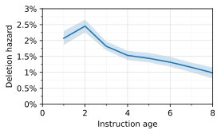

# Paper精读｜Why Does CLAUDE.md Keep Growing? Catastrophic Remembering in Agentic Coding

> [!abstract] 一句话结论
> **"灾难性记住"（Catastrophic Remembering）**——agentic 编码的 README（CLAUDE.md/AGENTS.md 类上下文文件）在真实仓库中**无界增长**，只有仓库退役或有人整体重写才会停。根因是**不完美的记忆**（imperfect recall）：追加一条指令永远便宜，可一旦指令背后的"为什么"（latent reasoning）消失，删除它而不冒正确性回归的风险需要 **O(2^|D|)** 次子集探测（|D| 条指令的 prompt）。实证盘子够大：**247,694 条指令生命周期、1,867 个仓库**——agentic prompt 平均 +226%（超 3 倍）增长、每次 commit 净增 +4.9 条指令、指令越老越不可能被删除（log-hazard -0.032/commit）。解法：**prompt 注释**——把指令的潜在推理在写入时存为注释（executor 看不到、只给下一位维护者看），在 Inverse-IFEval 可验证世界中**移除 99.3% 的多余指令**（excess +211.3% → +1.4%）；在 WildIFEval 真实场景中**指令跟随提升最高 23.1%**。金句："如果英语是新的代码，为什么我们还没有注释？"

> [!cite]- 论文信息（点开折叠）
> - **论文标题**：Why Does CLAUDE.md Keep Growing? Catastrophic Remembering in Agentic Coding
> - **arXiv**：2608.11095（cs.AI）
> - **链接**：[https://arxiv.org/abs/2608.11095](https://arxiv.org/abs/2608.11095)
> - **作者**：Kushal Chakrabarti（单人作者）
> - **机构**：South Park Commons
> - **日期**：2026-08-11

---

## 1️⃣ 论文想解决什么问题

Claude Code 等 agentic 编码工具兴起后，CLAUDE.md / AGENTS.md 成了"agent 的 README"——开发者通过往里面加指令来调教 agent 行为。但：

- **维护者只加不减**：出问题时追加一条指令成本极低，于是指令无限累积

- **删除有风险**：一条指令当初为什么加（对应什么隐藏约束/失败案例）没人记录——删错了会导致正确性回归，而验证删除安全需要穷举 2^|D| 个子集

- **后果严重**：中位数仓库 39 条指令（90 分位 131 条），远超指令跟随能力退化的阈值——**prompt 越大，agent 越不听话**

论文把它形式化为**灾难性记住**——灾难性遗忘（catastrophic forgetting）的反面：连续学习领域研究"模型怎么忘不掉旧知识"，这里的问题是"**prompt 怎么删不掉旧指令**"。两者共享同一根源：**无法区分"仍然必要的知识"与"过时的负担"**。

**核心问题**：为什么 agentic prompt 只涨不缩？能否阻止这种无界增长？

---

## 2️⃣ 核心洞察

> [!important] 核心洞察
> 1. **删除需要记住"为什么"**：追加一条指令只需要知道"现在坏了"；删除一条指令需要知道"当初为什么加它"（对应哪个约束、防哪个失败）。**写时 provenance（来源/理由）一旦衰减，最优估计器就退化为 append-only**——这是无界增长的理论根源。
>
> 2. **O(2^|D|) 的审计成本**：冗余会击败逐条探测——两条指令各覆盖一个约束，单独看每条都可删，一起删才坏。诚实审计需要穷举所有子集，D*（最小覆盖）一般不可计算。
>
> 3. **棘轮效应（ratchet）**：整体重写（bulldoze）是主要删除方式（77.3% 的指令死亡来自重写/迁移），但重写只重置大小、不解决根因——**重写后立刻以更快速度重新增长**（4.1%/commit → 4.9%/commit）。
>
> 4. **删除危险随年龄下降 = 不完美记忆的指纹**：如果是指令过时（staleness），删除危险应随年龄**上升**；实证是**下降**（log-hazard -0.032/commit）——推理在丢失，不是指令在过时。多作者文件的衰减更陡（β=-0.021, z=-11.7）——记忆在交接中损失。
>
> 5. **注释是修复**：软件工程几十年前就解决了同样的问题（代码注释）——**"指令告诉 executor 做什么；注释告诉下一位维护者为什么"**。把潜在推理在写入时存下来，棘轮就停了。
>
> 6. **注释必须携带结果（outcomes）**：消融显示注释形状的噪音无效、只叙述尝试过程无效——**必须记录失败、假设与结果**（"这条指令因 X 失败而加，假设 Y，结果 Z"）。

---

## 3️⃣ 方法解读

### 组件1：理论模型——prompt 维护即在线估计（§2）

- **任务** j=(o_j, C_j)：陈述目标 o_j + 不可观测约束 C_j ⊆ C（隐藏验证器集合）

- **prompt** D_t = 有限指令集；指令 d 年龄 a_d = t - τ_d

- **维护者目标**：最小覆盖 D* = argmin|D| s.t. D ∈ argmax E[q_c(D,j)]——**正确性最高且指令最少**

- **五条约束集特性（Table 1）**：A1 可指导性（存在 d 提升 q_c）、A2 干扰性（加 d 降低其他 q_c'）、A3 冗余性（第二条 d' 不增加覆盖）、A4 审查性（结果不指名是哪个 d 起作用）、A5 随机性（即使覆盖 q_c < 1）——A1-A3 设定 regime，A4 阻断删除、A5 驱动追加

- **Δ_c(d|D) = E[q_c(D,j) - q_c(D{d},j)]**：d 对 c 的贡献；d 是多余的当且仅当对所有 c 有 Δ_c ≤ 0——估计它需要探测 D{d}，而冗余使单条探测失效，诚实审计 O(2^|D|)

### 组件2：观测研究——棘轮的三段论（§3）

**语料**：1,867 GitHub 仓库、1,801 个多版本文件、299,440 次版本转换、247,694 条指令生命周期

**3.1 无界增长**：

- 末版本中位 39 条指令（90 分位 131）——远超指令跟随退化阈值

- 64.3% 仓库增长 vs 26.6% 收缩；中位净增 +7 条；每次 commit 净增 +4.9 条（19,267 commits）

- 生命周期 +226% 数量、+10% 平均长度、+140% 总大小（数量增长不是文本迁移）

**3.2 大多数"消失"不是删除**：

- 77.3% 的指令死亡来自**整体重写或迁移**到兄弟文件——维护者是"推土机"而非"修剪工"

- 重写/迁移作为竞争风险审查（96,162 + 682 死亡）；匹配验证 precision 1.000 / recall 0.933（50 条人工标注）

**3.3 重写后立刻重新增长**：

- 对齐首次重写：重写砍到 59.5%，10 个 commit 内恢复到 91.5%

- **重写后增长更快**：4.9%/commit vs 重写前 4.1%/commit

**3.4 删除危险证伪竞争机制**：

- 删除危险随年龄**下降**（log-hazard -0.032/commit，95% CI [-0.047, -0.019]）——证伪"指令过时"假说（应上升），支持"不完美记忆"（推理丢失）

- gamma frailty 模型（28,255 死亡）吸收组合效应后斜率仍 -0.0355——内容脆弱性无法解释

- **多作者 × 年龄交互显著**（β=-0.021, z=-11.7）——只有不完美记忆能预测这一点：记忆在多人交接中损失更快

*（原图未能本地化：Figure 1: 因果与观测双重证据——(a) 无注释/注释形状噪音的 prompt 无界增长，有信息量注释则稳定在最优大小附近；(b) 真实仓库中指令数生命周期 +226%；IMA 媒体接口没有可用媒体编号）*

*Figure 1（核心证据）：(a) 因果：无注释（或注释形状噪音）的 prompt 无界增长；有信息量注释的 prompt 以同等正确性稳定在最优大小附近（excess = |Dt|/|D⋆| − 1，184 worlds 的 95% bootstrap）；(b) 观测：1,867 仓库中 agentic README 指令数生命周期 +226%。*

### 组件3：Inverse-IFEval——让最小覆盖可观测（§4.1）

标准 IFEval 每项 (D_j, C_j)（指令 + 验证器）做三步变换：

1. **隐藏 D_j**：原指令成为参考最小覆盖 D*——|D*| 先验已知，excess size 可测量

2. **保留 C_j**：验证器成为世界的隐藏约束集，只有 harness 运行、从不告诉维护者

3. **生成简短 o_j**：强模型有损总结 D_j 为通用任务目标（"起草一份产品公告"）

新维护者从 o_j 出发、T 步重建 D_j，只见审查过的噪音反馈；**arm 决定是否允许给指令 d 加注释 r_d（携带潜在推理）**。下一位维护者读 D_t + 所有 r_d；executor 只读 D_t——**harness 在 prompt 到达 executor 前剥离注释**，并拒绝引用过去失败的指令，注释成为潜在推理唯一幸存通道。

### 组件4：注释干预结果（§4.2-4.3）

**Inverse-IFEval（552 条维护历史，|D*|=2.2）**：

- 有注释维护者：**-5.8% excess** vs 无注释 **+60.4%**（66.2pp 差距）——约束满足率持平（parity）

- 更强维护者棘轮更猛、注释帮得更多：3 档维护者，无注释 arm 的 excess 从 +67.7% 涨到 **+571.9%**；顶级维护者下注释实现约束满足与 excess 的**严格 Pareto 改进**

- 消融（Table 10）：注释必须携带结果——注释形状噪音落在无注释 arm 噪音范围内；只叙述尝试过程的注释同样无效

- 摘要数据：注释编码潜在推理**移除 99.3% 的多余指令**（+211.3% → +1.4%）

**WildIFEval（64 worlds，K=1 真指令 + G=16 噪音指令）**：

- 噪音指令让已有真指令的正确性损失 24.1pp（65.6% → 41.5%）

- **注释把满足率从 50.4% 提升到 62.0%**（3 轮维护，+11.6pp，95% CI [5.1, 18.3]）——**相对提升 23.1%**

- 消融：注释形状噪音只比无注释 arm 好 2.7pp（CI 含零）——行为由注释编码的潜在推理驱动

- 双裁判验证：6,336 个判定用第二裁判重评，判据复现、效应量差 3.8pp

*Figure 5（机制识别）：Nelson–Aalen 删除危险估计（28,426 次删除）随指令年龄下降——log-hazard -0.032/commit。指令过时假说预测危险上升、年龄无关假说预测平坦；只有不完美记忆（推理衰减）预测下降。*

*（原图未能本地化：Figure 6: 注释的形态——每条注释指名其指令背后的失败、假设与结果（绿色 # 开头，从不到达 executor）；IMA 媒体接口没有可用媒体编号）*

*Figure 6（注释形态）：每条注释命名其指令背后的失败、一个假设及其结果（如 "# r3: task 0 failed with 'certain wording is not used the right number of times' — … d12 was passing, so keeping that approach"）。注释绿色（#）标记、从不到达 executor——8,541 次添加中每约束族 3 例。*

---

## 5️⃣ 学术评价

**优点：**

1. **概念的漂亮命名与对偶**：**灾难性记住 = 灾难性遗忘的反面**——连续学习领域几十年的框架直接迁移到 agentic prompt 维护，一句话点破"prompt 为什么只涨不缩"——删不掉的根源是无法区分必要知识与过时负担

2. **理论-观测-干预三件套完整**：O(2^|D|) 审计成本的理论下界 → 24.7 万条指令生命周期的观测验证（含危险函数、frailty 模型、多作者交互）→ Inverse-IFEval 的因果干预——从"为什么"到"怎么办"闭环

3. **机制识别的严谨性**：用删除危险的**斜率方向**区分竞争假说（过时=上升 vs 记忆衰减=下降 vs 组合效应），再用多作者交互做**只有不完美记忆能预测的检验**——教科书级的假说证伪设计

4. **Inverse-IFEval 是方法论创新**：把标准指令跟随基准**倒过来**变成"可验证的最小覆盖世界"——让理论上不可计算的 excess size 变得可测量，为 prompt 评测开了新路

5. **"注释告诉下一位维护者为什么"是直接可用的工程启示**：指令/注释分离 + 注释必须携带结果——对任何用 CLAUDE.md/AGENTS.md 的人立即可落地

6. **金句与文化感**："If English is the new code, why don't we have comments yet?"——一句话把问题放进软件工程四十年的历史里

> [!ed-warning] 局限（风险与不确定性）
> 先说处境：单人作者把预注册判据和消融都做齐了，附录详尽，这份自律不常见；但风险还是要摆明：
> 1. **单人作者 + South Park Commons**：非学术机构背书，审稿严谨性未知（虽然预注册判据齐全、附录极其详尽）
>
> 2. **任务平稳假设**：Inverse-IFEval/WildIFEval 都是 task-stationary 世界——真实仓库的约束集随需求演化，注释的长期有效性在**非平稳**环境下未验证
>
> 3. **"注释"的具体落地未完成**：作者自认"prototype 只是 prototype"——CLAUDE.md 注释语法、harness 集成、生态支持都未定义
>
> 4. **观测研究的选择偏差**：GitHub 上能追踪的仓库本身是幸存者（活跃维护者才写 CLAUDE.md）；被整体重写/删除文件的指令"死亡"被审查，真实增长可能更严重或更轻
>
> 5. **WildIFEval 的 LLM judge**：无代码验证器，靠 arm-blind LLM judge 评分——双裁判复现了判据，但 judge 噪声仍是上限约束
>
> 6. **指令跟随退化的因果**：39 条中位数的"退化阈值"引用外部工作，未在本语料中直接测量正确性随大小的下降曲线

---

## 6️⃣ 局限与可扩展方向

- **非平稳环境**：约束集演化时注释是否仍然有效——需要"约束漂移"世界的实验

- **注释的自动生成/维护**：能否让 agent 在写入指令时自动生成携带结果的注释；注释本身会不会也腐烂（stale comments 问题）

- **rehearsal/regularization 的类比**：作者指出 prompt 维护是"文本上的连续学习"——rehearsal（重放旧任务）与正则化的文本模拟是什么？

- **大规模测量**：非平稳、约束不可机械验证、代表性约束数量的评测基准

- **工程落地**：CLAUDE.md 注释语法标准、harness 自动剥离注释、IDE/agent 生态集成——作者已号召"coding agent developers can give prompts a comment syntax"

---

## 与其他论文的对话

| **相关工作** | **关系** | **差异** |
| --- | --- | --- |
| **Lilian Weng / Harness 工程浪潮（harness-engineering-self-improvement）** | 同属"agent 工程"主题 | Harness 论谈外部程序管理 agent；本作聚焦**prompt 文件本身的维护动力学**——harness 的"代码"（CLAUDE.md）也需要工程纪律 |
| **agent-skills / superpowers（GitHub 技能方法论）** | 同主题不同层 | 那些是"怎么写好技能/指令"的最佳实践；本作是**为什么指令会膨胀**的机制研究 + 注释修复 |
| **MemHarness（2607.28272）** | 记忆管理 | MemHarness 重构 agent 经验记忆；本作是**prompt 指令集**的记忆（provenance 衰减）——两种"记忆"的维护问题 |
| **Catastrophic Forgetting（连续学习）** | 概念对偶 | 连续学习防遗忘；本作发现并命名"灾难性记住"——prompt 删不掉旧指令，同一枚硬币的反面 |
| **IFEval / WildIFEval** | 方法基础 | 标准指令跟随基准被**倒置**为可验证的最小覆盖世界——评测工具的创造性复用 |
| **SWE-Bench ProMax（2608.09802）** | 编码 agent 评测 | ProMax 测 agent 能力；本作测**维护者与 prompt 文件的交互**——agent 工程的"元层面" |
| **AGENTS.md/CLAUDE.md 生态（本作主题）** | 直接对象 | 本作是第一个把 CLAUDE.md 增长作为科学对象研究的论文 |

---

## 7️⃣ 最后总结

这篇论文用一个漂亮的对称命名（**灾难性记住** vs 灾难性遗忘）抓住了 agentic 编程时代最普遍却最没人管的现象：**CLAUDE.md 只涨不缩**。解释链是完整的——追加便宜、删除需记忆"为什么"、审计 O(2^|D|) 不可行 → prompt 必然无界增长；24.7 万条指令生命周期证明根因是不完美记忆（删除危险随年龄下降 + 多作者加速衰减）；Inverse-IFEval 的因果实验再补一刀：**写入时把潜在推理存为注释**能停掉棘轮（excess +211.3% → +1.4%，移除 99.3% 多余指令），WildIFEval 真实场景指令跟随提升 23.1%。药方也直接可抄：给每条指令写注释，注明它防的失败、假设与结果——软件工程四十年的老智慧搬回 AI 新世界。我最想看的下一步是"约束漂移"世界里的复验：注释自己也是文本，它会不会腐烂（stale comments），是这套方案能不能走出 prototype 的关键。

---

## 8️⃣ 三句速记

> [!summary]- 点开展开
> 1. **灾难性记住**：CLAUDE.md 类 prompt 无界增长（+226%，每次 commit +4.9 条），根因是不完美记忆——删除需 O(2^|D|) 审计，指令越老越删不掉（log-hazard -0.032/commit）。
>
> 2. **注释停住棘轮**：写入时把"为什么"存为注释（指令给 executor、注释给下一位维护者），excess +211.3% → +1.4%（移除 99.3% 多余指令）；WildIFEval 指令跟随 +23.1%。
>
> 3. **注释必须携带结果**：只写过程/噪音形状的注释无效——必须记录失败、假设与结果；重写（bulldoze）只重置大小，重写后增长反而更快（4.1% → 4.9%/commit）。