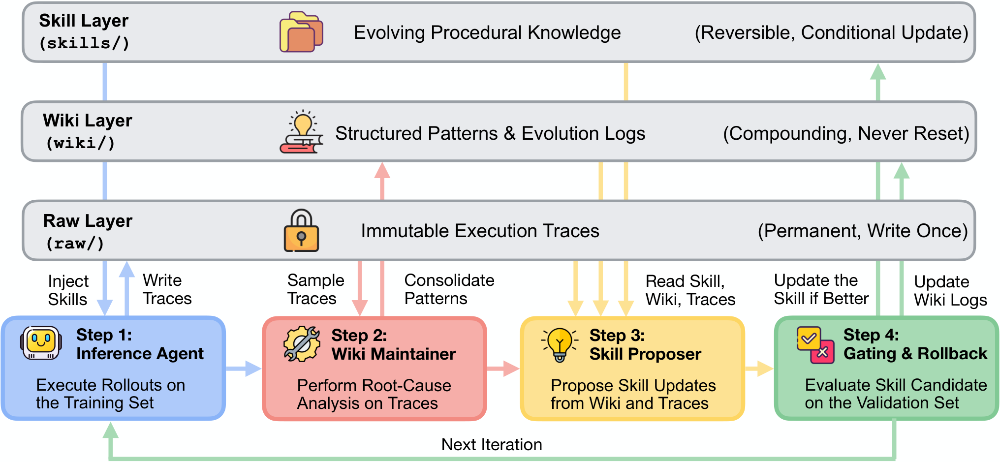
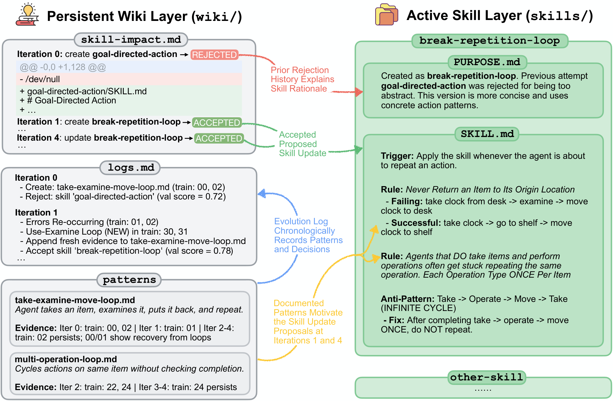

# Paper精读｜WikiSkill: Compiling Agent Experience into Persistent Knowledge for Skill Evolution

> [!abstract] 一句话结论
> **WikiSkill** 把 Agent 的原始执行轨迹编译成**持久化的 Wiki 层**，再让 Wiki 反过来指导**可回滚的技能更新**：经验先沉淀成知识，知识再驱动技能，Raw / Wiki / Skill 三层各管各的。跑下来它比无技能基线稳，也压过 Trace2Skill、EvoSkill、SkillOpt 这批主流 skill-evolution 方法。

> [!cite]- 论文信息（点开折叠）
> - **论文标题**：WikiSkill: Compiling Agent Experience into Persistent Knowledge for Skill Evolution
> - **arXiv**：2608.27454（v1, 2026-08-27）
> - **链接**：[https://arxiv.org/abs/2608.27454](https://arxiv.org/abs/2608.27454)
> - **作者**：Liyan Tang, Cyrus Rashtchian, Chun-Sung Ferng, Andrew Tomkins, Da-Cheng Juan, Tu Vu
> - **机构**：Google Research / Virginia Tech
> - **日期**：2026-08-27

---

## 论文分类标注

- **研究类型**：Agent / LLM 系统与技能演化论文；引入可持久化知识库以支持技能持续改进。

- **领域归属**：LLM agent > 技能演化 / skill evolution > 经验积累、知识管理与技能复用。

- **方法学标签**：三层知识架构（Raw/Wiki/Skill）、持久化 wiki 维护、Skill Proposer、Gating and Rollback、跨模型 transfer、Ablation of wiki access。

- **性质**：面向 Open/Reinforcement Agent Skill 的框架性改进，强调"经验→知识→技能"的编译分离。

- **与用户笔记库的关系**：呼应此前精读的 Prime Agent、Trace2Skill、EvoSkill、SkillOpt 等 Agent/Skill 路线；是"如何让 Agent 从执行轨迹中持续积累结构经验"的更系统化版本。

---

## 1️⃣ 论文想解决什么问题

Agent skill 这两年成了把领域知识和工作流打包成可复用资源的标准做法：不动模型参数，把知识写成文件系统里的模块，注进 agent 的上下文或工具调用。参数一个字节不碰，换来的是**可审计、可复用、可跨轮次积累**。

Trace2Skill、EvoSkill、SkillOpt 这条线已经证明，让 agent 在训练任务上反复 rollout、从成败轨迹里提取反馈迭代技能，就能换来渐进式适应。但这批方法盯的都是「怎么改技能文件」，**促成改进的那些经验洞察本身**并没有一个自己的家——每次更新都是一次独立编辑，上一轮学到的教训不会系统地传给下一轮。

这篇论文的核心问题是：

> 如何把 agent 的执行经验编译为持久化的结构化知识，让后续技能演化可以建立在前一轮积累的基础上，而不是每次从头优化？

作者的答案是把系统拆成三个阶段：

- **Raw 层**：保留不可变的执行轨迹，用于事后诊断

- **Wiki 层**：维护结构化的跨轮次知识，持续累积

- **Skill 层**：包含当前可执行技能，参与推理并使用 skill 的渐进披露

整套设计里最关键的一条差异：**wiki 永远不会被重置或回滚**，能回滚的只有技能。技能更新可以大胆试错——反正教训已经写进 wiki 了，丢不了。

---

## 2️⃣ 核心洞察

> [!important] 核心洞察
> 1. **经验不直接变技能，先被编译成知识**：把 rollout 直接映射到 skill，诊断过程和跨轮次模式就丢了。先写进 wiki 再据此改 skill，中间多出一层能翻账本的经验管理。
>
> 2. **Skill 可回滚，Wiki 不回滚**：验证不过就撤销 skill 变更，wiki 里新记的模式照样留着——这次更新失败了，失败原因和修正证据下一轮提案还是能用上。
>
> 3. **模型越大，从技能演化里捞到越多**：Qwen-3.5-4B → 9B → 27B 的增益分别约 +12.3、+17.5、+23.9 分，一路放大；小模型配上演化技能还可能反超大模型裸奔。技能发现和技能执行是两种能力，能力强的模型更会把演化出的技能用足。
>
> 4. **跨模型迁移时常比自我演化更好用**：Gemini 或更大 Qwen 模型学出的技能搬到小模型上，有时比自己演化还强；反过来大模型也能从小模型的技能里受益。迁移效果不只看 source 强不强，还得看技能本身抽象到什么程度。

*图注：系统分为 Raw Layer、Wiki Layer、Skill Layer。每轮循环由 Inference Agent 生成 rollout，Wiki Maintainer 把轨迹压缩为 wiki，Skill Proposer 在此基础上提出 skill 更新，最终由 validation gating 决定是否接受。*

---

## 3️⃣ 方法解读

### 组件1：三层知识架构

- **Raw Layer (****`raw/`****)**

  - 包含所有从训练集上执行得到的 rollout trace，格式为 `(o_1, a_1, ..., o_T, a_T)`

  - 该层是 immutable 的，只供分析使用

  - 包含观察、工具调用、推理和最终答案

- **Wiki Layer (****`wiki/`****)**

  - 维护跨轮次积累的 structured knowledge

  - 主要组成部分包括：

    - `patterns/` 目录，存放每个 pattern 的 markdown 文件（失败模式与成功策略）

    - `index.md`，维护 pattern 列表

    - `logs.md`，记录演化日志

    - `skill-impact.md`，记录每次提案 diff 和验证结果

  - wiki 在整个演化过程中持续增长，不被丢弃

- **Skill Layer (****`skills/`****)**

  - 包含当前活跃技能集合 `S`

  - 每个 skill 包含 `SKILL.md`（实际技能内容）和 `PURPOSE.md`（说明该技能受哪些 wiki 模式驱动）

  - skill 在推理时通过 prompt injection 直接加载，避免 skill retrieval 干扰评估

### 组件2：四阶段演化循环

演化循环（Algorithm 1）每轮 `k` 跑四步，看点在每一步能读什么、不能读什么：

1. **Inference Agent 执行 rollout**

  - 使用当前技能 `S_{k-1}` 在训练集上执行

  - 生成轨迹 `T_train,k`

  - 推理阶段限制访问 wiki，因为 ablation 发现推理时看 wiki 反而不利于技能学习

2. **Wiki Maintainer 模式整合**

  - 对成功和失败轨迹做分层采样（最多 8 条，含失败的 ≤5 条和成功的 ≤3 条）

  - 执行根因分析与成功策略提取

  - 更新 wiki 并写入 `logs.md`

3. **Skill Proposer 提案**

  - 基于 wiki index、skill-impact.md、以及任务结果摘要发起多轮 ReAct-style 推理

  - 按需读取特定 pattern 和 raw trace

  - 产生一个针对单个 skill 的 patch-style 更新

4. **Gating & Rollback**

  - 把提案应用到 `S_{k-1}`，得到候选 `S'_k`

  - 在 validation set 上评估

  - 得分高于当前阈值则接受并更新 `R_best`，否则丢弃

  - 无论是否接受，wiki 均被更新并追加本次提案记录

状态转移可简化为：

- rollout：`τ_i ∼ π(x_i; S_{k-1})`

- wiki 更新：`W'_k ← M_WM(W_{k-1}, T_sample,k)`

- 提案：`P_k ← M_P(W'_k, S_{k-1}, T_train,k)`

- 接受判定：`S_k ← S'_k` 当且仅当 `R(T_val,k) > R_best`，否则 `S_k = S_{k-1}`

### 组件3：关键实现细节

- **策略生成方式**：采用 patch 式更新（add/remove/edit 段落），而非重写整个 skill

- **验证门控阈值**：初始化为无 skill 基线在 validation 集上的分数；验证得分到 1.0 就提前终止

- **wiki 的审计功能**：记录所有被拒的 skill 提案及其 diff，后续提案不重复踩同一个坑

- **Skill 注入方式**：完整 active skill 直接写进 system prompt，保证 skill retrieval 的噪声不干扰实验对比

- **样本分层**：优先采样错误轨迹做 root-cause analysis，同时留少量成功轨迹防止退化

- **Prompt 隔离**：wiki 不进推理阶段，只进 wiki maintainer 和 proposer 阶段——「学习时的知识」和「执行时的知识」被切开

### 优势估计

- **持久记忆不丢失**：失败经验一直留在 wiki，后续迭代随时能翻出来用

- **可回滚但可积累**：skill 撤销得了，wiki 撤销不了

- **结构化知识比 raw trace 好复用**：wiki 是对 raw 的经验总结，省掉了直接啃长 trace 的噪声

- **skill 与 wiki 解耦**：前者装 procedural knowledge，后者装 meta-patterns，混在一起就没法追溯了

---

## 4️⃣ 实验部分怎么读

### 实验设置

| **项目** | **设置** |
| --- | --- |
| 模型 | Qwen-3.5-4B、Qwen-3.5-9B、Qwen-3.6-27B、Gemma-4-31B、Gemini-3.5-Flash |
| 任务 | LiveMathematicianBench、SealQA、SpreadsheetBench、OfficeQA、ALFWorld |
| Baseline | Trace2Skill、EvoSkill、SkillOpt、No-skill |
| 评价 | 五次 benchmark 平均分，三次独立运行取平均 |
| 验证标准 | paired bootstrap 显著性检验（1000 次），p < 0.05 |

### 核心结果

| **模型** | **No skill** | **EvoSkill** | **SkillOpt** | **WikiSkill** |
| --- | --- | --- | --- | --- |
| Qwen-3.5-4B | 26.2 | 33.7 | 35.2 | **38.5** |
| Qwen-3.5-9B | 29.9 | 42.3 | 40.2 | **47.4** |
| Qwen-3.6-27B | 39.4 | 53.3 | 50.7 | **63.3** |
| Gemma-4-31B | 41.3 | 43.4 | 49.1 | **54.9** |
| Gemini-3.5-Flash | 49.5 | 56.1 | 55.9 | **68.1** |

*Figure 1 画出来也是同一个故事：所有模型上 WikiSkill 都压着其他 skill-evolution 方法。*

表之外还有几条发现，每条都有信息量：

- Qwen 系列上增益随模型变大而放大：+12.3、+17.5、+23.9 分

- 小模型带上 skill 能翻过大模型裸奔这条线：Qwen-3.5-9B with WikiSkill 47.4% vs Qwen-3.6-27B no-skill 39.4%

- ALFWorld 上提升最大，Spreadsheet 次之；OfficeQA 对较小模型帮助有限

- LiveMath 增益最稳：几乎所有模型都提升约 20 分以上

- 跨模型 transfer 有效：大模型学到的 skill 往往比小模型自进化更好用，反过来也成立

*图注：展示了一个被拒绝的 skill 提案如何被后续提案继承经验，并最终形成更具体的规则。Wiki 层在此过程中持续累积模式证据。*

### 关键分析

- **Persistent wiki 的重要性**

  - 有 wiki 的 Skill Proposer vs 无 wiki 的平均性能差距约 **+15.0 分**

  - 去掉 wiki 后，复杂失败模式的修复明显变差

- **推理时禁用 wiki 更好**

  - 允许 Inference Agent 访问 wiki 反而拉低性能，论文给的解释是「知识会被 bypass skill 直接读取，从而削弱 skill 学习」

- **Skill 长度与 Wiki 模式数随模型/任务变化**

  - Qwen 系产出更长 skill（约 118-128 行）

  - SpreadsheetBench 产生最多 wiki patterns（平均 9.8 个）

  - 任务越复杂，需要越多模式与更细粒度的 skill

---

## 5️⃣ 学术评价

**优点：**

1. **三层分离是真设计，不是概念装饰**：Raw/Wiki/Skill 各司其职，wiki 作为 persistent knowledge base 有了实际工程价值——这一层正是 Trace2Skill、EvoSkill、SkillOpt 都没给的。

2. **实验铺得开**：5 种模型 × 5 个 benchmark 全跑，ablation、cross-model transfer、paired bootstrap 显著性检验都做了，不是只挑顺手的场景。

3. **反直觉发现不止一个**：小模型演化技能能赢无技能大模型、模型越大从演化获益越多、推理时给 agent 看 wiki 反而帮倒忙——每条都指向「技能发现和技能执行是两种能力」。

4. **和 prior work 的分界画得清楚**：Trace2Skill、EvoSkill、SkillOpt 都在「直接改技能」，WikiSkill 在中间加了「经验先编译成知识」这一步，对比实验里赢的就是这一步。

> [!ed-warning] 局限（风险与不确定性）
> 先说处境：skill 全量注入 prompt、完全不碰检索，是为了把「技能演化」这一个变量干净地隔离出来，我理解这个取舍。但代价在哪儿也得说清楚：
> 1. **skill 是全量注入的，没有检索**：真实部署里 skill 一多就得有检索与触发，论文完全没碰这块，往外推要打折扣
>
> 2. **验证集偏小，噪声风险在**：validation split 规模有限，gating 决策可能被噪声带偏
>
> 3. **wiki 没有自动剪枝**：积累到后期会膨胀，论文自己承认缺这套机制
>
> 4. **任务跨度离真实场景还远**：benchmark 多是较短交互任务，小时级、超长 horizon 的多步任务没覆盖
>
> 5. **skill 质量与模型能力的耦合还没掰开**：scaling 与 skill evolution 有互补性这点立住了，但具体到每类任务，skill 发现和执行能力怎么分工，论文没给出答案

---

## 6️⃣ 局限与可扩展方向

- 引入 skill retrieval、triggering 机制，扩展为可检索的 skill library

- 设计 wiki 自动 pruning 与去重机制，避免知识过度膨胀

- 将 skill 更新扩展到支持中间表现停滞但仍具长期收益的中性提案（而非仅限 strictly 提升）

- 引入在线 skill adaptation，在单次长时间 rollout 内动态调整 skill

- 研究 skill 与 model parameter 变化的联合训练

- 扩展到更长 horizon 的任务，如 hour-long multi-turn agentic 工作流

- 将 skill transfer 机制与 negative transfer 检测结合，提升跨域可迁移性

- 将 Wiki 扩展为可版本化、可分支的结构化知识库

---

## 与其他论文的对话

| **相关工作** | **本文关系** |
| --- | --- |
| Trace2Skill | 更强调单轮轨迹本地经验；WikiSkill 增加持久化 wiki 记录跨轮经验 |
| EvoSkill | 更强调多候选 search；WikiSkill 强调知识层分离与持久化 |
| SkillOpt | 反馈型 meta guidance；WikiSkill 提供独立 knowledge base 避免信息丢失 |
| Karpathy LLM Wiki | 启发式来源；将“经验即知识库”的思想落实到 skill evolution 系统 |
| Skill Retrieval / routing | WikiSkill 暂时不处理；但后续可将 wiki 作为检索辅助 |
| Reinforcement Learning / Skill RL | WikiSkill 与 SkillRL 等路线互补；前者管经验沉淀，后者管参数/策略更新 |

---

## 7️⃣ 最后总结

WikiSkill 把技能演化从「单轮试错→改文件」改成了「经验编译→持续积累→指导演化」：技能每轮可回滚，wiki 只增不减，失败教训留在系统里，不随轨迹一起被扔掉。ablation 里分量最重的是那个 **+15.0 分** 的对比——wiki 拿掉，Skill Proposer 就少了一半判断依据，复杂失败模式修不动。论文没回答的恰恰是规模问题：skill 多到注不进 prompt、wiki 涨到读不完的时候，这套无检索、无剪枝的设计还撑不撑得住。

---

## 8️⃣ 三句速记

> [!summary]- 点开展开
> 1. 轨迹先编译进持久 wiki，wiki 再指导 skill 的可回滚更新——「经验沉淀」和「技能进化」分成两层，各走各的。
>
> 2. 5 模型 × 5 benchmark 压过 Trace2Skill/EvoSkill/SkillOpt，且模型越大从 skill evolution 里捞到的增益越大。
>
> 3. 开放问题集中在规模：skill 数量涨上来之后，检索与触发怎么接进来；wiki 长期积累之后，靠什么自动剪枝和版本化。
