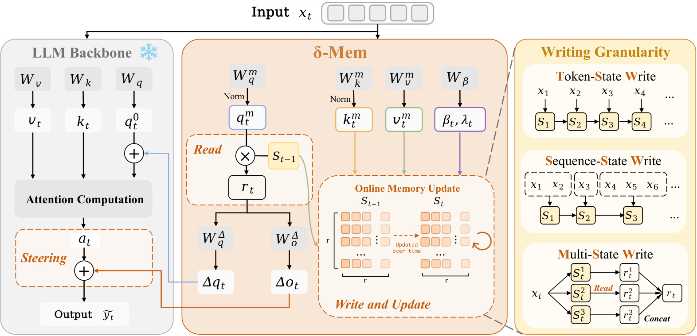
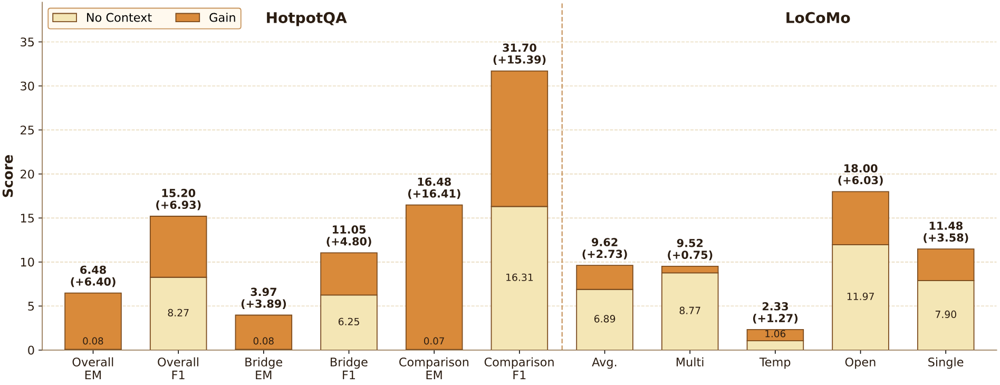

# Paper精读｜δ-mem: Efficient Online Memory for Large Language Models

> [!abstract] 一句话结论
> **δ-mem 用一个 8×8 的在线记忆状态（固定大小、delta-rule 更新），通过低秩校正直接干预 frozen backbone 的注意力计算，以 0.12% 的参数量达到 1.10× 基线和 1.15× 最佳非 δ-mem 记忆方法的平均得分。**

> [!cite]- 论文信息（点开折叠）
> - **论文标题**：** δ-mem: Efficient Online Memory for Large Language Models
> - **arXiv**：** 2605.12357
> - **链接**：** [https://www.alphaxiv.org/abs/2605.12357](https://www.alphaxiv.org/abs/2605.12357)
> - **GitHub**：** [https://github.com/declare-lab/delta-Mem](https://github.com/declare-lab/delta-Mem)
> - **作者**：** Jingdi Lei, Di Zhang, Junxian Li, Weida Wang, Kaixuan Fan, Xiang Liu, Qihan Liu, Xiaoteng Ma, Baian Chen, Soujanya Poria (NTU, Fudan, Mind Lab, SJTU, CUHK, HKUST(GZ))
> - **日期**：** 2026-05-13
> - **机构**：** Nanyang Technological University, Fudan University, Mind Lab 等

---

## 1️⃣ 论文想解决什么问题

LLM 在长期助手和 agent 场景中需要积累和复用历史信息。现有方案有三大类，各有硬伤：

1. **文本记忆（TMM）**：把记忆写成文本塞回 context——受窗口大小限制、检索噪声大、压缩丢失严重

2. **外通道记忆（OMM）**：记忆存在外部模块，通过检索/编码桥接——集成复杂、表示对齐难

3. **参数化记忆（PMM）**：记忆编码进 adapter/prefix 参数——静态写入，无法动态演化

核心矛盾是：**记忆需要紧凑、动态演化；记忆回读需要与 backbone 的注意力计算紧密耦合。** 现有方法没有一个能同时满足这两点。

---

## 2️⃣ 核心洞察

δ-mem 的两个关键设计选择：

> [!important] 核心洞察
> 1. **用在线关联记忆状态（Online State of Associative Memory, OSAM）代替 token 级存储**——记忆不存成文本，而是一个固定大小的矩阵。新的信息通过 **delta-rule 学习**写入：只写预测误差（residual），已记住的内容不会重复写入，保证状态高效利用。
>
> 2. **记忆直接干预注意力计算，不走检索/拼接路径**——读出的信号生成低秩校正项，直接加到 backbone 的 query 和 output 上。这不是检索文本再拼回 context，而是让记忆信号成为注意力计算的组成部分。

---

## 3️⃣ 方法解读

### 三步流程（每步一个位置）

*图 1｜δ-mem 的查询、检索与记忆更新。 [来源](https://arxiv.org/html/2605.12357v1/#S3.F1)*

**① Read**：上一时刻的状态 $S_{t-1}$ 被当前输入的 $q^m_t$ 查询 → 读出向量 $r_t = S_{t-1}q^m_t$

**② Steer**：$r_t$ 经过两个小线性映射，生成 query 侧校正 $\Delta q_t$ 和 output 侧校正 $\Delta o_t$：

- $ilde{q}_t = q^0_t + lpha r_t \Delta q_t$（校正后的 query）

- $ilde{y}_t = a_t + lpha r_t \Delta o_t$（校正后的 output）

**③ Write**：当前 key/value 对经 delta-rule 写入状态：

- $S_t = \lambda_t S_{t-1} + eta_t (v^m_t - S_{t-1}k^m_t)(k^m_t)^ op$

- 三项含义：保留旧状态 → 擦除旧预测方向 → 写入新值

- $\lambda_t$（遗忘门）和 $eta_t$（写入强度）都是逐维度的，不同记忆维度可独立控制

### 三种写入粒度

| **策略** | **缩写** | **粒度** | **特点** |
| --- | --- | --- | --- |
| Token-State Write | TSW | 每 token | 最细粒度，适合局部变化，但易受噪声干扰 |
| Sequence-State Write | SSW | 每消息段 | 减少冗余写入，状态演化更平滑 |
| Multi-State Write | MSW | 多子状态并行 | 不同子状态存放不同类型信息，减少互相干扰 |

### 训练

标准 SFT loss，frozen backbone 只看到 query + response，context token 的写入发生在在线状态中，不重复喂入 backbone。

---

## 4️⃣ 实验部分怎么读

### 主表（Table 1）

Qwen3-4B-Instruct backbone 上对比：

| **方法** | **Avg** |
| --- | --- |
| 基线（无记忆） | 46.79 |
| BM25 RAG | 44.56 |
| LLMLingua-2 | 42.96 |
| MemoryBank | 43.88 |
| Context2LoRA | 44.90 |
| MemGen | 30.66 |
| MLP Memory | 22.85 |
| **δ-mem (TSW)** | **51.66** |
| **δ-mem (SSW)** | 51.44 |
| **δ-mem (MSW)** | 50.74 |

三种写入粒度全都压过表里所有基线。这张表里最扎眼的反倒是基线那半边：MemGen 和 MLP Memory 掉到 30.66/22.85，比什么都不记的 46.79 还差一大截——记忆模块做不好是负资产。TSW 在 HotpotQA 上 EM/F1 从 42.35/56.00 → 49.41/63.66；MemoryAgentBench 上 MSW 平均分从 29.54 → 38.85，LoCoMo 的 Multi/Temporal/Open 三个子集也是 MSW 表现最佳。

### 跨 backbone 泛化（Table 2）

在 Qwen3-8B 和 SmolLM3-3B 上也一致提升，SmolLM3-3B 的平均分从 26.08 拉到 36.96（+10.88）——换 backbone 不掉链子，方法不挑模型这一点，至少在 3B-8B 这个规模上立住了。

### Context Recovery 实验（Figure 2）

*图 2｜HotpotQA 与 LoCoMo 的上下文恢复结果。 [来源](https://arxiv.org/html/2605.12357v1/#S5.F2)*

严格测试：**去掉原始 context，只靠压缩的记忆状态推理。** HotpotQA Overall EM 从 0.08% → 6.48%（+6.40），Bridge subset EM 从 0.08% → 3.97%。这是很强的证据——说明 8×8 矩阵确实压缩了有用信息。

### Head Ablation（Table 3）

测试 query(Q)、key(K)、value(V)、output(O) 各种组合。**q+o 组合最优**（Avg 47.97），说明 query 侧校正 + output 侧校正配合最好。全加 (q+k+v+o) 反而略降？可能 k 和 v 侧的校正引入了冗余信息。

### 插入层数（Table 4）

**All Layers 最优**（Avg 47.97），Middle 12 层其次（46.66）。前面层表示太局部、后面层深度不够传播。

---

## 理论贡献 / 机制解释

1. **delta-rule 记忆更新**——继承了线性注意力（Linear Attention / DeltaNet）的在线学习视角，但把它包装成一个轻量记忆模块而非 backbone 替代。

2. **低秩注意力校正**——LoRA 是静态的（训练后固定），δ-mem 的校正项来自动态在线状态，同一个投影矩阵在不同历史下产生不同效果——相当于把 LoRA 动态化了。

3. **记忆即计算，而非记忆即检索**——最核心的设计哲学。记忆不返回文本片段，而是直接作为偏置项参与注意力计算。这让记忆和推理在同一表示空间中完成。

---

## 6️⃣ 局限与可扩展方向

1. **状态容量有限**——8×8=64 个标量。虽然实验证明有效，但在极长交互或海量事实场景下可能不够。MSW 通过多状态并行缓解了这个问题。

2. **依赖 backbone 质量**——训练用的 context 要写进状态，但 backbone 对写的内容是盲的（看不到 context token）。如果 backbone 本身推理能力弱，记忆校正效果也会受限。

3. **解码速度略降**——每步多一次读和写操作，吞吐低于 Vanilla 和 Context2LoRA。

4. **仅验证到 4B-8B 规模**——未在 70B+ 上验证，虽然方法本身与规模无关。

---

## 7️⃣ 最后总结

δ-mem 是我读过的记忆方案里做得最克制的一个：δ-mem 不假设 backbone 结构、不搭检索系统、不往 context 里拼 token，就靠 64 个标量的状态 + 低秩校正把记忆做出来了。它赢在把记忆放进注意力计算本身——检索噪声、表示对齐这些别家的硬伤，在它这儿压根不出现。代价也摆在明面上：状态只有 64 个标量，解码还慢一拍，要记的东西有多大、交互有多长，决定了这套状态够不够用。

---

## 8️⃣ 三句速记

- δ-mem = 8×8 在线记忆状态 + delta-rule 更新 + 低秩注意力校正

- 记忆直接干预注意力计算，不走检索/拼接路线

- 4.87M 参数量（0.12% backbone），比所有基线都好
